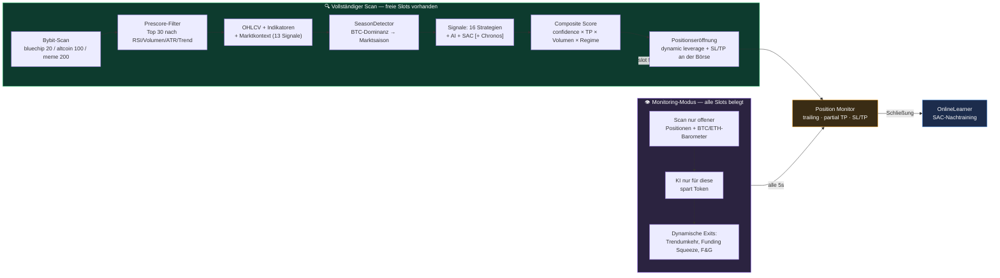

<div align="center">


# 🤖 BitbotBY

### KI-Hybrid-Handelsbot für Bybit Futures

Claude / DeepSeek / OpenAI / Groq / Gemini · SAC (RL) · Amazon Chronos · 10+ Echtzeit-Marktsignale

[](https://www.python.org/)
[](https://fastapi.tiangolo.com/)
[](https://www.docker.com/)
[](README.md)
[](https://www.bybit.com/)
[](LICENSE)

🌐 [Русский](README.md) · [English](README.en.md) · [中文](README.zh.md) · [Español](README.es.md) · **Deutsch**

</div>

> Die russische [README.md](README.md) und die englische [README.en.md](README.en.md) sind aktueller (App, Ein-Klick-Launcher, AI-Kette, Schlüsselverschlüsselung).


---

BitbotBY scannt den Bybit-Markt, kombiniert die Signale eines KI-Modells, eines SAC-Netzes und 16
klassischer Strategien mit dem Marktkontext (Funding, Liquidationen, Fear & Greed, Orderbuch,
Derivate, Social-Media-Sentiment) und handelt Perpetual-Futures long/short — mit quantitativem
Risikomanagement (Kelly, CVaR, Almgren-Chriss) und vollständiger Steuerung über Telegram.

Drei Marktprofile für unterschiedliche Volatilität: **Bluechip** (Top 20), **Altcoin** (Top 100),
**Meme** (Top 200, Pump-Strategien + Twitter/Telegram-Sentiment).

> ⚠️ Handel mit echtem Geld. Starte immer mit `PAPER_TRADING=true` und arbeite die
> [Checkliste vor dem echten Trading](#-vor-dem-echten-trading) durch.

---

## Inhaltsverzeichnis

- [Wie es funktioniert](#-wie-es-funktioniert)
- [Architektur](#-architektur)
- [Funktionen](#-funktionen)
- [Schnellstart](#-schnellstart)
- [Konfiguration](#-konfiguration)
- [.env-Referenz — alle Variablen](#-env-referenz--alle-variablen)
- [Steuerung über Telegram](#-steuerung-über-telegram)
- [Monitoring](#-monitoring)
- [Training des SAC-Modells](#-training-des-sac-modells)
- [Backtest und Alpha-Validierung](#-backtest-und-alpha-validierung)
- [Makefile-Befehle](#-makefile-befehle)
- [Tests](#-tests)
- [FAQ](#-faq)
- [Vor dem echten Trading](#-vor-dem-echten-trading)

---

## 🔄 Wie es funktioniert

Der Zyklus passt sich an den Portfolio-Zustand an: ein **vollständiger Scan** des Marktes, wenn freie
Slots verfügbar sind, und ein schlanker **Monitoring-Modus**, wenn alle Positionen belegt sind
(spart 5–33× an KI-Token).



<details>
<summary><b>Die vollständige Entscheidungskette — 14 Schritte mit Formeln</b> (aufklappen)</summary>

| # | Schritt | Was passiert |
|---|---|---|
| 1 | **Snapshots** ([cycle.py](src/cycle.py)) | OHLCV → Indikatoren (RSI/MACD/BB/ATR/Trend) + News-Sentiment pro Coin |
| 2 | **Prescore** | `score = vol×0.35 + rsi×0.30 + atr×0.20 + regime_bonus×0.15` → Top 30 an die KI |
| 3 | **Marktkontext** ([market_context.py](src/market_context.py)) | 13 Signale: Funding, OI+Liquidationen, F&G, Basis, Orderbuch, Deribit PCR/IV, Google Trends, Glassnode, ETF-Flows, Reddit (CryptoBERT), Stablecoin-Supply |
| 4 | **SignalCombiner** ([signal_combiner.py](src/signal_combiner.py)) | `local` / `ai` / `dqn` / **`hybrid`** (SAC+KI-Konsens, Gewichtung je nach Regime: trending 50/50, ranging 40/60) / **`hybrid+Chronos`** (±0.05…0.15 Modifikator) |
| 5 | **Kontextfilter** | Jedes der 13 Signale verschiebt die confidence um ±0.05…0.15 (z. B. F&G ≤15 + Liquidationskaskade → confidence = 0) |
| 6 | **Direkte Kontextsignale** | Extremwerte (funding overheated, squeeze, imbalance >0.4, F&G ≤10/≥92) erzeugen eigene Signale |
| 7 | **Lokaler Fallback** | Gibt es keine Signale — Indikator-Strategie, TP breiter im Trend, enger im Seitwärtsmarkt |
| 8 | **Priorisierung** | `composite_score = confidence × (1+tp_bonus) × (1+volume_bonus) × regime_mult` |
| 9 | **Portfolio-Allokation** | CVaR/Markowitz ([portfolio_optimizer.py](src/portfolio_optimizer.py)) bei ≥2 Signalen, Cap ×3 |
| 10 | **Execution Guards** ([order_executor.py](src/order_executor.py)) | Macro Blackout → Slots/Cooldown → Handelszeiten → doppeltes Symbol → **Correlation Guard** → Bestätigung in Telegram → **Liquidity Filter** → SL/TP-Validierung → **Kelly Sizing** → Drawdown Scaling → **Almgren-Chriss** → Dynamic Leverage → Order |
| 11 | **Nach der Eröffnung** | PositionMonitor alle 5s: dieselben 13 Kontextsignale steuern den Exit (force_close / tighten_sl) |

**Was sich zwischen den Profilen wirklich unterscheidet** (nicht nur Parameter): Meme ist das einzige
Profil mit Twitter/Telegram-Sentiment als Input und den Strategien `momentum_burst`/`pump_exit`/`sentiment`.
BTC-ETF-Flows werden nur auf BTC/USDT angewendet. Die übrige Logik (contrarian funding/PCR/FNG, Kelly,
Correlation Guard, Almgren-Chriss) ist in allen Profilen identisch — nur die Zahlen unterscheiden sich.

</details>

---

## 🏗 Architektur

```mermaid
flowchart TB
    SUP["supervisor.py\nrestart on crash · SIGTERM"] --> BOT["TradingBot\nsrc/trading_bot.py"]

    subgraph DATA["Daten und Signale"]
        SCAN["MarketScanner"]
        DL["DataLoader\nccxt async · CSV Cache 24 Std"]
        REGIME["RegimeDetector\nGaussianHMM"]
        CTX["MarketContext\n10+ Quellen, TTL 5–240 Min"]
        NEWS["NewsAnalyzer\nNewsAPI + RSS + VADER"]
        TW["TwitterAnalyzer\nMeme-Profil"]
        TG["TelegramSentiment\nTelethon MTProto"]
        POLL["SentimentPoller\nasyncio → Redis"]
    end

    subgraph BRAIN["Entscheidungsfindung"]
        COMBINER["SignalCombiner\nSAC + AI [+Chronos]"]
        CHRONOS["ChronosAnalyzer\namazon/chronos-t5-small"]
        CRYPTOBERT["CryptoSentimentAnalyzer\nElKulako/cryptobert"]
        PORT["PortfolioOptimizer\nCVaR / Markowitz"]
        CORR["CorrelationFilter"]
        MACRO["MacroCalendar\nFOMC/CPI/NFP Blackout"]
        ARB["FundingArbDetector"]
    end

    subgraph EXEC["Ausführung"]
        OE["OrderExecutor\nKelly → CVaR → Almgren-Chriss"]
        PM["PositionMonitor\nSL/TP · trailing · partial TP"]
        API["BybitAPI\nccxt async, linear+spot"]
        LEARN["OnlineLearner\nSAC auto-retrain"]
    end

    subgraph OUT["Observability"]
        NOTIFY["TelegramNotifier"]
        HIST["TradeHistory\nSQLite"]
        HEALTH["HealthServer\n/health /metrics"]
    end

    BOT --> SCAN & DL & REGIME & CTX
    CTX --> NEWS & TW & TG & POLL
    BOT --> COMBINER
    COMBINER --> CHRONOS & CRYPTOBERT
    BOT --> PORT & CORR & MACRO & ARB
    BOT --> OE --> API
    OE --> PM --> LEARN
    BOT --> NOTIFY & HIST & HEALTH

    style SUP fill:#1c1c1c,stroke:#888,color:#fff
    style BOT fill:#0d3b2e,stroke:#2ecc71,color:#fff
    style DATA fill:#16213e,stroke:#4a90e2,color:#fff
    style BRAIN fill:#2b2340,stroke:#9b6bff,color:#fff
    style EXEC fill:#3a2c14,stroke:#f39c12,color:#fff
    style OUT fill:#3a1414,stroke:#e74c3c,color:#fff
```



**RL / Backtest:**

```
reinforcement_learning/
  ├── rl_env.py      — TradingEnv (Gymnasium), OBS_DIM=21, Ausführung zu open[i+1]
  ├── train_sac.py   — SAC: 80/20 Split, Optuna, Walk-Forward, Online-Finetuning
  └── tune_sac.py     — Optuna Hyperparameter-Suche

backtest.py    — Walk-Forward mit 20% Holdout, Overfit Ratio
dashboard.py   — FastAPI :8080 (Balance, Positionen, Historie)
```

---

## ✨ Funktionen

### 📡 Markt-Edge — Echtzeitsignale

| Quelle | Logik | Profil |
|---|---|---|
| **Funding Rate** (Bybit) | >0.1% = Longs überhitzt → SHORT contrarian | alle |
| **Open Interest + Preis** | OI↓ + Preis↓ → Liquidation von Longs | alle |
| **Fear & Greed** | ≤15 konträres BUY (sofern keine Kaskade), ≥85 dämpft BUY | alle |
| **Orderbook Imbalance** | ask/bid > 1.4 → SELL | alle |
| **Basis (Futures-Spot)** | >2% Prämie = Gier → SELL | alle |
| **Deribit PCR + IV Skew** | PCR <0.5 = all-in calls → SELL | alle |
| **ETF Flows** (farside.co.uk) | Outflow < −$100M → SELL, Inflow > $150M → BUY | nur BTC |
| **Google Trends** | >75 = Retail-FOMO-Peak → SELL | alle |
| **Reddit / CryptoBERT** | NLP-Klassifikation von r/CryptoCurrency-Posts | alle |
| **News-Sentiment** | NewsAPI/RSS + Claude/DeepSeek/VADER | alle |
| **Twitter/X** | VADER, Basic API ~10K Tweets/Monat | nur Meme |
| **Telegram-Pump-Kanäle** | Telethon MTProto, Gewicht 2× im Score | nur Meme |
| **Stablecoin Supply** | USDT-Marktkapitalisierung ↓ → Abfluss-Risiko | Filter |

Alle Quellen werden gecacht (5 Min – 4 Std) und degradieren bei Nichtverfügbarkeit graceful.

### 🧠 Strategien und Modelle

- **10 Basisstrategien**: EMA Crossover, RSI, MACD, Bollinger Bands, Scalping, Swing, Breakout, Mean Reversion, Trend Following, Volume Spike
- **6 profilspezifische Strategien**: werden automatisch beim Profilwechsel aktiviert (`momentum_burst`, `pump_exit`, `sentiment` — Meme; u. a.)
- **KI-Analyse**: Claude / DeepSeek / OpenAI / Groq / Gemini mit Fallback-Kette
- **SAC (Soft Actor-Critic)** — RL-Modell, wird auf historischen Daten trainiert und nach jedem Trade online nachtrainiert
- **Amazon Chronos** — vortrainiertes Time-Series-Modell, sanfter Confidence-Modifikator im Hybrid-Modus

### 📐 Quant-Tools

| Tool | Einsatzbereich |
|---|---|
| **Kelly Criterion** (Half-Kelly) | Positionsgröße nach Live-Win-Rate/EV der Strategie |
| **CVaR / Markowitz** | Portfolio-Allokation bei mehreren gleichzeitigen Signalen |
| **Almgren-Chriss** | Korrektur des Entry-Preises für den Market Impact der Ordergröße |
| **GaussianHMM** | Erkennung des Marktregimes (trending/ranging) pro Symbol |
| **Correlation Guard** | Blockiert neue Positionen, die mit einer offenen Position korrelieren |

### 🛡 Risikomanagement

Macro Blackout (FOMC/CPI/NFP) · Correlation Filter · Liquidity Filter (Spread/Volumen) ·
Circuit Breaker und tägliches Verlustlimit · **Hard Drawdown Halt** (Schließen der Verlustpositionen,
SL auf Breakeven bei Gewinnpositionen, Blockade neuer Einstiege) · **ATR Spike Protection** (Schließen
aller Positionen, 1 Std Pause) · Dynamic Leverage (fixed/volatility/full, ATR-basiert) · Trailing Stop
+ Partial TP.

---

## 🚀 Schnellstart

### Voraussetzungen

Python 3.11 · Docker + Docker Compose (empfohlen) · Bybit-API-Schlüssel · ein KI-Provider · Telegram-Bot

### Start über Docker (empfohlen)

```bash
git clone https://github.com/deuteriumZzz/BitbotBY.git
cd BitbotBY
cp .env.example .env        # Schlüssel eintragen — siehe Abschnitt „Konfiguration"
make setup                  # Erststart: Build, htpasswd, docker compose up
```

### Lokaler Start (ohne Docker)

Benötigt werden Python 3.11, Redis und Node.js 20+ (für die App).

```bash
python -m venv venv && source venv/bin/activate   # Windows: venv\Scripts\activate
pip install -r requirements.txt
cp .env.example .env                              # Schlüssel eintragen, PAPER_TRADING=true
# Redis: macOS — brew install redis && brew services start redis
#        Linux — sudo apt install redis-server
#        jedes OS mit Docker — docker run -d -p 6379:6379 redis:7-alpine
make webapp                                       # App bauen: cd webapp && npm ci && npm run build
python supervisor.py --with-dashboard             # oder: make local
```

Bot und Dashboard lesen `.env` selbst (Umgebungsvariablen haben Vorrang). Die App läuft unter http://localhost:8080/app/ im Browser; in der Desktop-App `http://localhost:8080` als Server eintragen. Ohne `--with-dashboard` startet nur der Bot.

Die Telegram-MiniApp öffnet sich nur über eine öffentliche https-Adresse. Vom eigenen Rechner aus genügt ein Tunnel, z. B. `cloudflared tunnel --url http://localhost:8080`: dessen Adresse mit `/app/` in `WEBAPP_URL` eintragen und den Bot neu starten. Auf einem Server erledigt `docker compose` das alles — nötig sind nur https und `WEBAPP_URL`.

### Minimales `.env` für Paper Trading

```env
BYBIT_API_KEY=...
BYBIT_API_SECRET=...
BYBIT_TESTNET=false
MARKET_TYPE=linear

AI_PROVIDER=deepseek         # oder claude / openai / groq / gemini
DEEPSEEK_API_KEY=...

TELEGRAM_BOT_TOKEN=...
TELEGRAM_CHAT_ID=...          # numerische ID von @userinfobot, kein Username

PAPER_TRADING=true
AUTO_EXECUTE=false
MODE=hybrid
```

---

## ⚙️ Konfiguration

Die vollständige Liste der Variablen mit Beschreibung findest du in [`.env.example`](.env.example)
(Kommentare auf Russisch für alle Abschnitte: Bybit API, KI-Provider, Handelsmodus, Telegram,
Handelsparameter, Positionsmanagement, Risikomanagement, Macro Blackout, Online-Training des SAC,
externe Signale, Monitoring).

| Kategorie | Wichtige Variablen |
|---|---|
| Börse | `BYBIT_API_KEY/SECRET`, `MARKET_TYPE`, `BYBIT_TESTNET` |
| KI | `AI_PROVIDER`, `<PROVIDER>_API_KEY`, `AI_DAILY_BUDGET`, `AI_MAX_SYMBOLS` |
| Modus | `MODE` (`local`/`ai`/`dqn`/`hybrid`), `PAPER_TRADING`, `AUTO_EXECUTE` |
| Profil | `MARKET_PROFILE` (`bluechip`/`altcoin`/`meme`) |
| Positionen | `MAX_POSITIONS` (1–20), `RISK_PER_TRADE`, `LEVERAGE`, `LEVERAGE_MODE` |
| Risiko | `DAILY_LOSS_LIMIT`, `DRAWDOWN_HALT_HOURS`, `MAX_CORRELATION`, `MAX_SPREAD_PCT` |
| Telegram | `TELEGRAM_BOT_TOKEN`, `TELEGRAM_CHAT_ID`, `TELEGRAM_CONFIRM_TIMEOUT` |
| Infrastruktur | `REDIS_HOST/PASSWORD`, `DASHBOARD_USER/PASSWORD` |

Die meisten Parameter (Modus, Strategien, Risikoprofil, Handelszeiten, Anzahl der Positionen) lassen
sich **direkt im Telegram-Menü ohne Neustart** ändern — sie werden in Redis mit AOF-Persistenz
gespeichert.

---

## 📋 .env-Referenz — alle Variablen

Zeilenweise Beschreibung jeder Variable. Klappe die gewünschte Kategorie auf.

<details>
<summary><b>🔑 Bybit API</b></summary>

```env
BYBIT_API_KEY=           # Holen: bybit.com → Account → API Management
BYBIT_API_SECRET=        # ⚠ Niemals veröffentlichen oder in git committen

TESTNET=false            # true → auf testnet.bybit.com handeln (kein echtes Geld)
                         # Testnet-Schlüssel werden separat von Production erstellt!

MARKET_TYPE=linear       # linear → Perpetual Futures (EMPFOHLEN, Default beim Start)
                         #   + Kann SHORT-Positionen eröffnen
                         #   + Hat eine Funding Rate (zusätzliches Signal)
                         #   + Hebel bis 100x (wir setzen max=3)
                         # spot → nur LONG, kein Short, kein Hebel
                         # Das ist nur der Startwert beim ersten Start —
                         # danach wird der Modus live über Telegram umgeschaltet
                         # (💱 Markt in den Einstellungen), ohne .env-Änderung und Neustart.

LEVERAGE=3               # MAXIMALER Hebel. Der Bot berechnet dynamisch zwischen 1 und LEVERAGE.
                         # Empfohlen: 2–3 zum Start. Nicht >5 setzen, solange keine Statistik vorliegt.
                         # LEVERAGE=1 = Handel ohne Hebel (wie Spot, aber auf Futures)
```

> **API-Schlüssel-Berechtigungen:** für Futures — `Contract — Orders` und `Contract — Positions`.
> Falls du später über Telegram auf Spot umschalten willst, aktiviere gleich auch `Spot — Trade` —
> beide Rechte können problemlos auf demselben Schlüssel koexistieren. Die Berechtigung zum Abheben
> von Geldern — **NICHT aktivieren**.

</details>

<details>
<summary><b>🧠 KI-Provider</b></summary>

```env
AI_PROVIDER=auto         # auto      → versucht Claude → OpenAI → DeepSeek → Groq → Gemini → lokale Strategien
                         # anthropic → nur Claude
                         # deepseek  → nur DeepSeek
                         # groq      → nur Groq (Llama 3.3 70B, am schnellsten)
                         # openai    → nur ChatGPT
                         # gemini    → nur Google Gemini Flash

# ── Groq — KOSTENLOSER Tier, 100k Token/Tag, Llama 3.3 70B ──
# console.groq.com → API Keys → Create
GROQ_API_KEY=gsk_...
GROQ_MODEL=llama-3.3-70b-versatile

# ── Google Gemini Flash — KOSTENLOSER Tier, 1500 Requests/Tag ──
# aistudio.google.com → Get API Key (kostenlos, keine Kreditkarte)
GEMINI_API_KEY=...
GEMINI_MODEL=gemini-2.0-flash-lite

# ── DeepSeek — AM GÜNSTIGSTEN (~0,002 $ pro Request) ──
# platform.deepseek.com → API Keys → Create
DEEPSEEK_API_KEY=sk-...
DEEPSEEK_MODEL=deepseek-chat

# ── Claude (Anthropic) — beste Analysequalität ──
# console.anthropic.com → API Keys → Create Key
ANTHROPIC_API_KEY=sk-ant-...
AI_MODEL=claude-sonnet-4-6

# ── ChatGPT (OpenAI) ──
# platform.openai.com → API Keys
OPENAI_API_KEY=sk-...
OPENAI_MODEL=gpt-4o-mini

AI_DAILY_BUDGET=500      # Limit für KI-Aufrufe pro Tag (UTC). Über dem Limit → lokale Strategien.
                         # Bluechip: 96 Requests/Tag. Altcoin: 288 Requests/Tag.
```

> **Tipp für den Start (kostenlos):** füge Groq + Gemini hinzu — reicht für den ganzen Tag bei beiden
> Profilen. Für bessere Qualität lade zusätzlich 5 $ auf DeepSeek auf (~9–26 Handelstage).

**Fallback-Kette — der Bot bleibt niemals stehen:**

```
Claude (Anthropic) — beste Qualität, kostenpflichtig
    ↓ kein Guthaben → Benachrichtigung in Telegram
OpenAI GPT-4o-mini — gute Qualität, kostenpflichtig
    ↓ kein Guthaben → Benachrichtigung in Telegram
DeepSeek — gute Qualität, am günstigsten, ~5 $ für 9–26 Tage
    ↓ kein Guthaben → Benachrichtigung in Telegram
Groq + Gemini — kostenlos, reicht für den ganzen Tag
    ↓ am Tagesende aufgebraucht → Benachrichtigung mit Countdown bis zum Reset
Lokale Strategien — 10 Basis- + bis zu 4 profilspezifische Strategien ohne KI, funktionieren immer
```

Konfiguriert sind nur die Provider, für die ein Schlüssel in `.env` hinterlegt ist. Die tatsächliche
Reihenfolge und der Status jedes Providers stehen in Telegram: ⚙️ Einstellungen → 🤖 KI-Provider.

| Provider | Kosten | Qualität | Limit |
|---|---|---|---|
| DeepSeek | ~5 $ für 9–26 Tage | Gut | je nach Guthaben |
| Groq (Llama 3.3 70B) | kostenlos | Gut | 100k Token/Tag |
| Gemini 2.0 Flash | kostenlos | Gut | 1500 Requests/Tag |
| Claude Sonnet | ~0,01 $/Request | Exzellent | je nach Guthaben |
| OpenAI GPT-4o-mini | ~0,003 $/Request | Gut | je nach Guthaben |

</details>

<details>
<summary><b>🔀 Handelsmodus</b></summary>

```env
MODE=ai                  # ai     → KI analysiert jeden Coin und generiert ein Signal
                         # local  → nur Basisstrategien (10 + profilspezifisch), ohne KI (kostenlos)
                         # dqn    → nur das SAC-Netz (benötigt ein trainiertes Modell)
                         # hybrid → SAC + KI müssen übereinstimmen (am konservativsten)

AUTO_EXECUTE=false       # false → der Bot sendet ein Signal mit Buttons und Timer.
                         #         Auto-Ausführung nach Ablauf des Timeouts.
                         #         Skip drücken, um den konkreten Trade abzubrechen.
                         # true  → der Bot handelt sofort, ohne Dialog. Es kommt eine Benachrichtigung im Nachhinein.
                         # Empfohlen: mit false starten (2 Wochen), danach true aktivieren

PAPER_TRADING=true       # true  → Simulation, KEINE echten Orders (für den Start)
                         # false → echter Handel (erst nach Prüfung der Signale!)
                         # Live-Umschaltung über Telegram:
                         # ⚙️ Einstellungen → 📄 Modus: PAPER → Live (erfordert Codewort)

TRADING_MODE_PIN=        # Codewort für das Umschalten Paper ↔ Live über Telegram.
                         # Leer lassen — der Umschalt-Button wird nicht angezeigt.
                         # Beispiel: TRADING_MODE_PIN=mysecret2024
                         # Nach Eingabe des Codeworts sendet der Bot eine Benachrichtigung 🚨 WICHTIG!

SCAN_TOP_N=20            # Wie viele Coins gescannt werden (Top nach 24h-Volumen).
                         # Mehr = mehr Chancen, aber mehr API-Requests.

MAX_POSITIONS=3          # Startwert (1–20). Wird live über Telegram geändert:
                         # ⚖️ Risikoprofil → ➖ / ➕.
                         # Im Paper-Modus empfohlen: 10–15 für schnelleres SAC-Training.
```

</details>

<details>
<summary><b>💬 Telegram</b></summary>

```env
TELEGRAM_BOT_TOKEN=      # Schritt 1: @BotFather schreiben → /newbot → Token kopieren
                         # Format: 1234567890:ABCdefGHI...

TELEGRAM_CHAT_ID=        # Schritt 2: @userinfobot schreiben → "Your ID" kopieren
                         # ⚠ WICHTIG: das ist DEINE numerische ID, nicht die ID des Bots.
                         # Format: 123456789 (nur Ziffern, ohne @)

TELEGRAM_CONFIRM_TIMEOUT=60   # Sekunden, die auf eine Antwort per Trade/Skip-Button gewartet wird (bei AUTO_EXECUTE=false).
                               # Nach Ablauf → führt den Trade automatisch aus.
                               # Ohne Neustart änderbar: ⚙️ Einstellungen → ⏱ Bestätigungs-Timeout

SILENT_DEATH_HOURS=6.0   # Alarm in Telegram, wenn N Stunden lang kein einziger Trade stattfand.
                         # Hilft, ein Hängenbleiben des Bots rechtzeitig zu bemerken. 0 = deaktiviert.
```

</details>

<details>
<summary><b>📈 Handelsparameter</b></summary>

```env
TIMEFRAME=15m            # Candle-Timeframe für die Strategien.
                         # 15m — guter Kompromiss. Optionen: 1m (verrauscht), 5m, 15m, 1h, 4h.

INITIAL_BALANCE=10000.0  # Startbalance für Paper Trading (für Berechnungen und Anzeige).
                         # Im echten Handel holt der Bot die Balance automatisch von der Börse.

RISK_PER_TRADE=0.02      # Risiko pro Trade als Anteil der Balance.
                         # 0.02 = 2 % der Balance. Bei 10.000 $ → 200 $ Risiko pro Trade.
                         # Empfohlen: 0.01 zum Start, danach 0.02.

MIN_SIGNAL_CONFIDENCE=0.75        # Minimale Signal-Confidence im Live-Modus (0–1).
                                  # Für konservativeren Handel auf 0.80–0.85 erhöhen.
MIN_SIGNAL_CONFIDENCE_PAPER=0.60  # Schwelle für den Paper-Modus — niedriger, um mehr
                                  # Trades für das SAC-Training zu sammeln. Änderbar über Telegram
                                  # ohne Neustart: ⚖️ Risikoprofil → 🎯 Paper ▼/▲.

TRADING_INTERVAL=60      # Fallback-Zyklusintervall in Sekunden (ohne Profil).
                         # Bei aktivem Profil wird das Intervall aus dem Profil verwendet:
                         # bluechip → 900s (15 Min), altcoin → 300s (5 Min).
```

</details>

<details>
<summary><b>🎯 Positionsmanagement</b></summary>

```env
# ── Teilweise Gewinnmitnahme ──────────────────────────────────────────
PARTIAL_TP_ENABLED=true  # Bei Erreichen von 60 % des Wegs zum TP:
                         # 1. Schließt 50 % der Position (sichert einen Teil des Gewinns)
                         # 2. Verschiebt den SL auf Breakeven (der Rest handelt ohne Risiko)
PARTIAL_TP_TRIGGER=0.6   # Anteil des Wegs entry→TP für die Auslösung. 0.6 = 60 %.
PARTIAL_TP_FRACTION=0.5  # Welcher Anteil der Position geschlossen wird. 0.5 = 50 %.

# ── Trailing Stop ────────────────────────────────────────────────────────
TRAILING_STOP_ATR_MULT=1.0   # Der SL folgt dem Preis in Schritten von 1×ATR.
                              # 0.5 = enger Stop (mehr Auslösungen).
                              # 1.5 = weiter Stop (weniger Auslösungen, größerer Drawdown).

# ── Drawdown Scaling ─────────────────────────────────────────────────────
DRAWDOWN_SCALE_ENABLED=true       # Bei Drawdown vom Hoch — Positionsgröße reduzieren.
DRAWDOWN_SCALE_THRESHOLD=0.10     # Schwelle: 0.10 = bei Drawdown >10 % vom Balance-Hoch.
DRAWDOWN_SCALE_FACTOR=0.5         # Größenfaktor beim Drawdown: 0.5 = mit halber Größe handeln.
                                  # Beispiel: Balance war 10.000 $, fiel auf 9.000 $ → Positionen ×0.5.

# ── Liquiditätsfilter ───────────────────────────────────────────────────
MIN_VOLUME_USDT=1000000  # Mindestvolumen des Coins über 24h in USDT.
                         # 1 Mio. $ = nur liquide Coins. Darunter → Manipulationsrisiko.
MAX_SPREAD_PCT=0.3       # Maximaler Bid/Ask-Spread in %.
                         # 0.3 % = bei Ein- und Ausstieg gehen maximal 0.3 % verloren.

# ── Cooldown (Schutz vor Overtrading) ─────────────────────────────────────
SYMBOL_COOLDOWN_HOURS=3  # Dasselbe Symbol N Stunden nach dem Schließen nicht erneut eröffnen.
                         # Schützt davor, dass der Bot mehrfach in denselben Token einsteigt,
                         # nachdem der SL schnell ausgelöst wurde (z. B. 7× in TAC/USDT an einem Tag).
                         # 0 = deaktiviert. Empfohlen: 2–4 Stunden.

# ── Handelszeiten ────────────────────────────────────────────────────────
TRADING_HOURS=           # Leer = rund um die Uhr handeln (EMPFOHLEN für Krypto).
                         # "8-22" = nur von 8:00 bis 22:00 UTC.
                         # Nicht empfohlen: Krypto ist 24/7 aktiv, nächtliche Bewegungen sind real.
```

</details>

<details>
<summary><b>🛡 Risikomanagement</b></summary>

```env
DAILY_LOSS_LIMIT=0.05    # Tägliches Verlustlimit: 0.05 = 5 % der Balance.
                         # Bei Überschreitung → alle Positionen werden geschlossen, Handelspause bis zum nächsten UTC-Tag.
                         # Empfohlen: 0.03 zum Start, danach 0.05.

# ── Black Swan / Notfall-Stoppschalter ────────────────────────────────────
MAX_DRAWDOWN_PERCENT=0.20     # Hard Drawdown Halt: Equity-Drawdown vom Hoch ≥ 20 %.
                               # Equity = Balance + unrealized PnL (genauer als freies USDT).
                               # Bei Auslösung: alle Positionen schließen → N Stunden Pause.

DRAWDOWN_HALT_HOURS=4          # Pause in Stunden nach Auslösung des Hard Drawdown Halt.

DRAWDOWN_CONFIRM_CYCLES=3      # Flash-Schutz: Halt erst nach N Bestätigungen in Folge.
                               # 1 Zyklus ≈ 30s. 3 = löst nach ~90s anhaltendem Drawdown aus.
                               # Ein Flash Crash (Erholung innerhalb von Sekunden) triggert nicht.
                               # Ohne Neustart änderbar: Telegram → ⚖️ Risikoprofil → 🛡 Flash-Schutz ±

ATR_SPIKE_MULT=3.0             # ATR Spike: aktueller ATR N× über dem Durchschnitt → Positionen schließen.
                               # 3.0 = nur bei extremer Volatilität (Krieg, Crash).

ATR_SPIKE_LOOKBACK=20          # Fenster zur Berechnung des durchschnittlichen ATR (in Candles).

CIRCUIT_BREAKER_LOSSES=3 # Auto-Stopp nach N Verlust-Trades in Folge.
                         # 3 = drei Stops in Folge → der Bot stoppt bis zum manuellen Neustart.
                         # 0 = deaktiviert. Empfohlen: 3–5.

MAX_CORRELATION=0.7      # Signal blockieren, wenn |Korrelation| mit einer offenen Position ≥ Schwelle.
                         # 0.7 = kein ETH-Long, wenn bereits ein BTC-Long gehalten wird.
                         # 0.0 = Filter deaktiviert. Empfohlen: 0.7.
MAX_CORRELATION_PAPER=0.85  # Korrelationsschwelle für den Paper-Modus.
                         # In einem Seitwärtsmarkt korreliert Krypto bei 0.70–0.77 —
                         # eine Schwelle von 0.7 würde fast alle Einstiege blockieren.
                         # 0.85 erlaubt, mehr Trades für SAC zu sammeln.
CORRELATION_WINDOW=50    # Fenster zur Korrelationsberechnung in Bars (50 × 15m = 12,5 Stunden).
```

</details>

<details>
<summary><b>📅 Macro Blackout</b></summary>

```env
FINNHUB_API_KEY=         # Finnhub-Schlüssel (kostenloser Tier): finnhub.io → Dashboard → API Key
                         # Wenn nicht gesetzt — wird Macro Blackout automatisch deaktiviert.

MACRO_BLACKOUT_ENABLED=true  # Neue Positionen 30 Min vor/nach folgenden Events blockieren:
                             # FOMC (Fed-Leitzins), CPI (Inflation), NFP (Beschäftigung), GDP, PCE.
                             # Diese Events verursachen heftige Bewegungen — besser abwarten.
```

</details>

<details>
<summary><b>🎓 Online-Training des SAC</b></summary>

```env
ONLINE_LEARNING_MODE=periodic  # disabled → deaktiviert (SAC trainiert nicht automatisch)
                                # online   → Gradient Steps nach JEDEM Trade
                                #            ⚠ RISKANT: eine Verlustserie kann das Modell verschlechtern
                                # periodic → Retraining alle N Trades im Hintergrund [EMPFOHLEN]
                                # hybrid   → periodic + dynamische Strategiegewichte in Echtzeit

ONLINE_LEARNING_TRIGGER=50      # Retraining alle 50 geschlossenen Trades (für periodic/hybrid).
                                # 3 Positionen × 10 Trades/Tag ≈ Retraining alle ~17 Stunden.

ONLINE_LEARNING_GRADIENT_STEPS=50  # Gradient Steps pro Online-Update.
                                    # Nur für den Modus online. Empfohlen ≤ 50.

TRAIN_TOP_N=20           # Wie viele Top-Coins nach Volumen für das SAC-Training verwendet werden.
                         # Ohne Neustart änderbar — Telegram-Befehl: /trainn 15
                         # Bei aktivem Profil wird automatisch überschrieben:
                         #   bluechip → 20 Coins (15m),  altcoin → 50 Coins (5m)
TRAIN_MIN_CANDLES=2880   # Mindestanzahl an Candles pro Symbol beim SAC-Training.
                         # 2880 = ~1 Monat 15m-Daten. Symbole mit weniger Daten werden
                         # übersprungen — zu wenig Historie für das Training.
TOTAL_TIMESTEPS=500000   # SAC-Trainingsschritte (wird bei make train per env überschrieben).
                         # 500k ≈ 60 Min auf CPU. 1M = besseres Modell (~2 Std).
SAC_MODEL_PATH=models/sac_model.zip  # Pfad zur SAC-Modelldatei.
                                     # Wird vom Profil überschrieben:
                                     #   bluechip → models/sac_model.zip
                                     #   altcoin  → models/sac_model_altcoin.zip
```

</details>

<details>
<summary><b>🌐 Externe Signale (optional)</b></summary>

Alle Schlüssel sind optional. Ohne sie funktioniert der Bot weiterhin, nur ohne diese Signalquellen.

```env
# Twitter/X Sentiment — VADER auf Coin-Tweets (nur aktiv bei Profil Meme)
# Basic-Tarif: 100 $/Monat, ~10.000 Tweets/Monat. Free-Tier unterstützt READ nicht.
# developer.twitter.com → Projects & Apps → Keys and Tokens → Bearer Token
# Wenn nicht gesetzt — gibt TwitterAnalyzer stillschweigend 0.0 zurück
TWITTER_BEARER_TOKEN=
TWITTER_MAX_RESULTS=10   # Tweets pro Request (10 = spart Basic-Limit)

# Telegram Sentiment — Monitoring öffentlicher Pump-Kanäle (nur Profil Meme)
# Kostenlos über Telethon MTProto. Holen: my.telegram.org → API development tools
# Wenn nicht gesetzt — gibt TelegramSentiment stillschweigend 0.0 zurück
TELEGRAM_SENTIMENT_API_ID=
TELEGRAM_SENTIMENT_API_HASH=
TELEGRAM_SENTIMENT_PHONE=+375291234567   # Format mit Ländervorwahl
TELEGRAM_SENTIMENT_CHANNELS=CryptoMoonAlerts,pumpsignalscrypto,memecoinsnews

# Parameter des Pollers (SentimentPoller, nur aktiv bei Profil Meme)
SENTIMENT_POLL_INTERVAL=300   # Abfrageintervall in Sekunden (alle 5 Min)
SENTIMENT_CACHE_TTL=600       # Cache-TTL in Redis (10 Min)
SENTIMENT_BUY_THRESHOLD=0.4   # Score ≥0.4 → Buy-Signal
SENTIMENT_SELL_THRESHOLD=-0.4 # Score ≤-0.4 → Sell-Signal

# Reddit Sentiment — r/CryptoCurrency
# reddit.com/prefs/apps → create app (Typ: script)
REDDIT_CLIENT_ID=
REDDIT_CLIENT_SECRET=
REDDIT_USER_AGENT=BitbotBY/1.0

# Glassnode — On-Chain-Metriken (Stablecoin Supply u. a.)
# glassnode.com → Account → API Access
GLASSNODE_API_KEY=

# NewsAPI — News-Sentiment (CoinDesk, CoinTelegraph)
# newsapi.org → Get API Key (kostenlos)
NEWS_API_KEY=
NEWS_UPDATE_INTERVAL=900   # Nachrichten alle 15 Minuten aktualisieren
```

</details>

<details>
<summary><b>🖥 Monitoring und Infrastruktur</b></summary>

```env
HEALTH_PORT=8080         # Port des HTTP-Health-Servers:
                         # GET /health  → JSON-Status des Bots
                         # GET /metrics → Prometheus-Metriken
                         # 0 = deaktiviert

DASHBOARD_API_KEY=       # Optionaler Schlüssel für das Web-Dashboard.
                         # Wenn gesetzt → alle Requests benötigen den Header: X-API-Key: Wert

GRAFANA_PASSWORD=admin   # Grafana-Passwort (http://localhost:3000, Login: admin)

REDIS_HOST=localhost     # Wird in Docker automatisch auf "redis" überschrieben.
REDIS_PORT=6379
REDIS_PASSWORD=          # In Production zu setzen empfohlen.
```

</details>

---

## 📱 Steuerung über Telegram

Beim Start sendet der Bot eine Tastatur mit Schnellzugriff auf:

- 🌐 **Marktprofil** — Umschalten zwischen Bluechip / Altcoin / Meme
- ⚙️ **Modus** — Local / AI / DQN / Hybrid (+ Chronos)
- ⚖️ **Risikoprofil** — Confidence-Schwellen, Flash-Schutz (ATR Spike / Drawdown Halt)
- 🎯 **Positionen** — Anzahl der Slots, Risk per Trade, Hebel
- 🧠 **SAC-Training** — Start des Nachtrainings, Fortschritt, Metriken
- 📊 **Statistik** — Win Rate, EV, Trade-Historie

Die Bestätigung jedes Trades (bei `AUTO_EXECUTE=false`) kommt mit der Live-Win-Rate/EV der Strategie
und Backtest-Statistik, Timeout — `TELEGRAM_CONFIRM_TIMEOUT`.

---

## 📊 Monitoring

| Dienst | URL | Zweck |
|---|---|---|
| **Web-Dashboard** | http://localhost:8080 | Balance, offene Positionen, Trade-Historie |
| **Grafana** | http://localhost:3000 | Dashboards für die Bot-Metriken |
| **Prometheus** | http://localhost:9090 | Rohmetriken |
| **Health Check** | http://localhost:8080/health | Status für Supervisor/Orchestrierung |
| **Telegram** | — | Signale, Trade/Skip, Silent Death, Arb-Alerts |

Das Dashboard ist über nginx abgesichert (HTTP Basic Auth, `DASHBOARD_USER`/`DASHBOARD_PASSWORD`) und
nicht direkt erreichbar.

---

## 🎓 Training des SAC-Modells

```bash
make train           # lokales Training (Optuna + Walk-Forward)
make train-docker     # dasselbe in Docker (~60 Min)
make tune             # nur Hyperparameter-Suche
```

Bis das Training abgeschlossen ist, verwende `MODE=ai`; das Umschalten auf `dqn`/`hybrid` ist ohne
Neustart über Telegram möglich, sobald das Training fertig ist. `OnlineLearner` trainiert das Modell
automatisch nach jedem geschlossenen Trade nach (Modi `periodic`/`hybrid`/`online`).

---

## 🔬 Backtest und Alpha-Validierung

Die Reihenfolge ist wichtig — jeder Schritt prüft etwas, was der vorherige nicht kann:

```bash
make backtest          # Walk-Forward, 20 % Holdout, Overfit Ratio (sollte <2× sein)
make alpha-report       # Bootstrap Sharpe + Wilcoxon — ist die Alpha statistisch signifikant?
make live-divergence    # Slippage/Ausführungsverzögerung Live vs. Backtest
make ai-isolation       # liefert der KI-Layer einen Edge über reine Indikatoren hinaus (verbraucht KI-Kontingent)
```

`alpha-report` benötigt mindestens 30–50 Trades pro Gruppe, sonst `INSUFFICIENT DATA` — das ist ein
Signal, länger zu beobachten, nicht die Prüfung als bestanden zu betrachten.

---

## 🛠 Makefile-Befehle

<details>
<summary>Vollständige Liste (aufklappen)</summary>

| Befehl | Zweck |
|---|---|
| `make setup` | Erststart: Build + htpasswd + docker compose up |
| `make up` / `make down` | Start / Stopp der Container |
| `make rebuild` | Vollständiger Rebuild (Redis-Reset) |
| `make logs` | Bot-Logs (`./logs.sh`) |
| `make train` / `make train-long` / `make train-docker` | SAC-Training |
| `make tune` / `make tune-bluechip` / `make tune-altcoin` | Optuna Hyperparameter-Suche |
| `make retrain` | Nachtraining mit neuen Daten |
| `make backtest` / `make backtest-eth` | Walk-Forward-Backtest |
| `make alpha-report` | Statistische Signifikanz der Alpha |
| `make live-divergence` | Vergleich Live- vs. Backtest-Ausführung |
| `make ai-isolation` | Isolierung des Beitrags des KI-Layers |
| `make paper` / `make paper-ai` | Paper Trading (Local-/KI-Modus) |
| `make local` / `make webapp` | Ohne Docker: Bot + Dashboard + App auf diesem Rechner / App bauen |
| `make live` | Live-Handel |
| `make test` / `make lint` / `make fmt` | pytest / ruff / Formatierung |
| `make htpasswd` | Passwort-Generierung für nginx Basic Auth |

</details>

---

## ✅ Tests

```bash
make test
# pytest tests/ -v --cov=src --cov-fail-under=50
```

**1242 Unit-Tests** — Indikatoren, Strategien, Risikomanagement, CVaR, Kelly, Almgren-Chriss,
Korrelation, SAC-Inferenz, Dynamic Leverage, Partial TP, Drawdown Scaling, Liquidity Filter,
Dynamic Exits, Position Monitor, Online Learner, Runtime Config, E2E-Handelszyklus. Coverage: **69%**.

---

## ❓ FAQ

<details>
<summary><b>Der Bot meldet "Top 0 by volume" und handelt nicht</b></summary><br>

Prüfe, ob `MARKET_TYPE=linear` in der `.env` gesetzt ist. Bybit liefert bei linear Symbole im Format
`BTC/USDT:USDT` — der Bot normalisiert das automatisch. Bleibt der Fehler bestehen — `BYBIT_API_KEY`
prüfen.
</details>

<details>
<summary><b>Telegram empfängt keine Nachrichten</b></summary><br>

`TELEGRAM_CHAT_ID` muss **deine numerische ID** von @userinfobot sein, nicht die ID des Bots. Schreibe
dem Bot eine beliebige Nachricht, um den Chat zu aktivieren.
</details>

<details>
<summary><b>MODE=dqn oder hybrid bricht mit einem Modellfehler ab</b></summary><br>

Zuerst trainieren: `make train` oder `make train-docker` (~60 Min). Bis dahin — `MODE=ai` verwenden.
</details>

<details>
<summary><b>Warum handelt der Bot manchmal stundenlang nicht</b></summary><br>

Das ist normal — Schutz vor Overtrading. Im Live-Modus wird auf confidence ≥ `MIN_SIGNAL_CONFIDENCE`
(0.65) gewartet, im Seitwärtsmarkt liefern die lokalen Strategien ~0.60. Die Schwelle lässt sich in
Telegram anpassen: ⚖️ Risikoprofil.
</details>

<details>
<summary><b>Was passiert bei Hard Drawdown Halt / ATR Spike</b></summary><br>

**Drawdown Halt**: Verlustpositionen werden geschlossen, Gewinnpositionen bekommen einen SL auf
Breakeven, neue Einstiege werden für `DRAWDOWN_HALT_HOURS` blockiert. **ATR Spike**: alle Positionen
werden geschlossen, 1 Stunde Pause. Im Paper-Modus — nur eine Benachrichtigung, der Handel läuft
weiter.
</details>

<details>
<summary><b>Was ist Chronos und muss es trainiert werden</b></summary><br>

Ein vortrainiertes Time-Series-Modell von Amazon. Kein Training nötig — wird beim ersten Aktivieren
automatisch heruntergeladen (~400 MB). Wirkt im Hybrid-Modus als sanfter Confidence-Modifikator, nicht
als harte Bedingung.
</details>

<details>
<summary><b>Der Bot wurde neu gestartet und hat die Telegram-Einstellungen verloren</b></summary><br>

Sollte er nicht — die Einstellungen liegen in Redis mit AOF-Persistenz (Sync auf Platte jede Sekunde).
Ein vollständiger Reset erfolgt nur über `docker compose down -v` oder `make rebuild`.
</details>

---

## 🎯 Vor dem echten Trading

Die Reihenfolge ist wichtig — jeder Schritt prüft etwas, was der vorherige nicht kann:

1. ✅ `.env` ausfüllen — Bybit API, KI-Schlüssel, Telegram, `REDIS_PASSWORD`, `DASHBOARD_PASSWORD`
2. ✅ `make setup`
3. ✅ SAC trainieren (Button in Telegram beim ersten Start, oder `make train-docker`)
4. ✅ `make backtest` — Overfit Ratio <2×, andernfalls zuerst die Strategien überarbeiten
5. ✅ Mindestens **2 Wochen** Paper Trading (`PAPER_TRADING=true`, `AUTO_EXECUTE=false`)
6. ✅ `make alpha-report` — Alpha ist statistisch signifikant, nicht nur "sieht ganz gut aus"
7. ✅ `make live-divergence` — bei Verdacht auf Slippage/Verzögerung
8. ⬜ *(optional)* `make ai-isolation` — blockiert den Übergang nicht, verbraucht KI-Kontingent
9. ✅ Konservativ starten: `RISK_PER_TRADE=0.01`, `MAX_POSITIONS=2`, `LEVERAGE=2`
10. ✅ `DAILY_LOSS_LIMIT=0.03` für die erste Zeit
11. ✅ `PAPER_TRADING=false` erst, nachdem Schritt 6 eine signifikante Alpha gezeigt hat

---

## 📄 Lizenz

Das Projekt wird unter der [MIT](LICENSE)-Lizenz veröffentlicht.

---

## ⚠️ Haftungsausschluss

Der Handel mit Kryptowährungen ist mit einem hohen Risiko des Kapitalverlusts verbunden. Dieser Bot
ist kein Finanzberater. Nutzung auf eigenes Risiko. Starte immer mit Paper Trading (`PAPER_TRADING=true`).
