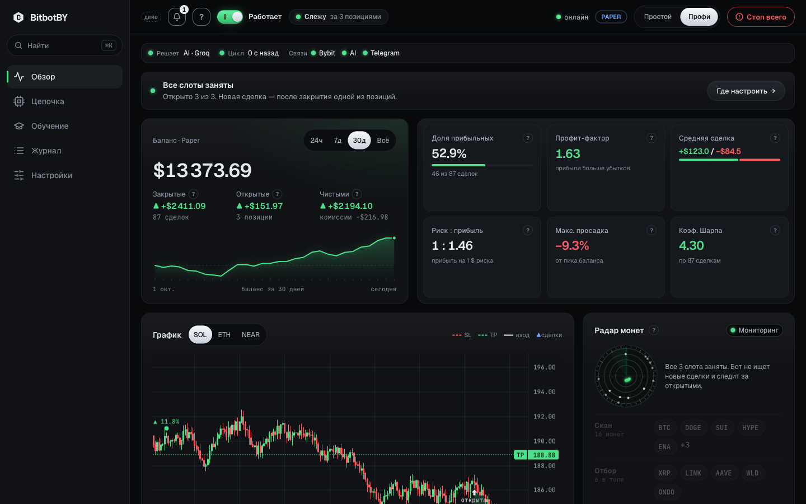
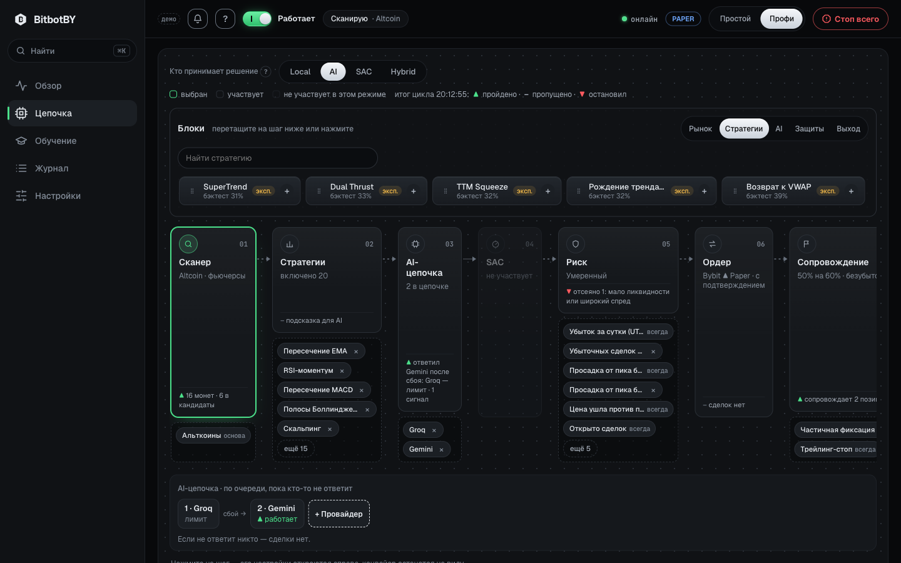
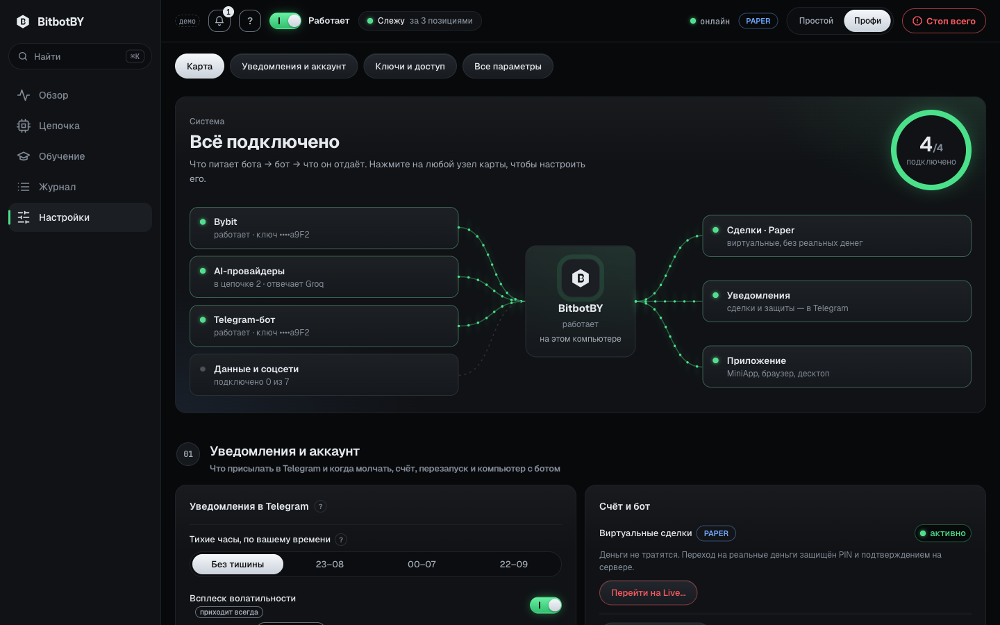
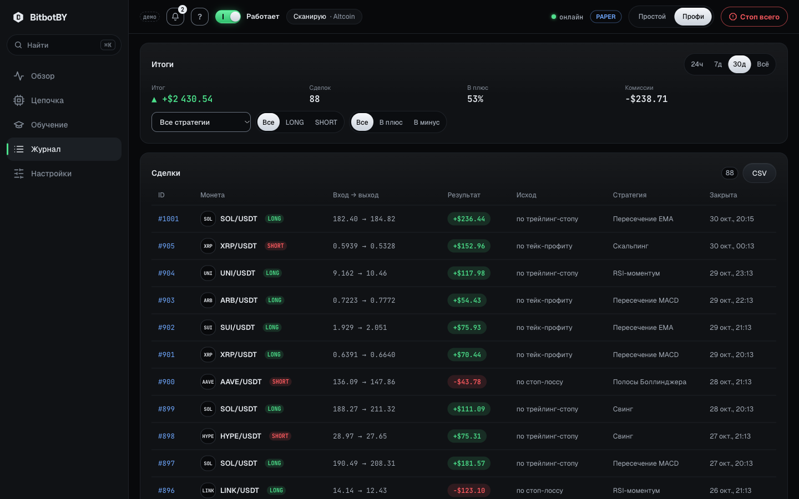
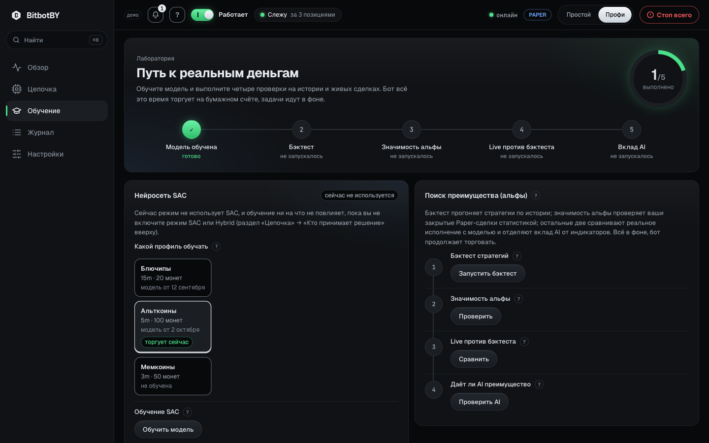
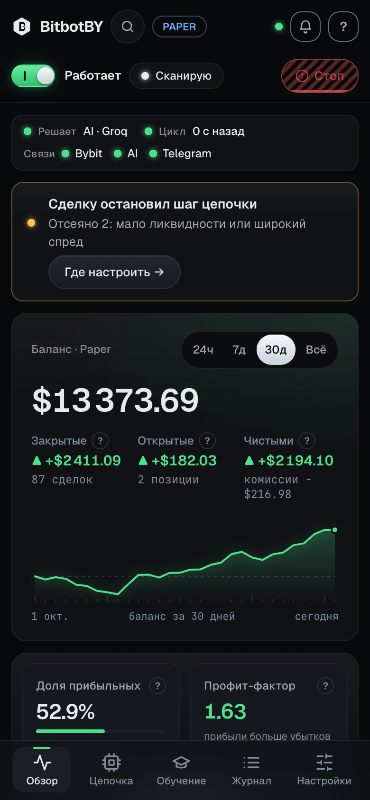
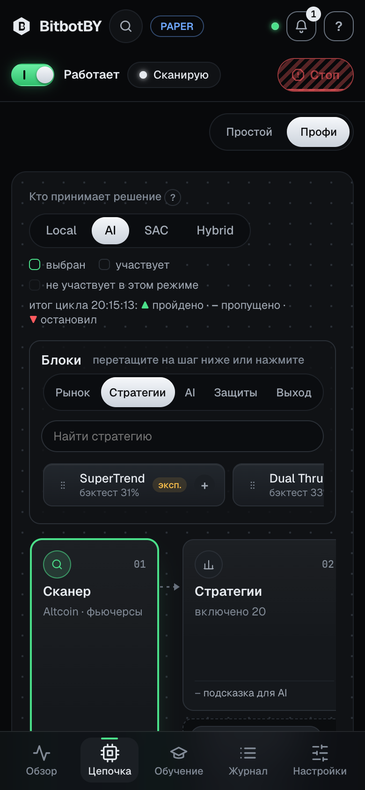
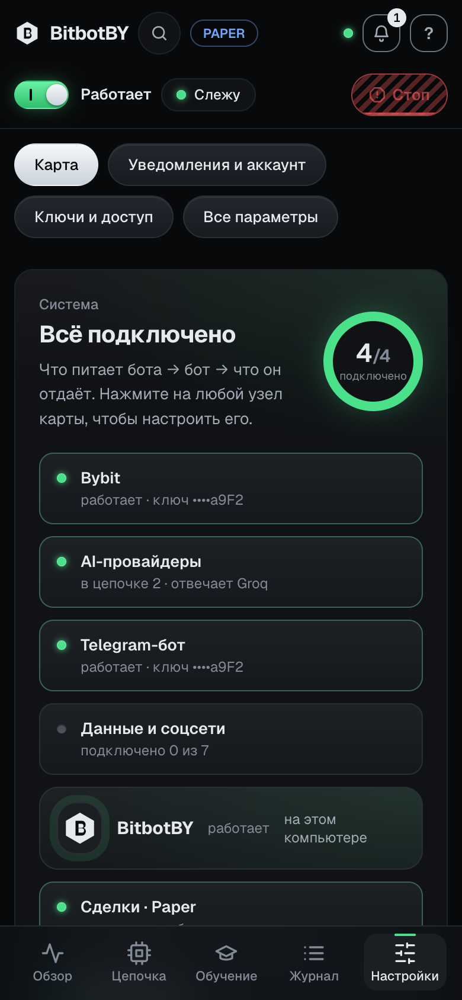
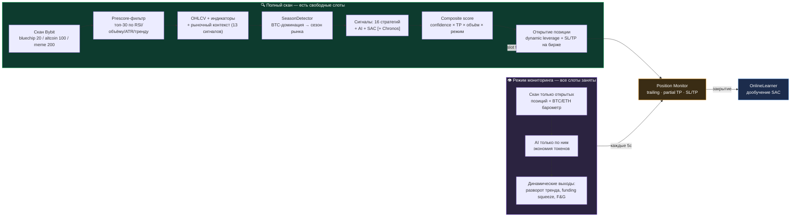

<div align="center">


# 🤖 BitbotBY

### AI-гибридный торговый бот для Bybit (фьючерсы и спот)

Цепочка из 16 AI-провайдеров · SAC (RL) · Amazon Chronos · 10+ рыночных сигналов · приложение (MiniApp, браузер, десктоп)

[](https://www.python.org/)
[](https://fastapi.tiangolo.com/)
[](https://www.docker.com/)
[](#-разработка-и-тесты)
[](https://www.bybit.com/)
[](LICENSE)

🌐 **Русский** · [English](docs/README.en.md) · [中文](docs/README.zh.md) · [Español](docs/README.es.md) · [Deutsch](docs/README.de.md)

</div>

---

BitbotBY сканирует рынок Bybit, сводит сигналы AI-моделей, SAC-нейросети и локальных стратегий с
рыночным контекстом (funding, ликвидации, Fear & Greed, ордербук, деривативы, сентимент) и торгует
perpetual-фьючерсами long/short или спотом — с риск-менеджментом (Kelly, CVaR, Almgren-Chriss).
Решать может AI, SAC, Hybrid или **только локальные стратегии без AI**. Управление — из **приложения**
(MiniApp в Telegram, браузер, десктоп) и из Telegram-бота: оба работают с одним и тем же ботом.

Три профиля рынка: **Bluechip** (топ-20), **Altcoin** (топ-100), **Meme** (топ-200, памп-стратегии и сентимент соцсетей).

> **Честный статус.** Бот стартует в **Paper** (виртуальные сделки). Бэктесты пока не нашли
> статистически значимого преимущества ни у одной стратегии ([docs/STRATEGIES.md](docs/STRATEGIES.md)),
> поэтому реальные деньги — только после [чек-листа](#-перед-реальной-торговлей).

> Переводы в `docs/README.*.md` отстают от этой версии; актуален русский README.

---

## 📸 Как выглядит приложение

<p align="center">
  
</p>

<table>
  <tr>
    <td width="50%" valign="top"><br><b>Цепочка</b> — шаги решения и блоки перетаскиванием</td>
    <td width="50%" valign="top"><br><b>Настройки</b> — карта: что питает бота и что он отдаёт</td>
  </tr>
  <tr>
    <td valign="top"><br><b>Журнал</b> — сделки таблицей, итоги, результат по часам входа</td>
    <td valign="top"><br><b>Обучение</b> — путь к реальным деньгам: модель и четыре проверки</td>
  </tr>
</table>

<p align="center">
  
  &nbsp;
  
  &nbsp;
  
</p>
<p align="center"><sub>Тот же интерфейс в Telegram MiniApp на телефоне. Скриншоты — демо-режим (<code>/app/?mock</code>) на тестовых данных, это не результаты торговли.</sub></p>

---

## Содержание

- [Быстрый старт](#-быстрый-старт)
- [Как это работает](#-как-это-работает)
- [Архитектура и структура](#-архитектура)
- [Возможности](#-возможности)
- [Приложение](#-приложение-miniapp-браузер-десктоп)
- [AI-провайдеры и цепочка](#-ai-провайдеры-и-цепочка)
- [Ключи и безопасность](#-ключи-и-безопасность)
- [Telegram](#-telegram)
- [Обучение SAC и бэктест](#-обучение-sac-модели)
- [Разработка и тесты](#-разработка-и-тесты)
- [FAQ](#-faq)
- [Перед реальной торговлей](#-перед-реальной-торговлей)
- Справочник всех переменных — [docs/CONFIGURATION.md](docs/CONFIGURATION.md)

---

## 🚀 Быстрый старт

### На своём компьютере — один ярлык

Нужны [Docker Desktop](https://www.docker.com/products/docker-desktop/) и Python 3. Ярлыки лежат в папке `launcher/`:

| Что | macOS | Windows | Linux |
|---|---|---|---|
| Запустить | `launcher/BitbotBY.command` | `launcher\BitbotBY.bat` | `launcher/bitbotby.sh` |
| Остановить | `launcher/BitbotBY-stop.command` | `launcher\BitbotBY-stop.bat` | `launcher/bitbotby.sh stop` |
| Приложение на телефоне | `launcher/BitbotBY-phone.command` | `launcher\BitbotBY-phone.bat` | `launcher/bitbotby.sh phone on` |

- Первый запуск собирает образ (5–15 минут), поднимает Redis, бота и дашборд и сам открывает приложение.
  Порт 8080 занят — лаунчер возьмёт ближайший свободный и покажет адрес.
- Старт в **Paper** и **Local** (решают локальные стратегии), поэтому ключи для начала не нужны. Ключи Bybit, AI и
  Telegram вводятся в приложении: **Настройки → Ключи и доступ** — и хранятся зашифрованными.
- Вход: лаунчер открывает одноразовую ссылку, которая работает только на этом компьютере (порт открыт на 127.0.0.1).
  Окно закрыли — `python3 launcher/launch.py url`.
- **Телефон:** `phone on` поднимает туннель Cloudflare (нужен `cloudflared`), и в Telegram появляется кнопка «Терминал».
  Без входа через Telegram данные не отдаются. Выключить — `phone off`.

<details>
<summary>Все команды лаунчера</summary>

| Команда | Что делает |
|---|---|
| `python3 launcher/launch.py start [--data-dir=/путь]` | Запуск (то же, что ярлык); данные можно держать в другой папке |
| `stop` · `status` · `logs` · `url` | Остановка, состояние, логи, ссылка входа |
| `phone on [--url=https://…]` · `phone off` | MiniApp с телефона через туннель или свой https-адрес |
| `import-env [--overwrite]` | Один раз перенести ключи из старого `.env` в шифрованное хранилище (значения не печатаются) |
| `autostart on/off` · `awake on/off` | Запуск при входе в систему; не давать компьютеру уснуть, пока бот работает |

Данные (`data/`, `models/`, `logs/`) и ключи при остановке сохраняются. Мастер-ключ хранилища лаунчер создаёт сам
в `.launcher/state.json` (права 600, в git и в образ не попадает).
</details>

### На сервере (VPS) — одна команда

```bash
git clone https://github.com/deuteriumZzz/BitbotBY.git bitbotby && cd bitbotby
python3 launcher/launch.py server --domain=bot.example.com
```

Команда готовит мастер-ключ, запускает бота, дашборд, Redis и Caddy с HTTPS и подключает Telegram (спросит токен
и попросит отправить боту код). `.env` серверу не нужен. Обновление, логи, остановка и безопасность —
в [docs/DEPLOY_SERVER.md](docs/DEPLOY_SERVER.md).

### Для разработки — без Docker

Нужны Python 3.11, Redis и Node.js 20+.

```bash
python -m venv venv && source venv/bin/activate
pip install -r requirements.txt
make webapp        # собрать приложение
make local         # бот + дашборд: http://localhost:8080/app/
```

Здесь бот читает переменные окружения и `.env` — список в [docs/CONFIGURATION.md](docs/CONFIGURATION.md).
Старый запуск в Docker с `.env` и nginx лежит в `deploy/legacy/` (`make setup`, `make up`, `make down`).

---

## 🔄 Как это работает

Цикл адаптируется к состоянию портфеля: **полный скан** рынка, когда есть свободные слоты,
и лёгкий **режим мониторинга**, когда все позиции заняты (экономия AI-токенов в 5–33×).



<details>
<summary><b>Полная цепочка принятия решения — 14 шагов с формулами</b> (развернуть)</summary>

| # | Шаг | Что делает |
|---|---|---|
| 1 | **Снэпшоты** ([cycle.py](src/core/cycle.py)) | OHLCV → индикаторы (RSI/MACD/BB/ATR/тренд) + новостной сентимент на монету |
| 2 | **Prescore** | `score = vol×0.35 + rsi×0.30 + atr×0.20 + regime_bonus×0.15` → топ-30 в AI |
| 3 | **Рыночный контекст** ([market_context.py](src/market/market_context.py)) | 13 сигналов: funding, OI+ликвидации, F&G, basis, orderbook, Deribit PCR/IV, Google Trends, Glassnode, ETF flows, Reddit (CryptoBERT), stablecoin supply |
| 4 | **SignalCombiner** ([signal_combiner.py](src/core/signal_combiner.py)) | `local` / `ai` / `dqn` / **`hybrid`** (SAC+AI согласие, вес зависит от режима: trending 50/50, ranging 40/60) / **`hybrid+Chronos`** (±0.05…0.15 модификатор) |
| 5 | **Контекстный фильтр** | Каждый из 13 сигналов двигает confidence на ±0.05…0.15 (напр. F&G ≤15 + каскад ликвидаций → confidence = 0) |
| 6 | **Прямые контекстные сигналы** | Экстремумы (funding overheated, squeeze, imbalance >0.4, F&G ≤10/≥92) генерируют отдельные сигналы |
| 7 | **Локальный fallback** | Если сигналов нет — индикаторная стратегия, TP шире в тренде, уже в боковике |
| 8 | **Приоритизация** | `composite_score = confidence × (1+tp_bonus) × (1+volume_bonus) × regime_mult` |
| 9 | **Portfolio allocation** | CVaR/Markowitz ([portfolio_optimizer.py](src/research/portfolio_optimizer.py)) при ≥2 сигналах, cap ×3 |
| 10 | **Execution guards** ([order_executor.py](src/core/order_executor.py)) | macro blackout → слоты/cooldown → торговые часы → дубликат символа → **correlation guard** → подтверждение в Telegram → **liquidity filter** → валидация SL/TP → **Kelly sizing** → drawdown scaling → **Almgren-Chriss** → dynamic leverage → ордер |
| 11 | **После открытия** | PositionMonitor каждые 5с: те же 13 сигналов контекста управляют выходом (force_close / tighten_sl) |

**Отдельный путь — доверенные каналы Telegram** ([trusted_trader.py](src/core/trusted_trader.py)). Пост канала,
которому вы доверяете, сразу идёт в ордер: сканер, стратегии, AI и фильтры этой таблицы его не отклоняют. Защиты
остаются: пауза, дневной лимит убытка, стоп всегда, свой риск и свои слоты, Paper остаётся Paper. Выключено по
умолчанию — см. [FAQ](#-faq).

**Что реально отличается по профилям** (не только параметры): Meme — единственный профиль с Twitter-сентиментом
и стратегиями `momentum_burst`/`pump_exit`. Посты Telegram-каналов (стратегия `sentiment`) работают во всех профилях.
BTC ETF flows применяются только к BTC/USDT. Остальная логика (contrarian funding/PCR/FNG, Kelly,
correlation guard, Almgren-Chriss) идентична во всех профилях — различаются только цифры.

</details>

---

## 🏗 Архитектура

```mermaid
flowchart TB
    SUP["supervisor.py\nrestart on crash · SIGTERM"] --> BOT["TradingBot\nsrc/core/trading_bot.py"]

    subgraph DATA["Данные и сигналы"]
        SCAN["MarketScanner"]
        DL["DataLoader\nccxt async · CSV cache 24ч"]
        REGIME["RegimeDetector\nGaussianHMM"]
        CTX["MarketContext\n10+ источников, TTL 5–240мин"]
        NEWS["NewsAnalyzer\nNewsAPI + RSS + VADER"]
        TW["TwitterAnalyzer\nMeme профиль"]
        TG["TelegramSentiment\nTelethon MTProto"]
        POLL["SentimentPoller\nasyncio → Redis"]
    end

    subgraph BRAIN["Принятие решений"]
        COMBINER["SignalCombiner\nSAC + AI [+Chronos]"]
        CHRONOS["ChronosAnalyzer\namazon/chronos-t5-small"]
        CRYPTOBERT["CryptoSentimentAnalyzer\nElKulako/cryptobert"]
        PORT["PortfolioOptimizer\nCVaR / Markowitz"]
        CORR["CorrelationFilter"]
        MACRO["MacroCalendar\nFOMC/CPI/NFP blackout"]
        ARB["FundingArbDetector"]
    end

    subgraph EXEC["Исполнение"]
        OE["OrderExecutor\nKelly → CVaR → Almgren-Chriss"]
        PM["PositionMonitor\nSL/TP · trailing · partial TP"]
        API["BybitAPI\nccxt async, linear+spot"]
        LEARN["OnlineLearner\nSAC auto-retrain"]
    end

    subgraph OUT["Наблюдаемость"]
        NOTIFY["TelegramNotifier"]
        HIST["TradeHistory\nSQLite"]
        HEALTH["HealthServer\n/health /metrics"]
    end

    BOT --> SCAN & DL & REGIME & CTX
    CTX --> NEWS & TW & TG & POLL
    BOT --> COMBINER
    COMBINER --> CHRONOS & CRYPTOBERT
    BOT --> PORT & CORR & MACRO & ARB
    BOT --> OE --> API
    OE --> PM --> LEARN
    BOT --> NOTIFY & HIST & HEALTH

    style SUP fill:#1c1c1c,stroke:#888,color:#fff
    style BOT fill:#0d3b2e,stroke:#2ecc71,color:#fff
    style DATA fill:#16213e,stroke:#4a90e2,color:#fff
    style BRAIN fill:#2b2340,stroke:#9b6bff,color:#fff
    style EXEC fill:#3a2c14,stroke:#f39c12,color:#fff
    style OUT fill:#3a1414,stroke:#e74c3c,color:#fff
```



**Структура проекта:**

```
config.py · supervisor.py · dashboard.py — настройки по умолчанию и точки входа (бот, панель)
docker-compose.local.yml / .server.yml  — свой компьютер (лаунчер) и сервер (Caddy + HTTPS)

launcher/        — ярлыки BitbotBY (.command / .bat / .sh) и launch.py: локальный запуск, телефон, сервер
src/
  core/          — торговый цикл: TradingBot, решение, ордер, сопровождение, риск, история, след решения
  strategies/    — стратегии, базовый класс, портированные наборы
  ai/            — AI-провайдеры и анализ, Chronos, SAC-сигнал, онлайн-обучение
  market/        — свечи, сканер, режим и сезон рынка, корреляции, макро-календарь, индикаторы
  sentiment/     — новости, Twitter, Telegram-каналы, CryptoBERT
  exchange/      — Bybit (ccxt)
  telegram_bot/  — команды и уведомления в Telegram
  settings/      — настройки во время работы, реестр параметров, шифрованное хранилище ключей, вход
  infra/         — Redis, шина событий, логи, health, фоновые задачи
  dashboard/     — FastAPI: API, WebSocket, приложение /app/
  research/      — бэктесты и отчёты: python -m src.research.backtest и др.
reinforcement_learning/ — SAC: среда, обучение, подбор гиперпараметров
webapp/          — приложение (React + Vite + TypeScript), собирается в образ Docker
tests/           — тесты по тем же папкам, что и src/ (+ launcher/, integration/ для testnet)
deploy/          — Caddyfile, monitoring/ (Prometheus/Grafana), legacy/ — старый запуск с .env
docs/            — CONFIGURATION, DEPLOY_SERVER, STRATEGIES, RUNBOOK, design/, переводы README
```

---

## ✨ Возможности

### 📡 Рыночный Edge — сигналы реального времени

| Источник | Логика | Профиль |
|---|---|---|
| **Funding Rate** (Bybit) | >0.1% = лонги перегреты → SHORT contrarian | все |
| **Open Interest + цена** | OI↓ + цена↓ → ликвидация лонгов | все |
| **Fear & Greed** | ≤15 контрарный BUY (если нет каскада), ≥85 гасит BUY | все |
| **Orderbook Imbalance** | ask/bid > 1.4 → SELL | все |
| **Basis (futures-spot)** | >2% премия = жадность → SELL | все |
| **Deribit PCR + IV Skew** | PCR <0.5 = all-in calls → SELL | все |
| **ETF Flows** (farside.co.uk) | Outflow < −$100M → SELL, Inflow > $150M → BUY | только BTC |
| **Google Trends** | >75 = retail FOMO пик → SELL | все |
| **Reddit / CryptoBERT** | NLP-классификация постов r/CryptoCurrency | все |
| **News sentiment** | NewsAPI/RSS + Claude/DeepSeek/VADER | все |
| **Twitter/X** | VADER; платный API или бесплатно через аккаунты X ([twscrape](https://github.com/vladkens/twscrape)) | только Meme |
| **Telegram-каналы** | Telethon, посты в реальном времени, точный поиск монеты ($WIF, #WIF, WIF/USDT), вес 2× в score | все |
| **Stablecoin Supply** | USDT market cap ↓ → риск оттока | фильтр |

Все источники кэшированы (5 мин — 4 часа) и gracefully degradируют при недоступности.

### 🧠 Стратегии и модели

- **20 встроенных стратегий**: EMA crossover, RSI, MACD, Bollinger Bands, Scalping, Swing, Breakout, Mean Reversion, Trend Following, Volume Spike, ICT/SMC (Fair Value Gap, Liquidity Sweep, AMD и др.), профильные `momentum_burst`, `pump_exit`, `sentiment`
- **49 экспериментальных стратегий** из [Argent-Systems](https://github.com/deuteriumZzz/Argent-Systems) (SuperTrend, Ichimoku, Parabolic SAR, VWAP и др.): выключены по умолчанию, с меткой «эксперимент»; **бэктест не показал у них преимущества** — см. [docs/STRATEGIES.md](docs/STRATEGIES.md)
- **Рынок спот / фьючерсы:** у каждой стратегии свой признак; на споте нет шортов, поэтому стратегии «только фьючерсы» там скрыты
- **Роль стратегий зависит от режима:** в Local они решают сами; в AI — подсказка для модели; в SAC не используются; в AI/SAC/Hybrid их можно включить как запасной путь на время недоступности модели — не ответил ни один AI-провайдер или SAC не загружен (`LOCAL_FALLBACK`, по умолчанию выключен)
- **AI-анализ**: цепочка из 16 провайдеров (см. [AI-провайдеры и цепочка](#-ai-провайдеры-и-цепочка))
- **SAC (Soft Actor-Critic)** — RL-модель, обучается на истории, дообучается онлайн после каждой сделки
- **Amazon Chronos** — предобученная time-series модель, мягкий модификатор confidence в hybrid-режиме

### 📐 Квант-инструменты

| Инструмент | Где применяется |
|---|---|
| **Kelly Criterion** (half-Kelly) | Sizing позиции по live win-rate/EV стратегии |
| **CVaR / Markowitz** | Portfolio allocation при нескольких одновременных сигналах |
| **Almgren-Chriss** | Поправка entry-цены на market impact от размера ордера |
| **GaussianHMM** | Определение режима рынка (trending/ranging) per-symbol |
| **Correlation guard** | Блокирует новую позицию, коррелирующую с открытой |

### 🛡 Риск-менеджмент

Macro blackout (FOMC/CPI/NFP) · Correlation filter · Liquidity filter (spread/объём) ·
Circuit breaker и дневной лимит убытков · **Hard drawdown halt** (закрытие убыточных, SL в breakeven
на прибыльных, блокировка входов) · **ATR spike protection** (закрытие всех позиций, пауза 1ч) ·
Dynamic leverage (fixed/volatility/full, ATR-based) · Trailing stop + partial TP · Kill-switch стратегий по live-статистике.
В Paper защиты портфеля можно отключить одним переключателем (`PAPER_GUARDS_OFF`, в Live игнорируется) — чтобы быстрее накопить сделки.

### 🌡 Контекст рынка в интерфейсе

На терминале показаны **индекс Страха и Жадности** (стрелка 0–100 с зонами) и **сезон рынка** (альтсезон / сезон BTC /
нейтрально, индекс альтсезона, доминация BTC); бот сам переключает профиль по сезону, если включено `SEASON_SWITCH_MODE`.

---

## 📲 Приложение: MiniApp, браузер, десктоп

Всё, что есть в Telegram-меню, есть и в приложении (`webapp/`, React + Vite): Telegram MiniApp,
обычный браузер (`/app/`) и десктоп-оболочка открывают один и тот же интерфейс. Telegram и приложение
управляют одним и тем же ботом: команды идут через общую очередь Redis, настройки и замки задач общие.

| Вкладка | Что внутри |
|---|---|
| **Обзор** | Строка здоровья и огни связей (Bybit · AI · Telegram), **«Почему бот молчит?»** — одна причина из последнего цикла с переходом к нужному шагу, под ней последний пост доверенного канала (вошли или почему нет); баланс и кривая equity, метрики, график с SL/TP, **сканер** справа (радар и лента этапов — монеты идут скан → сигналы → защита → вход), открытые позиции карточками («почему открыта», шаги решения, закрыть / SL-TP / трейлинг / 50%), лента событий, сезон рынка и индекс Страха/Жадности |
| **Цепочка** | Конвейер решения из 7 шагов; **блоки перетаскиванием** (стратегии, профиль рынка, AI-провайдеры, защиты, частичная фиксация — включаются и выключаются с «Отменить»); клик по шагу — его настройки в панели сбоку |
| **Обучение** | «Путь к реальным деньгам»: модель SAC по профилю и откат, бэктест, значимость альфы, «Live против бэктеста», «даёт ли AI преимущество» — с кольцом готовности |
| **Журнал** | Сделки таблицей (как обозреватель блоков): строка открывает чек сделки с шагами решения; фильтры, итоги по стратегиям, **результат по часам входа** (лучший и худший час, окно часов торговли в одно нажатие — от 50 сделок), календарь P&L, качество исполнения, CSV |
| **Настройки** | Одна страница: **карта подключений** (Bybit, AI, Telegram, данные → бот → сделки, уведомления, приложение; где работает бот — компьютер или сервер), уведомления и тихие часы, аккаунт, компьютер, **ключи связками** (ключ → какой шаг цепочки он питает, форма в панели сбоку; вход в Telegram-каналы и способ чтения X — прямо в карточке), **каналы Telegram** (какие читаются и доверенные каналы с их лимитами), все параметры (поиск, история, копирование, сброс) |

Режим интерфейса **Простой / Профи**: в простом — только главное, в профи — все параметры. Вкладка «Цепочка» показывает конвейер решения по каждой монете и правила защиты «если → то»; уведомления можно выключать по видам, есть тихие часы.

Удобство: «Отменить» после любого изменения настроек, командная палитра (`Ctrl/⌘ K`), горячие клавиши
(`1–5` вкладки, `?` справка, `N` уведомления), центр уведомлений, кнопка PANIC (удержание секунду; на
телефоне ещё и под крышкой), мастер первого запуска.

**Вход без паролей:** в MiniApp — подпись Telegram; в браузере и десктопе — 6-значный код, который бот
присылает владельцу в Telegram; при запуске лаунчером — одноразовая ссылка (только на этом компьютере).
Управлять ботом может только владелец (`TELEGRAM_CHAT_ID`).

Дизайн-система «Тёмный премиум-терминал» описана в [webapp/DESIGN.md](webapp/DESIGN.md) (токены — `webapp/src/styles/tokens.css`), контракт API
приложения — в [docs/design/CONTRACT.md](docs/design/CONTRACT.md).

---

## 🤖 AI-провайдеры и цепочка

В каталоге **16 провайдеров**: Groq, Gemini, Cerebras, OpenRouter, NVIDIA NIM, Mistral, GitHub Models,
Cloudflare Workers AI, Hugging Face, Ollama Cloud, Cohere, LLM7, Ollama на компьютере, DeepSeek, OpenAI,
Claude. Бесплатные идут по умолчанию; режим цепочки: **Бесплатные / Смешанный / Платные**.

- **Цепочка или один провайдер.** В цепочке бот спрашивает провайдеров по порядку: ошибка или лимит —
  сразу следующий, после лимита провайдер «отдыхает» и возвращается. В режиме «Один провайдер» решает
  одна модель, а при её недоступности цикл идёт на локальных стратегиях.
- **Схема цепочки** (Настройки → AI → «Схема») — холст в стиле редактора потоков: узлы «Запрос → провайдеры
  → Решение», линии с бегущим потоком, ветка «если все отказали». Порядок узлов и есть порядок цепочки:
  перетащили узел — порядок пересобрался; потянули в «Резерв» — провайдер выключен, ключ остался.
  «Список» — тот же функционал в виде списка, с перетаскиванием и клавиатурой.
- **Меню узла** (правый щелчок, долгое нажатие или «⋯»): сделать первым, проверить связь (запрос списка
  моделей, лимит не тратится), «если он упадёт, кто заменит», в резерв, удалить ключ (с отменой).
- **Подключение провайдера** — поле «Вставьте ключ»: провайдер определяется по началу ключа, ключ
  проверяется запросом к сервису и сохраняется зашифрованным. Новый ключ вступает в силу после перезапуска
  бота (кнопка есть в приложении).
- Без единого ключа бот работает в режиме **Local** (решают локальные стратегии).

---

## 🔐 Ключи и безопасность

- Ключи хранятся **только зашифрованными** (Fernet) в `data/secrets.enc.json`. Приложение показывает последние
  4 символа и никогда не отдаёт ключ обратно. Мастер-ключ `BITBOT_SECRETS_KEY` лаунчер кладёт в
  `.launcher/state.json`, серверная команда — в `.server/server.env` (права 600, в git и в образ не попадают).
- Лаунчер и сервер `.env` не читают. Старые ключи из `.env` переносятся один раз: `python3 launcher/launch.py import-env`.
- Ключ Bybit создавайте **без права вывода средств** и с привязкой к IP — ключи с выводом приложение отклоняет.
- Переход Paper → Live — только кнопкой с кодовым словом (`TRADING_MODE_PIN`), не обычными словами в Telegram.
- Вход в приложение — только владельцу (`TELEGRAM_CHAT_ID`): подпись Telegram в MiniApp, 6-значный код в браузере,
  одноразовая ссылка лаунчера — только на этом компьютере. Сессии хранятся в Redis хэшем, а не токеном.
- На сервере наружу открыт только Caddy (HTTPS); `/metrics` и `/webhook/*` снаружи отвечают 404.

---

## 📱 Telegram

- Кнопка **«Терминал»** открывает приложение прямо в Telegram (нужен https-адрес: сервер или `phone on`).
- `/app` присылает одноразовую ссылку входа, которая работает только на компьютере, где запущен бот.
- Можно писать словами: «статус», «позиции», «пауза», «продолжи», «закрой все», «риск 1.5%», «сделок 3»,
  «добавь PEPE», «выключи стратегию bb».
- Команды: `/pnl` `/pos` `/scan` `/symbols` `/strategies` `/risk` `/lev` `/hours` `/provider` `/alerts` `/closeall`.
- Прежние меню (профиль, режим, риск, позиции, стратегии, обучение) остаются запасным путём, пока нет https;
  в них есть кнопка «Настройки в приложении».
- Сообщения о сделках и сигналах подчиняются переключателям уведомлений и тихим часам из приложения.

Один Telegram-токен нельзя использовать у двух запущенных ботов сразу (конфликт polling) — например, на сервере и
на компьютере. Для второго заведите отдельного бота.

---

## 🎓 Обучение SAC-модели

```bash
make train           # локальное обучение (Optuna + walk-forward)
make train-docker     # то же самое в Docker (~60 мин)
make tune             # только hyperparameter search
```

Обучение и тюнинг можно запускать и **из приложения** (вкладка «Обучение»): у каждого профиля рынка
(Bluechip / Altcoin / Meme) своя модель, свой таймфрейм и число монет — выбираете профиль и запускаете; откат
возвращает модель именно этого профиля. Параметр `TRAIN_TOP_N` («Монет для автодообучения») влияет только на
автоматическое дообучение, ручное берёт число монет из профиля.

До завершения обучения используйте `MODE=ai` (или `MODE=local`); переключение на `dqn`/`hybrid` доступно из
Telegram и приложения без перезапуска сразу после того, как обучение завершится. `OnlineLearner` дообучает модель автоматически
после каждой закрытой сделки (`periodic`/`hybrid`/`online` режимы).

---

## 🔬 Бэктест и валидация альфы

Порядок важен — каждый шаг проверяет то, что предыдущий не может:

```bash
make backtest          # walk-forward, holdout 20%, overfit ratio (должен быть <2×)
make alpha-report       # bootstrap Sharpe + Wilcoxon — значима ли альфа статистически
make live-divergence    # проскальзывание/задержка исполнения live vs бэктест
make ai-isolation       # даёт ли AI-слой edge поверх голых индикаторов (жжёт AI-квоту)
```

`alpha-report` требует минимум 30–50 сделок на группу, иначе `INSUFFICIENT DATA` — это сигнал
наблюдать дольше, а не считать проверку пройденной.

Все четыре проверки и сам бэктест запускаются и из приложения (вкладка «Обучение»), фоном — бот продолжает торговать.
Результаты текущих стратегий (в том числе 49 портов из Argent) собраны в [docs/STRATEGIES.md](docs/STRATEGIES.md):
**ни у одной стратегии нет статистически значимого преимущества**, поэтому держите Paper, пока live-статистика
не подтвердит обратное. Качество исполнения (проскальзывание и задержка) копится по новым сделкам и показано на терминале.

---

## 🛠 Разработка и тесты

```bash
make test                     # pytest с покрытием (порог 50%)
make lint                     # flake8 + mypy
make fmt                      # black + isort
cd webapp && npx vitest run   # тесты приложения
```

**1953 теста бэкенда** (индикаторы, стратегии и порты из Argent, риск, CVaR, Kelly, Almgren-Chriss, SAC-инференс,
монитор позиций, настройки, API приложения и вход, лаунчер, e2e цикл) и **57 тестов приложения** (vitest).
CI проверяет black, isort, flake8, mypy, компиляцию и тесты. Настройки инструментов — в `pyproject.toml` и `setup.cfg`.

<details>
<summary>Все команды Makefile</summary>

| Команда | Назначение |
|---|---|
| `make local` / `make webapp` | Бот + дашборд без Docker / сборка приложения |
| `make paper` / `make paper-ai` / `make live` | Только бот: Paper (local / AI) / Live — читают `.env` |
| `make train` / `make train-long` / `make train-docker` | Обучение SAC |
| `make tune` / `make tune-bluechip` / `make tune-altcoin` | Подбор гиперпараметров (Optuna) |
| `make retrain` | Дообучение на новых данных |
| `make backtest` / `make backtest-eth` | Walk-forward бэктест |
| `make alpha-report` / `make live-divergence` / `make ai-isolation` | Значимость альфы / live против бэктеста / вклад AI |
| `make test` / `make lint` / `make fmt` | Тесты / линтеры / форматирование |
| `make setup` / `make up` / `make down` / `make rebuild` / `make logs` | Старый запуск `deploy/legacy/` с `.env` и nginx |

</details>

Мониторинг: `/health` (статус для supervisor), Prometheus и Grafana — конфиги в `deploy/monitoring/`.

---

## ❓ FAQ

<details>
<summary><b>Бот не торгует часами</b></summary><br>

Нормально: это защита от overtrading. Вход ждёт confidence ≥ порога режима риска, в боковике локальные стратегии
его редко достигают. Почему пропущена монета — видно на «Обзоре» («Почему бот молчит?») и во вкладке «Цепочка» (конвейер решения и след решения).
</details>

<details>
<summary><b>Hybrid или SAC пишет, что нет модели</b></summary><br>

Сначала обучите модель профиля: вкладка «Обучение» или `make train`. До этого — режим Local или AI.
</details>

<details>
<summary><b>AI-провайдеры отвечают ошибками</b></summary><br>

Проверьте связь в Настройки → AI («Проверить связь»): 401 — ключ недействителен, 402 — кончился баланс, 429 — лимит.
Цепочка сама переходит к следующему провайдеру. Если не ответил никто, новых сделок нет, пока кто-то не ответит;
открытые позиции сопровождаются. Включите «Если AI или SAC недоступны — торговать по этим стратегиям», чтобы на это
время решали стратегии.
</details>

<details>
<summary><b>Как подключить Twitter / X бесплатно</b></summary><br>

Настройки → Ключи и доступ → Twitter / X → «Через аккаунты». Бот входит в X под вашими аккаунтами и ищет твиты так
же, как сайт x.com в браузере, через открытую библиотеку [twscrape](https://github.com/vladkens/twscrape). Это
бесплатно, но против правил X: аккаунты могут заблокировать.

1. Заведите отдельный аккаунт X на отдельную почту, не основной.
2. Войдите в него в браузере и пройдите проверки X (телефон, капча).
3. Выключите на нём двухфакторную защиту X: бот не умеет вводить код из приложения.
4. В почте включите IMAP и создайте «пароль приложения» (Gmail, Яндекс, Mail.ru): по нему бот прочитает код входа от X.
5. Добавьте аккаунт в приложении и перезапустите бота. Лучше 2–3 аккаунта: при лимите запросов бот берёт следующий.

Аккаунты хранятся только в зашифрованном хранилище, пароли приложение не показывает. Если задан официальный API
(«Официальный API», около $100 в месяц), работает он, а аккаунты не используются. Твиты читаются только в профиле Meme.
</details>

<details>
<summary><b>Как подключить каналы Telegram и доверенные каналы</b></summary><br>

**Вход.** На [my.telegram.org](https://my.telegram.org) → API development tools возьмите API ID и API Hash. Введите их в
Настройки → Ключи и доступ → Памп-каналы Telegram, нажмите «Войти» и введите код, который придёт в Telegram (и облачный
пароль, если он включён). Сессия хранится только в зашифрованном хранилище, не в файле и не в `.env`; бот больше
не спрашивает код. Лучше отдельный аккаунт Telegram, не основной.

**Чтение каналов.** Бот подписывается на каналы и получает посты сразу, без опроса. Монеты текущего скана ищутся
точно: `$WIF`, `#WIF`, `WIF/USDT` или слово заглавными (без подстрок вроде «wifi»). Учитываются посты за последние
60 минут, а список монет меняется вместе с профилем и сезоном. Что читается и почему канал не читается — в
Настройки → Каналы Telegram.

**Доверенные каналы.** Там же: главный тумблер «Сделки по доверенным каналам» (по умолчанию выключен) и у каждого
канала «Доверять: входить по постам». Бот разбирает пост (монета, лонг или шорт, вход, стоп, цель) и входит за
секунды, минуя сканер, стратегии и AI. Ограничения по умолчанию: риск 0,5% на сделку, 2 слота, стоп 3%, если в посте
его нет, одна сделка по монете за 30 минут, пост старше 2 минут пропускается. Можно снимать доверие после N убытков
подряд. Последний разобранный пост и причина «вошли / не вошли» видны на «Обзоре», а итоги по каналам — в «Журнале».
Посты разбираются по шаблонам, поэтому канал с необычным форматом сначала проверьте в Paper.
</details>

<details>
<summary><b>Telegram не получает сообщения</b></summary><br>

Привяжите чат в Настройки → Ключи и доступ → Telegram («Найти мой chat id»). Нужен ваш числовой ID, а не ID бота;
напишите боту любое сообщение, чтобы открыть чат.
</details>

<details>
<summary><b>Что происходит при drawdown halt / ATR spike</b></summary><br>

**Drawdown halt**: убыточные позиции закрываются, прибыльные получают SL в безубыток, новые входы блокируются на
`DRAWDOWN_HALT_HOURS`. **ATR spike**: все позиции закрываются, пауза 1 час. В Paper защиты можно отключить
переключателем `PAPER_GUARDS_OFF` (в Live он игнорируется).
</details>

<details>
<summary><b>Настройки сохраняются после перезапуска?</b></summary><br>

Да: они в Redis с AOF (сброс на диск каждую секунду) и в `data/`. Полный сброс — только удаление томов Docker.
</details>

---

## 🎯 Перед реальной торговлей

1. Минимум **2 недели** Paper с подтверждением сделок.
2. «Обучение» → бэктест: overfit ratio < 2×, иначе сначала разбираться со стратегиями.
3. «Проверка значимости альфы» (`make alpha-report`): альфа значима статистически, а не «выглядит неплохо».
   Меньше 30–50 сделок — `INSUFFICIENT DATA`, значит наблюдать дольше.
4. «Live против бэктеста» (`make live-divergence`) — если есть подозрение на проскальзывание.
5. Ключ Bybit без вывода и с привязкой к IP; начать консервативно: риск на сделку 1%, 2 позиции, плечо 2,
   дневной лимит убытка 3%.
6. Live — только после того, как шаг 3 показал значимую альфу.

---

## 📄 Лицензия

[MIT](LICENSE).

## ⚠️ Отказ от ответственности

Торговля криптовалютой сопряжена с высоким риском потери средств. Бот не является финансовым советником.
Используйте на свой риск и начинайте с Paper.
