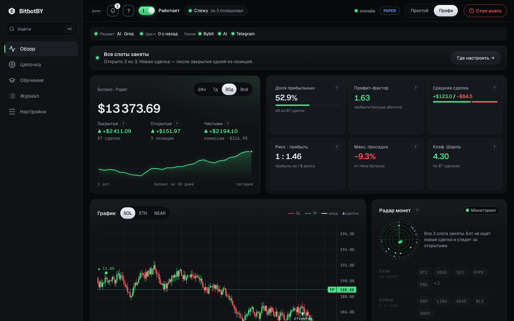
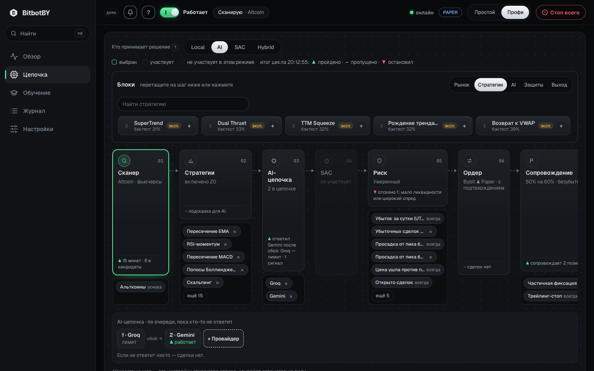
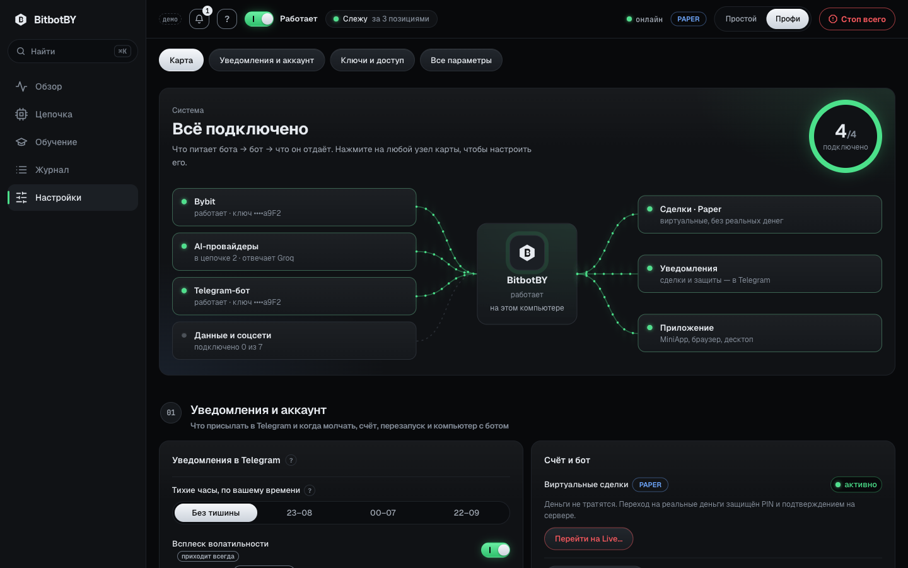
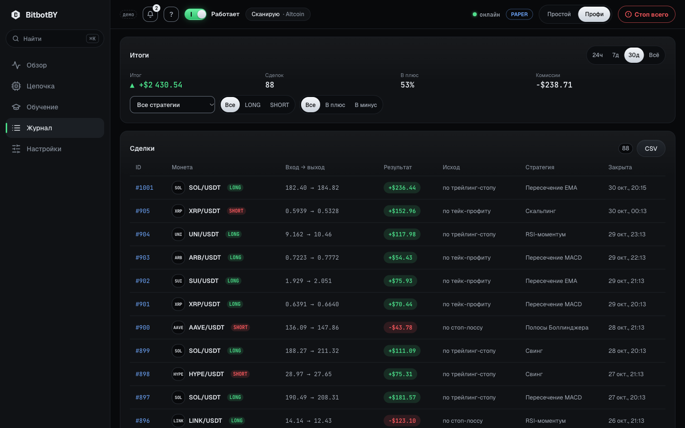
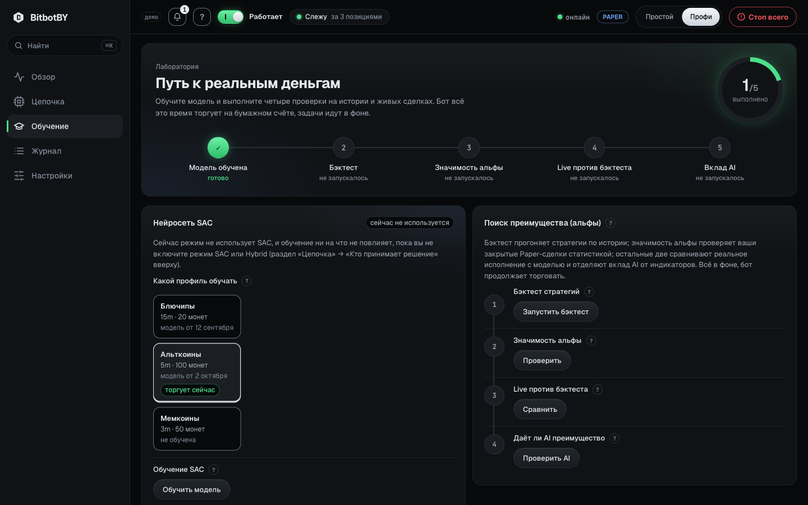

<div align="center">



# 🤖 BitbotBY

### Торговый бот для Bybit с понятным приложением

Стратегии · цепочка AI-провайдеров · нейросеть SAC · приложение в Telegram, браузере и на компьютере

[](https://www.python.org/)
[](https://www.docker.com/)
[](#-для-разработчиков)
[](https://www.bybit.com/)
[](LICENSE)

</div>

---

BitbotBY следит за рынком Bybit, ищет сделки и сам их ведёт: ставит стоп-лосс и тейк-профит, подтягивает стоп,
фиксирует часть прибыли. Решать может набор локальных стратегий (бесплатно, без ключей), языковая модель (AI),
обученная нейросеть SAC или их сочетание. Всем управляет одно приложение; Telegram присылает уведомления с кнопкой
«Открыть в приложении».

Три профиля монет: **Блючипы** (топ-20), **Альткоины** (топ-100), **Мемкоины** (памп-сигналы и соцсети).

> **Честно.** Бот стартует на **бумажном счёте** (paper): сделки виртуальные, рынок настоящий. На бэктесте
> (BTC/USDT, 15 минут, 6 месяцев) ни одна стратегия пока не показала статистически значимого преимущества.
> Поэтому реальные деньги — только после [проверок](#-перед-реальными-деньгами).

---

## 📸 Приложение

<p align="center">
  
</p>

<table>
  <tr>
    <td width="50%" valign="top"><br><b>Цепочка</b> (Профи) — шаги решения и все настройки</td>
    <td width="50%" valign="top"><br><b>Настройки</b> — что подключено и куда идёт</td>
  </tr>
  <tr>
    <td valign="top"><br><b>История</b> — сделки, итоги, лучшие часы</td>
    <td valign="top"><br><b>Обучение</b> (Профи) — модель и проверки</td>
  </tr>
</table>

<p align="center"><sub>Скриншоты сняты в демо-режиме (<code>/app/?mock</code>) — это не результаты торговли.</sub></p>

---

## 🚀 Как запустить

Нужны [Docker Desktop](https://www.docker.com/products/docker-desktop/) и Python 3. Двойной щелчок по
`BitbotBY.command` (macOS) или `BitbotBY.bat` (Windows) — или из терминала в папке проекта:

```bash
./bitbot start
```

- Первый запуск собирает всё нужное (5–15 минут) и сам открывает приложение.
- Ключи для начала не нужны: бот стартует на бумажном счёте и решает локальными стратегиями.
- Ключи Bybit, AI и Telegram вводятся в приложении: **Настройки → Ключи и доступ**. Хранятся только
  зашифрованными.
- Остановить — `./bitbot stop`. Проверить, всё ли готово, — `./bitbot check`. Все команды — `./bitbot help`.

**С телефона:** `./bitbot phone on` — в Telegram появится кнопка приложения (нужен `cloudflared`).
**На сервере:** `./bitbot server --domain=bot.example.com` — бот, приложение и HTTPS одной командой, подробности в
[docs/DEPLOY_SERVER.md](docs/DEPLOY_SERVER.md).

---

## 📲 Как пользоваться

В шапке приложения переключатель **Простой / Профи**. Настройки бота он не меняет — только то, сколько видно.

**Простой** — для повседневного использования:

| Вкладка | Что там |
|---|---|
| **Главная** | Работает ли бот и кто сейчас решает (если AI не отвечает — видно сразу и почему), баланс и результат, путь к реальным деньгам одной полосой, график, радар монет, открытые позиции с кнопками «закрыть / стоп / трейлинг / 50%» и объяснением «почему открыта» |
| **Бот** | Что торговать, сколько рисковать (три готовых варианта), кто решает (стратегии или стратегии + AI), защита — и список защит словами: работает, только наблюдает или выключено |
| **История** | Закрытые сделки, итоги, лучшие и худшие часы входа |
| **Настройки** | Подключения, уведомления и тихие часы, ключи, основные параметры |

**Профи** добавляет:

- **Цепочку** — конвейер решения из семи шагов (скан → стратегии → AI → SAC → риск → ордер → сопровождение) с
  настройками каждого шага: стратегии, AI-провайдеры по порядку, правила защиты, выход из сделки.
- **Обучение** — нейросеть SAC по профилю: обучение, **допуск к торговле** (модель не торгует, пока вы её не
  допустите; новое обучение снимает допуск), откат; бэктест, значимость альфы, «live против бэктеста», вклад AI;
  счётчик сделок для будущей **мета-модели**.
- **Все параметры** — поиск, история изменений, сброс.

Ещё: «Отменить» после любой правки, поиск по приложению (`Ctrl/⌘ K`), кнопка **PANIC** (удержать секунду —
закрыть всё и поставить на паузу), мастер первого запуска.

---

## 🧠 Как бот решает

Каждые несколько минут бот проходит цикл: берёт монеты профиля, проверяет защиты портфеля, собирает сигналы,
выбирает лучшую рекомендацию и открывает сделку, если она прошла все проверки. Сразу после входа на бирже
выставляются стоп-лосс и тейк-профит — позиция защищена, даже если бот упадёт.

| Кто решает | Как |
|---|---|
| **Только стратегии** | 20 основных стратегий на индикаторах (ещё 49 экспериментальных выключены); побеждает самая уверенная |
| **Стратегии + AI** | Языковая модель оценивает вероятности, и каждый её прогноз потом сверяется с ценой — **табло честности** показывает, лучше ли провайдер монетки; тот, кто не лучше, сделки не открывает. Провайдеры идут по очереди: не ответил один — спрашиваем следующего; не ответил никто — решают стратегии |
| **SAC** | Обученная нейросеть; торгует только после вашего допуска |
| **Hybrid** | SAC и AI должны согласиться |

**Защиты:** риск на сделку, лимит позиций, дневной лимит убытка, остановка при серии убытков и большой просадке,
пауза вокруг новостей ФРС и инфляции, меньший размер при просадке, частичная фиксация прибыли, отключение плохой
стратегии, нет входа по устаревшим данным, сверка позиций с биржей.

Подробно, от свечи до стоп-лосса на бирже, — в [docs/ARCHITECTURE.md](docs/ARCHITECTURE.md). Термины — в
[docs/GLOSSARY.md](docs/GLOSSARY.md).

---

## 🔐 Безопасность

- Ключи хранятся **только зашифрованными** в `data/secrets.enc.json`; приложение показывает последние 4 символа и
  никогда не отдаёт ключ обратно. Мастер-ключ создаётся сам и в git не попадает.
- Ключ Bybit создавайте **без права вывода** и с привязкой к IP — ключи с выводом приложение отклоняет.
- Переход с бумажного счёта на реальный — только кнопкой в приложении с кодовым словом.
- Управлять ботом может только владелец: вход через Telegram или одноразовым кодом.

---

## 📱 Telegram

Уведомления об открытии и закрытии сделок, тревогах риска, итогах задач и сигналах на подтверждение — под каждым
кнопка «Открыть в приложении». `/start` присылает кнопку приложения, `/app` — ссылку входа на компьютере с ботом.
Других команд нет: всё управление — в приложении.

---

## 🎯 Перед реальными деньгами

1. Минимум **2 недели** на бумажном счёте.
2. Обучение → бэктест: переобучение (overfit ratio) меньше 2×.
3. **Значимость альфы**: преимущество должно быть статистически значимым, а не «выглядеть неплохо». Меньше 30–50
   сделок — данных мало, наблюдать дольше.
4. **Live против бэктеста** — если есть подозрение на проскальзывание.
5. Ключ без вывода и с привязкой к IP; начать осторожно: риск 1% на сделку, 2 позиции, плечо 2, дневной лимит 3%.

---

## 🛠 Для разработчиков

```bash
python3.11 -m venv .venv && source .venv/bin/activate
pip install -e "backend[dev]"
./bitbot start --native --paper   # без Docker: нужен Redis, приложение — http://localhost:8080/app/
./bitbot test                     # тесты backend и приложения
./bitbot lint                     # ruff, black, слои импортов, mypy, типы приложения
```

```
backend/bitbot/   Python-пакет, разложен по слоям (контракт import-linter, исключений нет)
frontend/         приложение: React + Vite, десктоп-оболочка Tauri в frontend/desktop/
cli/, ./bitbot    единая команда запуска, задач и проверок
docs/             архитектура, настройки, словарь, что делать при сбоях
```

| Документ | О чём |
|---|---|
| [docs/ARCHITECTURE.md](docs/ARCHITECTURE.md) | Процессы, слои, цикл, как рождается сделка |
| [docs/CONFIGURATION.md](docs/CONFIGURATION.md) | Все настройки и флаги поведения (paper / live) |
| [docs/GLOSSARY.md](docs/GLOSSARY.md) | Словарь: режимы, профили, слоты, флаги |
| [docs/RUNBOOK.md](docs/RUNBOOK.md) | Что делать, когда что-то пошло не так |
| [docs/DEPLOY_SERVER.md](docs/DEPLOY_SERVER.md) | Сервер: установка, обновление, безопасность |
| [docs/architecture/](docs/architecture/) | Потоки данных, решение, отказы, жизненный цикл модели |
| [frontend/DESIGN.md](frontend/DESIGN.md) | Дизайн-система приложения |

Поведение торговой логики охраняет **golden replay** (`backend/tests/replay/`): индикаторы, все стратегии,
комбайнер и paper-позиции сверяются с эталоном.

---

## 📄 Лицензия

[MIT](LICENSE).

## ⚠️ Отказ от ответственности

Торговля криптовалютой сопряжена с высоким риском потери средств. Бот не является финансовым советником.
Используйте на свой риск и начинайте с бумажного счёта.
