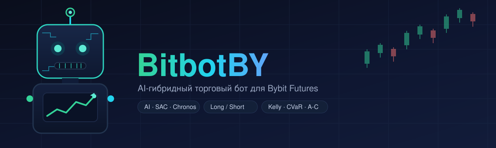
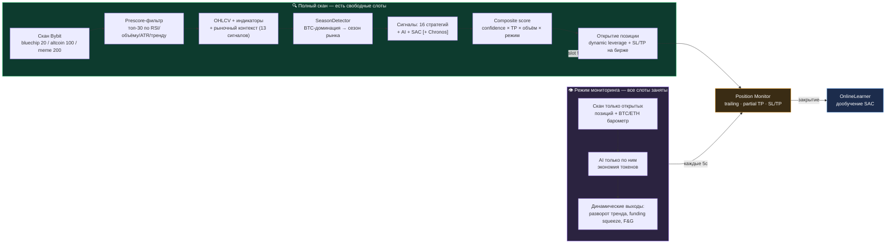

<div align="center">



# 🤖 BitbotBY

### AI-гибридный торговый бот для Bybit Futures

Claude / DeepSeek / OpenAI / Groq / Gemini · SAC (RL) · Amazon Chronos · 10+ рыночных сигналов в реальном времени

[](https://www.python.org/)
[](https://fastapi.tiangolo.com/)
[](https://www.docker.com/)
[](#-тесты)
[](#-тесты)
[](https://www.bybit.com/)
[](LICENSE)

🌐 **Русский** · [English](README.en.md) · [中文](README.zh.md) · [Español](README.es.md) · [Deutsch](README.de.md)

</div>

---

BitbotBY сканирует рынок Bybit, сводит сигналы AI-модели, SAC-нейросети и 16 классических стратегий с
рыночным контекстом (funding, ликвидации, Fear & Greed, ордербук, деривативы, сентимент соцсетей) и
торгует perpetual-фьючерсами long/short — с квант-риск-менеджментом (Kelly, CVaR, Almgren-Chriss) и
полным управлением через Telegram.

Три рыночных профиля под разную волатильность: **Bluechip** (топ-20), **Altcoin** (топ-100),
**Meme** (топ-200, памп-стратегии + Twitter/Telegram сентимент).

> ⚠️ Торговля с реальными деньгами. Всегда начинайте с `PAPER_TRADING=true` и пройдите
> [чек-лист перед реальной торговлей](#-перед-реальной-торговлей).

---

## Содержание

- [Как это работает](#-как-это-работает)
- [Архитектура](#-архитектура)
- [Возможности](#-возможности)
- [Быстрый старт](#-быстрый-старт)
- [Конфигурация](#-конфигурация)
- [Справочник .env — все переменные](#-справочник-env--все-переменные)
- [Управление через Telegram](#-управление-через-telegram)
- [Мониторинг](#-мониторинг)
- [Обучение SAC-модели](#-обучение-sac-модели)
- [Бэктест и валидация альфы](#-бэктест-и-валидация-альфы)
- [Makefile команды](#-makefile-команды)
- [Тесты](#-тесты)
- [FAQ](#-faq)
- [Перед реальной торговлей](#-перед-реальной-торговлей)

---

## 🔄 Как это работает

Цикл адаптируется к состоянию портфеля: **полный скан** рынка, когда есть свободные слоты,
и лёгкий **режим мониторинга**, когда все позиции заняты (экономия AI-токенов в 5–33×).



<details>
<summary><b>Полная цепочка принятия решения — 14 шагов с формулами</b> (развернуть)</summary>

| # | Шаг | Что делает |
|---|---|---|
| 1 | **Снэпшоты** ([cycle.py](src/cycle.py)) | OHLCV → индикаторы (RSI/MACD/BB/ATR/тренд) + новостной сентимент на монету |
| 2 | **Prescore** | `score = vol×0.35 + rsi×0.30 + atr×0.20 + regime_bonus×0.15` → топ-30 в AI |
| 3 | **Рыночный контекст** ([market_context.py](src/market_context.py)) | 13 сигналов: funding, OI+ликвидации, F&G, basis, orderbook, Deribit PCR/IV, Google Trends, Glassnode, ETF flows, Reddit (CryptoBERT), stablecoin supply |
| 4 | **SignalCombiner** ([signal_combiner.py](src/signal_combiner.py)) | `local` / `ai` / `dqn` / **`hybrid`** (SAC+AI согласие, вес зависит от режима: trending 50/50, ranging 40/60) / **`hybrid+Chronos`** (±0.05…0.15 модификатор) |
| 5 | **Контекстный фильтр** | Каждый из 13 сигналов двигает confidence на ±0.05…0.15 (напр. F&G ≤15 + каскад ликвидаций → confidence = 0) |
| 6 | **Прямые контекстные сигналы** | Экстремумы (funding overheated, squeeze, imbalance >0.4, F&G ≤10/≥92) генерируют отдельные сигналы |
| 7 | **Локальный fallback** | Если сигналов нет — индикаторная стратегия, TP шире в тренде, уже в боковике |
| 8 | **Приоритизация** | `composite_score = confidence × (1+tp_bonus) × (1+volume_bonus) × regime_mult` |
| 9 | **Portfolio allocation** | CVaR/Markowitz ([portfolio_optimizer.py](src/portfolio_optimizer.py)) при ≥2 сигналах, cap ×3 |
| 10 | **Execution guards** ([order_executor.py](src/order_executor.py)) | macro blackout → слоты/cooldown → торговые часы → дубликат символа → **correlation guard** → подтверждение в Telegram → **liquidity filter** → валидация SL/TP → **Kelly sizing** → drawdown scaling → **Almgren-Chriss** → dynamic leverage → ордер |
| 11 | **После открытия** | PositionMonitor каждые 5с: те же 13 сигналов контекста управляют выходом (force_close / tighten_sl) |

**Что реально отличается по профилям** (не только параметры): Meme — единственный профиль с
Twitter/Telegram сентиментом как входом и стратегиями `momentum_burst`/`pump_exit`/`sentiment`.
BTC ETF flows применяются только к BTC/USDT. Остальная логика (contrarian funding/PCR/FNG, Kelly,
correlation guard, Almgren-Chriss) идентична во всех профилях — различаются только цифры.

</details>

---

## 🏗 Архитектура

```mermaid
flowchart TB
    SUP["supervisor.py\nrestart on crash · SIGTERM"] --> BOT["TradingBot\nsrc/trading_bot.py"]

    subgraph DATA["Данные и сигналы"]
        SCAN["MarketScanner"]
        DL["DataLoader\nccxt async · CSV cache 24ч"]
        REGIME["RegimeDetector\nGaussianHMM"]
        CTX["MarketContext\n10+ источников, TTL 5–240мин"]
        NEWS["NewsAnalyzer\nNewsAPI + RSS + VADER"]
        TW["TwitterAnalyzer\nMeme профиль"]
        TG["TelegramSentiment\nTelethon MTProto"]
        POLL["SentimentPoller\nasyncio → Redis"]
    end

    subgraph BRAIN["Принятие решений"]
        COMBINER["SignalCombiner\nSAC + AI [+Chronos]"]
        CHRONOS["ChronosAnalyzer\namazon/chronos-t5-small"]
        CRYPTOBERT["CryptoSentimentAnalyzer\nElKulako/cryptobert"]
        PORT["PortfolioOptimizer\nCVaR / Markowitz"]
        CORR["CorrelationFilter"]
        MACRO["MacroCalendar\nFOMC/CPI/NFP blackout"]
        ARB["FundingArbDetector"]
    end

    subgraph EXEC["Исполнение"]
        OE["OrderExecutor\nKelly → CVaR → Almgren-Chriss"]
        PM["PositionMonitor\nSL/TP · trailing · partial TP"]
        API["BybitAPI\nccxt async, linear+spot"]
        LEARN["OnlineLearner\nSAC auto-retrain"]
    end

    subgraph OUT["Наблюдаемость"]
        NOTIFY["TelegramNotifier"]
        HIST["TradeHistory\nSQLite"]
        HEALTH["HealthServer\n/health /metrics"]
    end

    BOT --> SCAN & DL & REGIME & CTX
    CTX --> NEWS & TW & TG & POLL
    BOT --> COMBINER
    COMBINER --> CHRONOS & CRYPTOBERT
    BOT --> PORT & CORR & MACRO & ARB
    BOT --> OE --> API
    OE --> PM --> LEARN
    BOT --> NOTIFY & HIST & HEALTH

    style SUP fill:#1c1c1c,stroke:#888,color:#fff
    style BOT fill:#0d3b2e,stroke:#2ecc71,color:#fff
    style DATA fill:#16213e,stroke:#4a90e2,color:#fff
    style BRAIN fill:#2b2340,stroke:#9b6bff,color:#fff
    style EXEC fill:#3a2c14,stroke:#f39c12,color:#fff
    style OUT fill:#3a1414,stroke:#e74c3c,color:#fff
```



**RL / бэктест:**

```
reinforcement_learning/
  ├── rl_env.py      — TradingEnv (Gymnasium), OBS_DIM=21, exec по open[i+1]
  ├── train_sac.py   — SAC: 80/20 split, Optuna, walk-forward, online finetune
  └── tune_sac.py     — Optuna hyperparameter search

backtest.py    — walk-forward с holdout 20%, overfit ratio
dashboard.py   — FastAPI :8080 (баланс, позиции, история)
```

---

## ✨ Возможности

### 📡 Рыночный Edge — сигналы реального времени

| Источник | Логика | Профиль |
|---|---|---|
| **Funding Rate** (Bybit) | >0.1% = лонги перегреты → SHORT contrarian | все |
| **Open Interest + цена** | OI↓ + цена↓ → ликвидация лонгов | все |
| **Fear & Greed** | ≤15 контрарный BUY (если нет каскада), ≥85 гасит BUY | все |
| **Orderbook Imbalance** | ask/bid > 1.4 → SELL | все |
| **Basis (futures-spot)** | >2% премия = жадность → SELL | все |
| **Deribit PCR + IV Skew** | PCR <0.5 = all-in calls → SELL | все |
| **ETF Flows** (farside.co.uk) | Outflow < −$100M → SELL, Inflow > $150M → BUY | только BTC |
| **Google Trends** | >75 = retail FOMO пик → SELL | все |
| **Reddit / CryptoBERT** | NLP-классификация постов r/CryptoCurrency | все |
| **News sentiment** | NewsAPI/RSS + Claude/DeepSeek/VADER | все |
| **Twitter/X** | VADER, Basic API ~10K твитов/мес | только Meme |
| **Telegram памп-каналы** | Telethon MTProto, вес 2× в score | только Meme |
| **Stablecoin Supply** | USDT market cap ↓ → риск оттока | фильтр |

Все источники кэшированы (5 мин — 4 часа) и gracefully degradируют при недоступности.

### 🧠 Стратегии и модели

- **10 базовых стратегий**: EMA crossover, RSI, MACD, Bollinger Bands, Scalping, Swing, Breakout, Mean Reversion, Trend Following, Volume Spike
- **6 профильных стратегий**: активируются автоматически при смене профиля (`momentum_burst`, `pump_exit`, `sentiment` — Meme; и др.)
- **AI-анализ**: Claude / DeepSeek / OpenAI / Groq / Gemini с fallback-цепочкой
- **SAC (Soft Actor-Critic)** — RL-модель, обучается на истории, дообучается онлайн после каждой сделки
- **Amazon Chronos** — предобученная time-series модель, мягкий модификатор confidence в hybrid-режиме

### 📐 Квант-инструменты

| Инструмент | Где применяется |
|---|---|
| **Kelly Criterion** (half-Kelly) | Sizing позиции по live win-rate/EV стратегии |
| **CVaR / Markowitz** | Portfolio allocation при нескольких одновременных сигналах |
| **Almgren-Chriss** | Поправка entry-цены на market impact от размера ордера |
| **GaussianHMM** | Определение режима рынка (trending/ranging) per-symbol |
| **Correlation guard** | Блокирует новую позицию, коррелирующую с открытой |

### 🛡 Риск-менеджмент

Macro blackout (FOMC/CPI/NFP) · Correlation filter · Liquidity filter (spread/объём) ·
Circuit breaker и дневной лимит убытков · **Hard drawdown halt** (закрытие убыточных, SL в breakeven
на прибыльных, блокировка входов) · **ATR spike protection** (закрытие всех позиций, пауза 1ч) ·
Dynamic leverage (fixed/volatility/full, ATR-based) · Trailing stop + partial TP.

---

## 🚀 Быстрый старт

### Требования

Python 3.11 · Docker + Docker Compose (рекомендуется) · API-ключи Bybit · один AI-провайдер · Telegram-бот

### Запуск через Docker (рекомендуется)

```bash
git clone https://github.com/deuteriumZzz/BitbotBY.git
cd BitbotBY
cp .env.example .env        # заполнить ключи — см. раздел «Конфигурация»
make setup                  # первый запуск: сборка, htpasswd, docker compose up
```

### Локальный запуск

```bash
python -m venv venv && source venv/bin/activate   # Windows: venv\Scripts\activate
pip install -r requirements.txt
cp .env.example .env
python supervisor.py
```

### Минимальный `.env` для paper trading

```env
BYBIT_API_KEY=...
BYBIT_API_SECRET=...
BYBIT_TESTNET=false
MARKET_TYPE=linear

AI_PROVIDER=deepseek         # или claude / openai / groq / gemini
DEEPSEEK_API_KEY=...

TELEGRAM_BOT_TOKEN=...
TELEGRAM_CHAT_ID=...          # числовой ID из @userinfobot, не username

PAPER_TRADING=true
AUTO_EXECUTE=false
MODE=hybrid
```

---

## ⚙️ Конфигурация

Полный список переменных с описанием — в [`.env.example`](.env.example) (комментарии на русском ко
всем секциям: Bybit API, AI-провайдер, режим торговли, Telegram, торговые параметры, управление
позициями, риск-менеджмент, macro blackout, онлайн-обучение SAC, внешние сигналы, мониторинг).

| Категория | Ключевые переменные |
|---|---|
| Биржа | `BYBIT_API_KEY/SECRET`, `MARKET_TYPE`, `BYBIT_TESTNET` |
| AI | `AI_PROVIDER`, `<PROVIDER>_API_KEY`, `AI_DAILY_BUDGET`, `AI_MAX_SYMBOLS` |
| Режим | `MODE` (`local`/`ai`/`dqn`/`hybrid`), `PAPER_TRADING`, `AUTO_EXECUTE` |
| Профиль | `MARKET_PROFILE` (`bluechip`/`altcoin`/`meme`) |
| Позиции | `MAX_POSITIONS` (1–20), `RISK_PER_TRADE`, `LEVERAGE`, `LEVERAGE_MODE` |
| Риск | `DAILY_LOSS_LIMIT`, `DRAWDOWN_HALT_HOURS`, `MAX_CORRELATION`, `MAX_SPREAD_PCT` |
| Telegram | `TELEGRAM_BOT_TOKEN`, `TELEGRAM_CHAT_ID`, `TELEGRAM_CONFIRM_TIMEOUT` |
| Инфра | `REDIS_HOST/PASSWORD`, `DASHBOARD_USER/PASSWORD` |

Большинство параметров (режим, стратегии, риск-профиль, часы торговли, число позиций) меняются
**прямо из Telegram-меню без перезапуска** — хранятся в Redis с AOF-персистентностью.

---

## 📋 Справочник .env — все переменные

Построчное описание каждой переменной. Разворачивай нужную категорию.

<details>
<summary><b>🔑 Bybit API</b></summary>

```env
BYBIT_API_KEY=           # Получить: bybit.com → Account → API Management
BYBIT_API_SECRET=        # ⚠ Никогда не публиковать, не коммитить в git

TESTNET=false            # true → торговать на testnet.bybit.com (без реальных денег)
                         # Ключи testnet создаются отдельно от production!

MARKET_TYPE=linear       # linear → perpetual futures (РЕКОМЕНДУЕТСЯ, дефолт при старте)
                         #   + Умеет открывать SHORT позиции
                         #   + Есть funding rate (дополнительный сигнал)
                         #   + Плечо до 100x (мы ставим max=3)
                         # spot → только LONG, нет шорта, нет плеча
                         # Это только стартовое значение при первом запуске —
                         # дальше режим переключается на лету через Telegram
                         # (💱 Рынок в Настройках), без правки .env и рестарта.

LEVERAGE=3               # МАКСИМАЛЬНОЕ плечо. Бот рассчитывает динамически от 1 до LEVERAGE.
                         # Рекомендуется: 2–3 для старта. Не ставить >5 пока нет статистики.
                         # LEVERAGE=1 = торговля без плеча (как спот, но на фьючерсах)
```

> **Права API ключей:** для futures — `Contract — Orders` и `Contract — Positions`. Если планируете
> когда-либо переключаться на spot через Telegram — включите также `Spot — Trade` сразу, оба
> права спокойно живут на одном ключе. Право на вывод средств — **НЕ включать**.

</details>

<details>
<summary><b>🧠 AI-провайдер</b></summary>

```env
AI_PROVIDER=auto         # auto      → пробует Claude → OpenAI → DeepSeek → Groq → Gemini → локальные стратегии
                         # anthropic → только Claude
                         # deepseek  → только DeepSeek
                         # groq      → только Groq (Llama 3.3 70B, самый быстрый)
                         # openai    → только ChatGPT
                         # gemini    → только Google Gemini Flash

# ── Groq — БЕСПЛАТНЫЙ тир, 100k токенов/день, Llama 3.3 70B ──
# console.groq.com → API Keys → Create
GROQ_API_KEY=gsk_...
GROQ_MODEL=llama-3.3-70b-versatile

# ── Google Gemini Flash — БЕСПЛАТНЫЙ тир, 1500 запросов/день ──
# aistudio.google.com → Get API Key (бесплатно, без карты)
GEMINI_API_KEY=...
GEMINI_MODEL=gemini-2.0-flash-lite

# ── DeepSeek — САМЫЙ ДЕШЁВЫЙ (~$0.002 за запрос) ──
# platform.deepseek.com → API Keys → Create
DEEPSEEK_API_KEY=sk-...
DEEPSEEK_MODEL=deepseek-chat

# ── Claude (Anthropic) — лучшее качество анализа ──
# console.anthropic.com → API Keys → Create Key
ANTHROPIC_API_KEY=sk-ant-...
AI_MODEL=claude-sonnet-4-6

# ── ChatGPT (OpenAI) ──
# platform.openai.com → API Keys
OPENAI_API_KEY=sk-...
OPENAI_MODEL=gpt-4o-mini

AI_DAILY_BUDGET=500      # Лимит AI-вызовов в сутки (UTC). Сверх лимита → локальные стратегии.
                         # Bluechip: 96 запросов/день. Altcoin: 288 запросов/день.
```

> **Совет для старта (бесплатно):** добавь Groq + Gemini — хватает на весь день для обоих профилей.
> Для лучшего качества дополнительно пополни DeepSeek на $5 (~9–26 дней торговли).

**Цепочка надёжности — бот не останавливается никогда:**

```
Claude (Anthropic) — лучшее качество, платный
    ↓ нет баланса → уведомление в Telegram
OpenAI GPT-4o-mini — хорошее качество, платный
    ↓ нет баланса → уведомление в Telegram
DeepSeek — хорошее качество, самый дешёвый, ~$5 на 9–26 дней
    ↓ нет баланса → уведомление в Telegram
Groq + Gemini — бесплатные, хватает на весь день
    ↓ исчерпались к концу дня → уведомление с обратным отсчётом до сброса
Локальные стратегии — 10 базовых + до 4 профильных стратегий без AI, всегда работают
```

Настроены только те провайдеры, у которых есть ключ в `.env`. Реальный порядок и статус каждого —
в Telegram: ⚙️ Настройки → 🤖 AI-провайдер.

| Провайдер | Стоимость | Качество | Лимит |
|---|---|---|---|
| DeepSeek | ~$5 на 9–26 дней | Хорошее | по балансу |
| Groq (Llama 3.3 70B) | бесплатно | Хорошее | 100k токенов/день |
| Gemini 2.0 Flash | бесплатно | Хорошее | 1500 запросов/день |
| Claude Sonnet | ~$0.01/запрос | Отличное | по балансу |
| OpenAI GPT-4o-mini | ~$0.003/запрос | Хорошее | по балансу |

</details>

<details>
<summary><b>🔀 Режим торговли</b></summary>

```env
MODE=ai                  # ai     → AI анализирует каждую монету и генерирует сигнал
                         # local  → только базовые стратегии (10+профильные), без AI (бесплатно)
                         # dqn    → только SAC нейросеть (нужна обученная модель)
                         # hybrid → SAC + AI должны согласиться (самый консервативный)

AUTO_EXECUTE=false       # false → бот присылает сигнал с кнопками и таймером.
                         #         Авто-исполнение по истечении таймаута.
                         #         Нажми Skip чтобы отменить конкретную сделку.
                         # true  → бот торгует сразу, без диалога. Приходит уведомление о факте.
                         # Рекомендуется: начать с false (2 недели), потом включить true

PAPER_TRADING=true       # true  → симуляция, реальных ордеров НЕТ (для старта)
                         # false → реальная торговля (только после проверки сигналов!)
                         # Переключение в реальном времени через Telegram:
                         # ⚙️ Настройки → 📄 Режим: PAPER → Live (требует кодовое слово)

TRADING_MODE_PIN=        # Кодовое слово для переключения Paper ↔ Live через Telegram.
                         # Оставить пустым — кнопка переключения не показывается.
                         # Пример: TRADING_MODE_PIN=mysecret2024
                         # После ввода слова бот отправляет уведомление 🚨 ВАЖНО!

SCAN_TOP_N=20            # Сколько монет сканировать (топ по объёму за 24ч).
                         # Больше = больше возможностей, но больше API-запросов.

MAX_POSITIONS=3          # Начальное значение (1–20). Меняется в реальном времени
                         # через Telegram: ⚖️ Риск-профиль → ➖ / ➕.
                         # В paper режиме рекомендуется 10–15 для быстрого обучения SAC.
```

</details>

<details>
<summary><b>💬 Telegram</b></summary>

```env
TELEGRAM_BOT_TOKEN=      # Шаг 1: написать @BotFather → /newbot → скопировать токен
                         # Формат: 1234567890:ABCdefGHI...

TELEGRAM_CHAT_ID=        # Шаг 2: написать @userinfobot → скопировать "Your ID"
                         # ⚠ ВАЖНО: это ВАШ числовой ID, не ID бота.
                         # Формат: 123456789 (только цифры, без @)

TELEGRAM_CONFIRM_TIMEOUT=60   # Секунд ждать ответа на кнопки Trade/Skip (при AUTO_EXECUTE=false).
                               # По истечении → авто-исполняет сделку.
                               # Менять без перезапуска: ⚙️ Настройки → ⏱ Таймаут подтверждения

SILENT_DEATH_HOURS=6.0   # Алерт в Telegram если нет ни одной сделки за N часов.
                         # Помогает вовремя заметить зависание бота. 0 = выключен.
```

</details>

<details>
<summary><b>📈 Торговые параметры</b></summary>

```env
TIMEFRAME=15m            # Таймфрейм свечей для стратегий.
                         # 15m — хороший баланс. Варианты: 1m (шумно), 5m, 15m, 1h, 4h.

INITIAL_BALANCE=10000.0  # Начальный баланс для paper trading (для расчётов и отображения).
                         # В реальной торговле бот берёт баланс с биржи автоматически.

RISK_PER_TRADE=0.02      # Риск на одну сделку как доля баланса.
                         # 0.02 = 2% баланса. При $10k → рискуем $200 на сделку.
                         # Рекомендуется: 0.01 для старта, потом 0.02.

MIN_SIGNAL_CONFIDENCE=0.75        # Минимальная уверенность сигнала в live режиме (0–1).
                                  # Повысить до 0.80–0.85 для более консервативной торговли.
MIN_SIGNAL_CONFIDENCE_PAPER=0.60  # Порог для paper режима — ниже, чтобы накопить больше
                                  # сделок для обучения SAC. Меняется через Telegram без
                                  # перезапуска: ⚖️ Риск-профиль → 🎯 Paper ▼/▲.

TRADING_INTERVAL=60      # Fallback-интервал цикла в секундах (без профиля).
                         # При активном профиле используется интервал из профиля:
                         # bluechip → 900с (15 мин), altcoin → 300с (5 мин).
```

</details>

<details>
<summary><b>🎯 Управление позициями</b></summary>

```env
# ── Частичная фиксация прибыли ──────────────────────────────────────────
PARTIAL_TP_ENABLED=true  # При достижении 60% пути до TP:
                         # 1. Закрывает 50% позиции (фиксирует часть прибыли)
                         # 2. Переносит SL на breakeven (остаток торгуется без риска)
PARTIAL_TP_TRIGGER=0.6   # Доля пути entry→TP для срабатывания. 0.6 = 60%.
PARTIAL_TP_FRACTION=0.5  # Какую долю позиции закрыть. 0.5 = 50%.

# ── Trailing stop ────────────────────────────────────────────────────────
TRAILING_STOP_ATR_MULT=1.0   # SL подтягивается за ценой с шагом 1×ATR.
                              # 0.5 = тесный стоп (больше срабатываний).
                              # 1.5 = широкий стоп (меньше срабатываний, больше просадка).

# ── Drawdown scaling ─────────────────────────────────────────────────────
DRAWDOWN_SCALE_ENABLED=true       # При просадке от пика — уменьшить размер позиций.
DRAWDOWN_SCALE_THRESHOLD=0.10     # Порог: 0.10 = при просадке >10% от пика баланса.
DRAWDOWN_SCALE_FACTOR=0.5         # Множитель размера при просадке: 0.5 = торговать вдвое меньше.
                                  # Пример: баланс был $10k, упал до $9k → позиции ×0.5.

# ── Фильтр ликвидности ───────────────────────────────────────────────────
MIN_VOLUME_USDT=1000000  # Минимальный объём монеты за 24ч в USDT.
                         # $1M = только ликвидные монеты. Ниже → риск манипуляций.
MAX_SPREAD_PCT=0.3       # Максимальный спред bid/ask в %.
                         # 0.3% = на входе и выходе теряем не более 0.3%.

# ── Cooldown (защита от оверtrading) ─────────────────────────────────────
SYMBOL_COOLDOWN_HOURS=3  # Не переоткрывать один и тот же символ N часов после закрытия.
                         # Защищает от ситуации когда бот многократно заходит в один токен
                         # после быстрых SL (например 7 раз в TAC/USDT за один день).
                         # 0 = выключен. Рекомендуется: 2–4 часа.

# ── Торговые часы ────────────────────────────────────────────────────────
TRADING_HOURS=           # Пусто = торговать круглосуточно (РЕКОМЕНДУЕТСЯ для крипты).
                         # "8-22" = только с 8:00 до 22:00 UTC.
                         # Не рекомендуется: крипта активна 24/7, ночные движения реальные.
```

</details>

<details>
<summary><b>🛡 Риск-менеджмент</b></summary>

```env
DAILY_LOSS_LIMIT=0.05    # Дневной лимит убытка: 0.05 = 5% баланса.
                         # При превышении → все позиции закрываются, торговля до UTC-дня.
                         # Рекомендуется: 0.03 для старта, потом 0.05.

# ── Black swan / аварийные стоп-краны ────────────────────────────────────
MAX_DRAWDOWN_PERCENT=0.20     # Hard drawdown halt: просадка equity от пика ≥ 20%.
                               # Equity = баланс + unrealized PnL (точнее чем free USDT).
                               # При срабатывании: все позиции закрыть → пауза N часов.

DRAWDOWN_HALT_HOURS=4          # Пауза в часах после срабатывания hard drawdown halt.

DRAWDOWN_CONFIRM_CYCLES=3      # Flash-защита: halt только после N подтверждений подряд.
                               # 1 цикл ≈ 30с. 3 = сработает через ~90с устойчивой просадки.
                               # Flash crash (восстановился за секунды) не триггернёт.
                               # Меняется без перезапуска: Telegram → ⚖️ Риск-профиль → 🛡 Flash-защита ±

ATR_SPIKE_MULT=3.0             # ATR spike: текущий ATR в N× выше среднего → закрыть позиции.
                               # 3.0 = только экстремальная волатильность (война, крах).

ATR_SPIKE_LOOKBACK=20          # Окно для расчёта среднего ATR (в свечах).

CIRCUIT_BREAKER_LOSSES=3 # Автостоп после N убыточных сделок подряд.
                         # 3 = три стопа подряд → бот останавливается до ручного перезапуска.
                         # 0 = выключен. Рекомендуется: 3–5.

MAX_CORRELATION=0.7      # Блокировать сигнал если |корреляция| с открытой позицией ≥ порога.
                         # 0.7 = не откроем ETH long если уже держим BTC long.
                         # 0.0 = фильтр выключен. Рекомендуется: 0.7.
MAX_CORRELATION_PAPER=0.85  # Порог корреляции для paper режима.
                         # В боковом рынке крипто коррелирует на 0.70–0.77 —
                         # порог 0.7 блокировал бы почти все входы.
                         # 0.85 позволяет накопить больше сделок для SAC.
CORRELATION_WINDOW=50    # Окно расчёта корреляции в барах (50 × 15m = 12.5 часов).
```

</details>

<details>
<summary><b>📅 Macro blackout</b></summary>

```env
FINNHUB_API_KEY=         # Ключ Finnhub (бесплатный тир): finnhub.io → Dashboard → API Key
                         # Если не задан — macro blackout отключается автоматически.

MACRO_BLACKOUT_ENABLED=true  # Блокировать новые позиции за 30 мин до/после:
                             # FOMC (ставка ФРС), CPI (инфляция), NFP (занятость), GDP, PCE.
                             # Эти события вызывают резкие движения — лучше переждать.
```

</details>

<details>
<summary><b>🎓 Онлайн-обучение SAC</b></summary>

```env
ONLINE_LEARNING_MODE=periodic  # disabled → выключено (SAC не обучается автоматически)
                                # online   → gradient steps после КАЖДОЙ сделки
                                #            ⚠ РИСКОВАННО: серия убытков может испортить модель
                                # periodic → переобучение каждые N сделок в фоне [РЕКОМЕНДУЕТСЯ]
                                # hybrid   → periodic + динамические веса стратегий в реальном времени

ONLINE_LEARNING_TRIGGER=50      # Переобучение каждые 50 закрытых сделок (для periodic/hybrid).
                                # 3 позиции × 10 сделок/день ≈ переобучение каждые ~17 часов.

ONLINE_LEARNING_GRADIENT_STEPS=50  # Шагов градиента за один online-апдейт.
                                    # Только для режима online. Рекомендуется ≤ 50.

TRAIN_TOP_N=20           # Сколько топ-монет по объёму брать для обучения SAC.
                         # Менять не перезапуская — команда Telegram: /trainn 15
                         # При активном профиле переопределяется автоматически:
                         #   bluechip → 20 монет (15m),  altcoin → 50 монет (5m)
TRAIN_MIN_CANDLES=2880   # Минимум свечей для символа при обучении SAC.
                         # 2880 = ~1 месяц 15m-данных. Символы с меньшим количеством
                         # пропускаются — слишком мало истории для обучения.
TOTAL_TIMESTEPS=500000   # Шагов обучения SAC (переопределяется env при make train).
                         # 500k ≈ 60 мин на CPU. 1M = более качественная модель (~2ч).
SAC_MODEL_PATH=models/sac_model.zip  # Путь к файлу SAC-модели.
                                     # Переопределяется профилем:
                                     #   bluechip → models/sac_model.zip
                                     #   altcoin  → models/sac_model_altcoin.zip
```

</details>

<details>
<summary><b>🌐 Внешние сигналы (опционально)</b></summary>

Все ключи опциональны. Без них бот работает, просто без этих источников сигналов.

```env
# Twitter/X sentiment — VADER по твитам монет (активен только при профиле Meme)
# Тариф Basic: $100/мес, ~10 000 твитов/мес. Free-тир READ не поддерживает.
# developer.twitter.com → Projects & Apps → Keys and Tokens → Bearer Token
# Если не задан — TwitterAnalyzer молча возвращает 0.0
TWITTER_BEARER_TOKEN=
TWITTER_MAX_RESULTS=10   # Твитов на запрос (10 = экономия лимита Basic)

# Telegram sentiment — мониторинг публичных памп-каналов (только профиль Meme)
# Бесплатно через Telethon MTProto. Получить: my.telegram.org → API development tools
# Если не задан — TelegramSentiment молча возвращает 0.0
TELEGRAM_SENTIMENT_API_ID=
TELEGRAM_SENTIMENT_API_HASH=
TELEGRAM_SENTIMENT_PHONE=+375291234567   # Формат с кодом страны
TELEGRAM_SENTIMENT_CHANNELS=CryptoMoonAlerts,pumpsignalscrypto,memecoinsnews

# Параметры опросчика (SentimentPoller, активен только при профиле Meme)
SENTIMENT_POLL_INTERVAL=300   # Интервал опроса в секундах (каждые 5 мин)
SENTIMENT_CACHE_TTL=600       # TTL кэша в Redis (10 мин)
SENTIMENT_BUY_THRESHOLD=0.4   # Score ≥0.4 → buy-сигнал
SENTIMENT_SELL_THRESHOLD=-0.4 # Score ≤-0.4 → sell-сигнал

# Reddit sentiment — r/CryptoCurrency
# reddit.com/prefs/apps → create app (тип: script)
REDDIT_CLIENT_ID=
REDDIT_CLIENT_SECRET=
REDDIT_USER_AGENT=BitbotBY/1.0

# Glassnode — on-chain метрики (stablecoin supply и др.)
# glassnode.com → Account → API Access
GLASSNODE_API_KEY=

# NewsAPI — новостной sentiment (CoinDesk, CoinTelegraph)
# newsapi.org → Get API Key (бесплатно)
NEWS_API_KEY=
NEWS_UPDATE_INTERVAL=900   # Обновлять новости каждые 15 минут
```

</details>

<details>
<summary><b>🖥 Мониторинг и инфраструктура</b></summary>

```env
HEALTH_PORT=8080         # Порт HTTP health-сервера:
                         # GET /health  → JSON статус бота
                         # GET /metrics → Prometheus метрики
                         # 0 = выключен

DASHBOARD_API_KEY=       # Опциональный ключ для веб-дашборда.
                         # Если задан → все запросы требуют заголовок: X-API-Key: значение

GRAFANA_PASSWORD=admin   # Пароль Grafana (http://localhost:3000, логин: admin)

REDIS_HOST=localhost     # В Docker автоматически переопределяется на "redis".
REDIS_PORT=6379
REDIS_PASSWORD=          # Рекомендуется задать в production.
```

</details>

---

## 📱 Управление через Telegram

При запуске бот присылает клавиатуру с быстрым доступом к:

- 🌐 **Профиль рынка** — переключение Bluechip / Altcoin / Meme
- ⚙️ **Режим** — Local / AI / DQN / Hybrid (+ Chronos)
- ⚖️ **Риск-профиль** — пороги confidence, флэш-защита (ATR spike / drawdown halt)
- 🎯 **Позиции** — количество слотов, risk per trade, leverage
- 🧠 **Обучение SAC** — запуск дообучения, прогресс, метрики
- 📊 **Статистика** — win rate, EV, история сделок

Подтверждение каждой сделки (если `AUTO_EXECUTE=false`) приходит с live win-rate/EV стратегии и
бэктест-статистикой, таймаут — `TELEGRAM_CONFIRM_TIMEOUT`.

---

## 📊 Мониторинг

| Сервис | URL | Назначение |
|---|---|---|
| **Веб-дашборд** | http://localhost:8080 | Баланс, открытые позиции, история сделок |
| **Grafana** | http://localhost:3000 | Дашборды по метрикам бота |
| **Prometheus** | http://localhost:9090 | Сырые метрики |
| **Health check** | http://localhost:8080/health | Статус для supervisor/оркестрации |
| **Telegram** | — | Сигналы, Trade/Skip, silent death, arb-алерты |

Дашборд закрыт через nginx (HTTP basic auth, `DASHBOARD_USER`/`DASHBOARD_PASSWORD`), не доступен напрямую.

---

## 🎓 Обучение SAC-модели

```bash
make train           # локальное обучение (Optuna + walk-forward)
make train-docker     # то же самое в Docker (~60 мин)
make tune             # только hyperparameter search
```

До завершения обучения используйте `MODE=ai`; переключение на `dqn`/`hybrid` доступно из Telegram без
перезапуска сразу после того, как обучение завершится. `OnlineLearner` дообучает модель автоматически
после каждой закрытой сделки (`periodic`/`hybrid`/`online` режимы).

---

## 🔬 Бэктест и валидация альфы

Порядок важен — каждый шаг проверяет то, что предыдущий не может:

```bash
make backtest          # walk-forward, holdout 20%, overfit ratio (должен быть <2×)
make alpha-report       # bootstrap Sharpe + Wilcoxon — значима ли альфа статистически
make live-divergence    # проскальзывание/задержка исполнения live vs бэктест
make ai-isolation       # даёт ли AI-слой edge поверх голых индикаторов (жжёт AI-квоту)
```

`alpha-report` требует минимум 30–50 сделок на группу, иначе `INSUFFICIENT DATA` — это сигнал
наблюдать дольше, а не считать проверку пройденной.

---

## 🛠 Makefile команды

<details>
<summary>Полный список (развернуть)</summary>

| Команда | Назначение |
|---|---|
| `make setup` | Первый запуск: сборка + htpasswd + docker compose up |
| `make up` / `make down` | Старт / остановка контейнеров |
| `make rebuild` | Полная пересборка (сброс Redis) |
| `make logs` | Логи бота (`./logs.sh`) |
| `make train` / `make train-long` / `make train-docker` | Обучение SAC |
| `make tune` / `make tune-bluechip` / `make tune-altcoin` | Optuna hyperparameter search |
| `make retrain` | Дообучение на новых данных |
| `make backtest` / `make backtest-eth` | Walk-forward бэктест |
| `make alpha-report` | Статистическая значимость альфы |
| `make live-divergence` | Сравнение live vs backtest исполнения |
| `make ai-isolation` | Изоляция вклада AI-слоя |
| `make paper` / `make paper-ai` | Paper trading (local / AI режим) |
| `make live` | Live-торговля |
| `make test` / `make lint` / `make fmt` | pytest / ruff / форматирование |
| `make htpasswd` | Генерация пароля для nginx basic auth |

</details>

---

## ✅ Тесты

```bash
make test
# pytest tests/ -v --cov=src --cov-fail-under=50
```

**1242 unit-теста** — индикаторы, стратегии, риск-менеджмент, CVaR, Kelly, Almgren-Chriss,
корреляция, SAC-инференс, dynamic leverage, partial TP, drawdown scaling, liquidity filter,
dynamic exits, position monitor, online learner, runtime config, e2e торговый цикл. Coverage: **69%**.

---

## ❓ FAQ

<details>
<summary><b>Бот пишет "Top 0 by volume" и не торгует</b></summary><br>

Убедиться что `MARKET_TYPE=linear` в `.env`. Bybit при linear возвращает символы как `BTC/USDT:USDT` —
бот нормализует автоматически. Если ошибка остаётся — проверить `BYBIT_API_KEY`.
</details>

<details>
<summary><b>Telegram не получает сообщения</b></summary><br>

`TELEGRAM_CHAT_ID` должен быть **вашим числовым ID** из @userinfobot, а не ID бота. Написать боту
любое сообщение для активации чата.
</details>

<details>
<summary><b>MODE=dqn или hybrid падает с ошибкой о модели</b></summary><br>

Сначала обучить: `make train` или `make train-docker` (~60 мин). До завершения — `MODE=ai`.
</details>

<details>
<summary><b>Почему бот иногда не торгует часами</b></summary><br>

Нормально — защита от overtrading. Live ждёт confidence ≥ `MIN_SIGNAL_CONFIDENCE` (0.65), в боковике
локальные стратегии дают ~0.60. Порог настраивается в Telegram: ⚖️ Риск-профиль.
</details>

<details>
<summary><b>Что происходит при hard drawdown halt / ATR spike</b></summary><br>

**Drawdown halt**: убыточные позиции закрываются, прибыльные получают SL в breakeven, новые входы
блокируются на `DRAWDOWN_HALT_HOURS`. **ATR spike**: все позиции закрываются, пауза 1 час. В paper
режиме — только уведомление, торговля продолжается.
</details>

<details>
<summary><b>Что такое Chronos и нужно ли его обучать</b></summary><br>

Предобученная модель Amazon для time-series. Обучение не нужно, скачивается автоматически (~400MB)
при первом включении. Работает как мягкий модификатор confidence в hybrid-режиме, не жёсткое условие.
</details>

<details>
<summary><b>Бот перезапустился и потерял настройки из Telegram</b></summary><br>

Не должен — настройки в Redis с AOF-персистентностью (сброс на диск каждую секунду). Полный сброс
только через `docker compose down -v` или `make rebuild`.
</details>

---

## 🎯 Перед реальной торговлей

Порядок важен — каждый шаг проверяет то, что предыдущий не может:

1. ✅ Заполнить `.env` — Bybit API, AI-ключ, Telegram, `REDIS_PASSWORD`, `DASHBOARD_PASSWORD`
2. ✅ `make setup`
3. ✅ Обучить SAC (кнопка в Telegram при первом запуске, или `make train-docker`)
4. ✅ `make backtest` — overfit ratio <2×, иначе сначала разбираться со стратегиями
5. ✅ Минимум **2 недели** paper trading (`PAPER_TRADING=true`, `AUTO_EXECUTE=false`)
6. ✅ `make alpha-report` — альфа значима статистически, не просто "выглядит неплохо"
7. ✅ `make live-divergence` — если есть подозрение на проскальзывание/задержку
8. ⬜ *(опционально)* `make ai-isolation` — не блокирует переход, жжёт AI-квоту
9. ✅ Начать консервативно: `RISK_PER_TRADE=0.01`, `MAX_POSITIONS=2`, `LEVERAGE=2`
10. ✅ `DAILY_LOSS_LIMIT=0.03` на первое время
11. ✅ `PAPER_TRADING=false` только после того, как шаг 6 показал значимую альфу

---

## 📄 Лицензия

Проект распространяется под лицензией [MIT](LICENSE).

---

## ⚠️ Отказ от ответственности

Торговля криптовалютой сопряжена с высоким риском потери средств. Этот бот не является финансовым
советником. Используйте на свой риск. Всегда начинайте с бумажной торговли (`PAPER_TRADING=true`).
