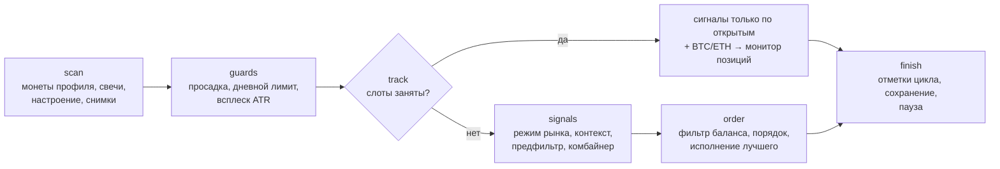

# Архитектура BitbotBY

Как устроен бот и как рождается сделка — от свечи до стоп-лосса на бирже. Термины — в
[GLOSSARY.md](GLOSSARY.md), кто прав при расхождении данных — в
[разделе ниже](#хранилища-и-кто-прав-при-расхождении), настройки и флаги — в [CONFIGURATION.md](CONFIGURATION.md).

## Процессы

| Процесс | Точка входа | Что делает |
|---|---|---|
| Бот | `python -m bitbot.workers.supervisor` | торговый цикл, монитор позиций, сверка с биржей, фоновые задачи; перезапуск при сбое |
| API | `python -m bitbot.api` | приложение `/app`, REST и WebSocket для него, вход |
| Фоновые задачи | `bitbot.ml.train_sac`, `bitbot.research.backtest` и др. | отдельные процессы: бот продолжает торговать |
| Воркер TimesFM | `bitbot.ai.forecast.timesfm_worker` | прогноз в своём окружении `.venv-timesfm`, JSON через stdin/stdout |

Бот и API общаются только через Redis: команды из приложения — очередь `bot:commands`, события для приложения —
`bot:events`, состояние — ключи `bot:*` (все перечислены в `backend/bitbot/config/keys.py`). Все точки входа
отдельных процессов — в `backend/bitbot/config/entrypoints.py`; запускать их можно только по имени модуля оттуда
(`./bitbot job …`, фоновые задачи из приложения, compose-сервис `trainer`).

## Слои

Пакет `backend/bitbot` разложен по слоям. Слой может импортировать только слои ниже — контракт
`import-linter` в `backend/pyproject.toml`, проверяется в CI, исключений нет.

| Слой | Что в нём |
|---|---|
| `workers` | `TradingBot`, шаги цикла (`steps/`), фоновые задачи, супервизор, health |
| `api` | FastAPI: роутеры, вход, отдача приложения |
| `ops` | аварийное управление, отчёты, проверка перед запуском (`check`), каталог задач |
| `research` | бэктесты, проверки альфы, replay, RAG по журналу решений |
| `execution` | исполнитель ордеров, монитор позиций (`monitor_base` → `booking` → `closing` → `levels` → `position_monitor`), сверка |
| `risk` | риск-менеджер, гейт риска, оптимизатор портфеля, метрики |
| `signals` | `SignalCombiner`: AI, SAC, Chronos и стратегии → одна рекомендация |
| `ml` | SAC: среда, обучение, онлайн-дообучение, реестр моделей |
| `ai` | цепочка LLM-провайдеров, Chronos/TimesFM, защита от инъекций в промпт |
| `market` | свечи, сканер, режим и сезон рынка, рыночный контекст, качество данных, WebSocket |
| `adapters` | Bybit (ccxt), `PaperExchange`, Telegram-уведомления, новости и соцсети |
| `domain` | 69 стратегий по семействам, контракты решений, состояния ордера, торговые режимы |
| `storage` | SQLite сделок, Redis, журнал решений, шина событий |
| `config` | `Config`, `RuntimeConfig` (правки из приложения), реестр настроек и флагов, ключи Redis, хранилище ключей |
| `infra` | логирование (с `trace_id` цикла), тяжёлые задачи, быстрый JSON |

`domain` нарочно внизу: стратегии и контракты не зависят ни от AI, ни от биржи, поэтому их можно гонять в
бэктесте и golden replay без сети.

## Торговый цикл

`TradingBot.trading_loop` (`workers/bot.py`) — короткий цикл: на каждый проход создаётся `CycleContext`
(неизменяемый: шаг возвращает новую копию) и по очереди вызываются шаги из `workers/steps/`. Шаг может закончить
цикл сам (вернуть `None`) — тогда он уже выждал паузу.



Имена шагов совпадают с узлами экрана «Цепочка» в приложении. Каждая запись журнала решений и каждая строка лога
цикла несут один `trace_id`.

## Как рождается сделка

Пример: профиль Bluechip, режим решений Hybrid, свободный слот есть.

1. **Монеты.** `scan` берёт топ монет профиля у `MarketScanner` (Altcoin и Meme исключают монеты профилей выше).
2. **Свечи и качество.** `DataLoader` грузит OHLCV, считаются индикаторы; у каждого снимка есть статус качества
   (`VALID`, `STALE`, …). В paper гейт качества данных включён: по монете с невалидными свечами входа не будет.
3. **Защиты портфеля.** `guards`: просадка от пика equity (подтверждение N циклов), дневной лимит убытка,
   всплеск ATR. Сработала защита — цикл заканчивается здесь (в paper защиты только уведомляют).
4. **Режим и контекст.** `signals`: режим рынка по HMM, рыночный контекст (funding, OI и ликвидации, Fear & Greed,
   стакан, basis, опционы, ETF, Google Trends, Reddit, стейблкоины), предфильтр — до `AI_MAX_SYMBOLS` монет.
5. **Сигнал.** `SignalCombiner` сводит SAC и ответ AI-цепочки (в Hybrid — с весами по режиму рынка), Chronos
   добавляет мягкую поправку, контекст двигает уверенность. Итог — рекомендация: сторона, уверенность, SL, TP,
   обоснование. Каждый шаг пишется в журнал решений.
6. **Отбор.** `order` отсекает то, на что не хватает баланса, сортирует по составному баллу
   (уверенность × цель × объём × режим) и отдаёт лучшую рекомендацию исполнителю.
7. **Проверки перед ордером.** `_execute_top_rec`: макро-окно (FOMC/CPI/NFP). Затем `OrderExecutor.execute`:
   торговые часы → свободный слот → нет позиции по монете → корреляция с открытыми → kill-switch стратегии →
   подтверждение в приложении (если автоисполнение выключено) → ликвидность и спред → проверка SL/TP →
   размер позиции (риск на сделку, half-Kelly, масштаб при просадке, лимит нагрузки портфеля) → поправка цены на
   проскальзывание (Almgren-Chriss) и повторная проверка SL/TP → округление объёма → плечо по волатильности.
   Любой отказ виден в приложении с причиной.
8. **Ордер.** `set_leverage` → рыночный ордер `create_order` → биржевые `SL` и `TP` (`place_exchange_sl_tp`).
   Исход ордера явный: `Placed`, `Rejected(причина)` или `Unknown(clientOrderId)` — сеть оборвалась, исход выяснит
   сверка по id, повторной отправки не будет. В paper те же вызовы исполняет `PaperExchange` по реальной цене.
9. **Запись.** Сделка — в SQLite (`trades_{paper,live}.db`), позиция — в монитор и в Redis, событие — в
   приложение, уведомление — в Telegram с кнопкой «Открыть в приложении».
10. **Сопровождение.** Монитор позиций каждые 5 с: цена, динамический выход по сигналам и контексту
    (`force_close` / `tighten_sl`), трейлинг, частичная фиксация, SL/TP. Закрытие идёт через `_send_close`:
    сначала снимаются биржевые стопы, затем рыночный reduce-only ордер; не подтвердился — стопы ставятся
    заново на весь объём и позиция остаётся под наблюдением.
11. **После закрытия.** Учёт (баланс paper, история, итог в журнале решений), опыт сделки — в файл своего
    профиля для дообучения SAC, circuit breaker по серии убытков.

Отдельный путь — **доверенные каналы Telegram** (`execution/trusted_trader.py`): пост доверенного канала идёт сразу
в исполнитель, минуя сканер, стратегии и AI; защиты (пауза, дневной лимит, стоп, свои слоты и риск) остаются.

## Проверка AI: табло честности

С флагом `AI_FORECAST_PROMPT` (в paper включён) AI отвечает вероятностями, которые можно проверить: по каждой монете
`p_up` — цена сначала пройдёт +ATR, а не −ATR, за 16 свечей; у сделки `p_win` — тейк раньше стопа; перед числом —
самый сильный довод против. Баланс, порог уверенности и «правила учебника» в запрос не попадают, температура 0.1.
Каждый прогноз пишется в журнал (`ai_forecast`); раз в 30 минут `research/ai_scoreboard.py` сверяет созревшие
прогнозы со свечами и считает по провайдеру Brier против «климата». Провайдер, чьи прогнозы на 200+ проверках не
точнее «всегда 50/50», с флагом `AI_TRUST_SCOREBOARD` сделку не открывает (прогнозы продолжают проверяться).
Табло — приложение: «Цепочка» → AI → «Честность прогнозов».

## Paper и live

Paper и live идут одним кодом исполнения. Разница — в адаптере: `BybitAPI` в paper отдаёт четыре торговых вызова
(ордер, SL/TP, отмена, плечо) симулятору `PaperExchange`; рыночные данные всегда настоящие. Баланс paper ведёт
`PortfolioManager`. Ручки реализма — `PAPER_SLIPPAGE_PCT`, `PAPER_LATENCY_S` (по умолчанию 0). Остальные различия
— политика paper из реестра флагов (`backend/bitbot/config/flags.py`): какие проверки включены, какие защиты только
уведомляют.

## Старт и остановка

- Старт: проверка Redis (без него нет блокировок ордеров), сверка позиций с биржей (live) или с базой (paper),
  восстановление позиций и баланса из Redis, запись `run_config` с включёнными флагами в журнал.
- Остановка (`SIGTERM`, `docker stop`): текущий цикл доходит до конца, паузы прерываются; через
  `SHUTDOWN_GRACE_S` (45 с) или по второму сигналу — отмена. В compose боту дано 60 с.

## Как проверяется, что поведение не изменилось

- **Golden replay** (`backend/tests/replay/`): индикаторы, 69 стратегий на 11 окнах, локальный турнир,
  486 сценариев комбайнера, 24 paper-позиции — сверка с эталоном `golden.json`. Эталон меняется только после
  разбора каждой разницы.
- **Слои** — `lint-imports`; **типы** — mypy, строгий для `domain`, `risk`, `execution`.
- **Ключи Redis** — тест не пускает строку `"bot:…"` вне `config/keys.py`.
- **Флаги** — тест сверяет реестр флагов с настоящими умолчаниями в paper и live.

## Решение: правила и инварианты

**Hybrid:** согласие AI и SAC с весами по режиму рынка; SAC hold = вето; SAC solo — только при уверенности ≥ 0.80; Chronos/TimesFM — мягкий модификатор. Эталон правила (`decision_engine.current`) сверен с боевым кодом на 350 комбинациях; ещё четыре стратегии объединения считаются в тени.

### Что объясняет решение
`python -m bitbot.domain.decision.explain <decision_id>`, в приложении Журнал → Отчёты → аудит (`/api/reports/audit/<decision_id>`): участники и природа их confidence, стадии уверенности, конфликты, группы и избыточные каналы, итог исполнения и исход.

### Оркестратор L1–L4 (спроектирован, не подключён)
`backend/bitbot/ai/orchestrator.py`: L1 Signal Intelligence + Meta-Model → L2 + SAC/прогноз → L3 + LLM/RAG → L4 перепроверка конфликта; безопасный отказ при плохих данных; бюджет времени; ранняя остановка, если решение уже уверенное. Сегодня маршрутизацию выполняет `combine()` по режиму; оркестратор заменит её, когда появятся Meta-Model и ≥ 2 тяжёлых компонента.

### Инварианты
Модели только предлагают; решение принимает Decision Engine; допустимость проверяет независимый Risk Engine; исполняет Execution. Отсутствие ответа никогда не подтверждает сделку. Закрывающие ордера не блокируются никакими защитами входа.

## Хранилища и кто прав при расхождении

### Хранилища
| Что | Где | Назначение |
|---|---|---|
| Сделки | SQLite `data/trades_{paper,live}.db` (WAL) | источник истины по сделкам; проверка и копии — `backend/bitbot/storage/db_health.py` |
| Состояние/настройки | Redis | позиции, пауза, режим, пульс, `bot:mode_readiness`, `bot:last_cycle` |
| События | Redis pub/sub `bot:events` (+ Streams `bot:stream:events` за флагом) | приложение и потребители |
| Журнал решений | `data/decision_ledger.jsonl` (ротация 50 МБ) | аудит, replay, отчёты, RAG |
| Датасеты SAC | Parquet + ZSTD + манифест | воспроизводимое обучение |
| Модели | `models/*.zip`, `models/registry.json` | реестр и стадии допуска |

### Кто прав, если источники расходятся
| Данные | Источник истины | Рабочие копии | Как сводятся |
|---|---|---|---|
| Открытые позиции, live (фьючерсы) | биржа | память бота (`_monitored`), Redis `monitored_positions_live` | на старте сверка добавляет/убирает позиции; потом сверка раз в `RECONCILE_INTERVAL_S` — только тревога, исправление за флагом `RECONCILE_AUTOFIX` |
| Открытые позиции, live (спот) | Redis + SQLite (у спота нет API позиций) | память бота | сверка с биржей не выполняется |
| Открытые позиции, paper | SQLite (`status='open'`) | память бота, Redis `monitored_positions_paper` | на старте `_reconcile_paper_positions` приводит память к базе |
| Сделки и их итог | SQLite `trades_{paper,live}.db` | — | единственная запись; отчёты и приложение читают её |
| Баланс | live: биржа; paper: Redis `portfolio_state_paper` | кэш баланса в памяти | live — синхронизация на старте и по циклу |
| Решения бота | журнал `decision_ledger.jsonl` (только дописывается) | Redis Stream (компактные отметки) | копия в шине может теряться, журнал — нет |
| Настройки | значения по умолчанию в `Config` → env → правки из приложения в Redis (`bot:*`, `bot:hot:*`) | — | последняя правка из приложения главнее env |
| Ключи API | только `data/secrets.enc.json` (шифрование, мастер-ключ вне репозитория) | — | окружение ключи не поставляет |
| Блокировки ордеров | Redis | — | без Redis бот не стартует (проверка в `initialize`) |
| Аварийный уровень | `data/emergency.json` | — | меняется только с подтверждением |
| Допуск моделей | `models/registry.json` | — | SAC торгует только после допуска |

Redis в обоих compose запущен с AOF (`--appendonly yes`): позиции и баланс paper
переживают рестарт Redis. Память процесса — копия на время работы; после
каждого изменения позиции бот пишет её в Redis.

### Принципы
Данные до решения фиксируются (`snapshot_id`, `replay_input`) — решение воспроизводимо (`python -m bitbot.research.replay`). REST — источник решений и эталон сверки; WS — параллельный наблюдатель. Любая запись в журнал и шину не имеет права ломать торговый цикл.

## Сбои

Принцип: **отсутствие ответа ≠ подтверждение сделки**. Деградация никогда не открывает вход и не повышает уверенность. Таблица политик — `backend/bitbot/ai/failure_policy.py` (тест фиксирует инвариант).

| Сбой | Что делает система | Где реализовано |
|---|---|---|
| LLM недоступна / таймаут | поправка AI пропускается, цикл идёт дальше; при исчерпании цепочки — тревога в Telegram, запасной путь по флагу | `AIAnalyzer`, `ai_call` в журнале |
| LLM вернула неверный вывод | в тени — аудит схемы; за флагом `AI_STRICT_VALIDATION` рекомендация отбрасывается | `ai_infra/schema.py` |
| Chronos / TimesFM недоступны | поправка нейтральна, цикл не блокируется | `signal_combiner`, `TimesFMForecaster` |
| SAC не загружена / не допущена | режимы с SAC не торгуют, причина видна в Telegram и приложении | `trading_modes`, `SACSignal.tradable` |
| RAG недоступен | решение без RAG | `ledger_rag.safe_context` |
| Данные STALE/INVALID | статус в `data_quality`; опциональный gate блокирует вход | `market/data_quality.py` |
| Биржа: ошибка API | ошибка не принимается за «позиций нет»; сверка с подтверждением двумя проверками | `fetch_positions_checked`, `_reconcile_tick` |
| Ордер с неизвестным исходом | поиск по `clientOrderId`, алерт при исполнении | `execution_reliability` |
| WS-поток замолчал | переподключение с backoff и jitter, тревога, книга сбрасывается и до ресинка недостоверна | `market/ws/client.py` |
| WS ≠ REST по свечам | метрика и тревога; решения принимаются по REST | `ops_tasks.candle_check` |
| Redis | деградация к памяти/БД, критичное состояние не только в Redis (дневная опора пишется и в Redis, и считается заново) | `RiskManager`, `RedisClient` |
| БД сделок | ежедневная проверенная копия, проверка в приложении (Журнал → Отчёты); открытие по `mode=ro`, чтобы не испортить базу | `db_health`, `ops_tasks.db_backup_loop` |
| Рестарт при аварии | уровень аварии в `data/emergency.json`; бот остаётся на паузе | `emergency`, `apply_emergency_on_start` |
| Исполнение не удалось | машина состояний ордера + сверка, слепого повтора нет | `execution_reliability`, `bybit_api` |
| Риск-проверка отказала | отказ с причиной в журнале (в бою — действующие защиты; единый шлюз пока в тени) | `risk_gate_shadow` |

### Аварийные уровни (приложение, `/api/emergency`)
1 — пауза входов · 2 — отмена отложенных ордеров (сейчас ничего: входы рыночные, биржевые SL/TP — защита и не снимаются) · 3 — закрыть убыточные, у прибыльных SL на безубыток · 4 — закрыть все и оставить паузу. Повышение — с подтверждением; снятие — `reset`, пауза остаётся до снятия паузы в приложении.

### Что намеренно не делается
Dead Man's Switch (отменил бы биржевые SL/TP — защиту позиций при падении бота); автоматическое переключение на вторую биржу.

## Жизненный цикл модели SAC

```
данные → features_v2 → train_sac_v2 (walk-forward) → candidate → validated → paper → shadow → canary → production
                                                          └─► rejected / retired (откат: rollback)
```

### Стадии и что нужно для перехода (`backend/bitbot/ml/model_registry.py`)
| Переход | Требования |
|---|---|
| candidate → validated | walk-forward пройден (≥ 3 фолдов), указан `dataset_version` |
| validated → paper | `approved_by` (человек) |
| paper → shadow | `approved_by` + ≥ 14 дней на paper |
| shadow → canary | `approved_by` + ≥ 14 дней на shadow |
| canary → production | `approved_by` + ≥ 14 дней на canary; прежняя production → retired (резерв для отката) |

Пропускать стадии нельзя. Понижение и отклонение — всегда, с причиной. Пороги и сроки — предложения владельцу.

### Допуск к торговле
`SAC_REQUIRE_APPROVAL=true` (по умолчанию): Paper исполняет стадии paper/canary/production, Live — только production; файл модели без записи в реестре не торгует. Canary в Live не исполняется, пока нет лимита доли капитала в исполнителе.

### Обучение
- Среда `env_v2`: действие — целевая экспозиция [−1, 1], шорт, комиссия, проскальзывание, funding, исполнение по open следующей свечи; `terminated` (банкротство) отделён от `truncated` (конец данных).
- Признаки `features_v2`: причинные, проверены тестом на look-ahead; нормализация только по train.
- Запуск: `python -m bitbot.ml.train_sac_v2 --csv … --symbol … --timeframe 15m --timesteps N --folds 4` или контейнер `docker compose --profile train run --rm trainer` (свои лимиты CPU/RAM, приоритет ниже).
- Вердикт ворот (`promotion_verdict`) — информация для реестра, не разрешение. На случайном блуждании ворота не проходятся (тест).

### Инференс
`SACV2Signal` подаёт модели то же наблюдение, на котором она училась, включая текущую позицию. Подключается флагом `SAC_V2_ENABLED`. Экспорт актора в ONNX с проверкой совпадения: `python -m bitbot.ml.onnx_export model.zip`.

### Что делает человек
Выбирает параметры среды (шорт, издержки), запускает боевое обучение, решает каждое продвижение, включает флаги. Автоматически модель не продвигается и production не заменяется.
