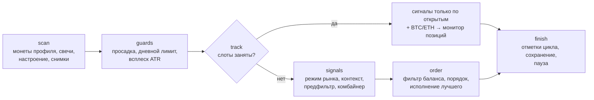

# Архитектура BitbotBY

Как устроен бот и как рождается сделка — от свечи до стоп-лосса на бирже. Термины — в
[GLOSSARY.md](GLOSSARY.md), кто прав при расхождении данных — в
[architecture/DATA_FLOW.md](architecture/DATA_FLOW.md), настройки и флаги — в [CONFIGURATION.md](CONFIGURATION.md).

## Процессы

| Процесс | Точка входа | Что делает |
|---|---|---|
| Бот | `python -m bitbot.workers.supervisor` | торговый цикл, монитор позиций, сверка с биржей, фоновые задачи; перезапуск при сбое |
| API | `python -m bitbot.api` | приложение `/app`, REST и WebSocket для него, вход |
| Фоновые задачи | `bitbot.ml.train_sac`, `bitbot.research.backtest` и др. | отдельные процессы: бот продолжает торговать |
| Воркер TimesFM | `bitbot.ai.forecast.timesfm_worker` | прогноз в своём окружении `.venv-timesfm`, JSON через stdin/stdout |

Бот и API общаются только через Redis: команды из приложения — очередь `bot:commands`, события для приложения —
`bot:events`, состояние — ключи `bot:*` (все перечислены в `backend/bitbot/config/keys.py`). Все точки входа
отдельных процессов — в `backend/bitbot/config/entrypoints.py`; запускать их можно только по имени модуля оттуда
(`./bitbot job …`, фоновые задачи из приложения, compose-сервис `trainer`).

## Слои

Пакет `backend/bitbot` разложен по слоям. Слой может импортировать только слои ниже — контракт
`import-linter` в `backend/pyproject.toml`, проверяется в CI, исключений нет.

| Слой | Что в нём |
|---|---|
| `workers` | `TradingBot`, шаги цикла (`steps/`), фоновые задачи, супервизор, health |
| `api` | FastAPI: роутеры, вход, отдача приложения |
| `ops` | аварийное управление, отчёты, проверка перед запуском (`check`), каталог задач |
| `research` | бэктесты, проверки альфы, replay, RAG по журналу решений |
| `execution` | исполнитель ордеров, монитор позиций (`monitor_base` → `booking` → `closing` → `levels` → `position_monitor`), сверка |
| `risk` | риск-менеджер, гейт риска, оптимизатор портфеля, метрики |
| `signals` | `SignalCombiner`: AI, SAC, Chronos и стратегии → одна рекомендация |
| `ml` | SAC: среда, обучение, онлайн-дообучение, реестр моделей |
| `ai` | цепочка LLM-провайдеров, Chronos/TimesFM, защита от инъекций в промпт |
| `market` | свечи, сканер, режим и сезон рынка, рыночный контекст, качество данных, WebSocket |
| `adapters` | Bybit (ccxt), `PaperExchange`, Telegram-уведомления, новости и соцсети |
| `domain` | 69 стратегий по семействам, контракты решений, состояния ордера, торговые режимы |
| `storage` | SQLite сделок, Redis, журнал решений, шина событий |
| `config` | `Config`, `RuntimeConfig` (правки из приложения), реестр настроек и флагов, ключи Redis, хранилище ключей |
| `infra` | логирование (с `trace_id` цикла), тяжёлые задачи, быстрый JSON |

`domain` нарочно внизу: стратегии и контракты не зависят ни от AI, ни от биржи, поэтому их можно гонять в
бэктесте и golden replay без сети.

## Торговый цикл

`TradingBot.trading_loop` (`workers/bot.py`) — короткий цикл: на каждый проход создаётся `CycleContext`
(неизменяемый: шаг возвращает новую копию) и по очереди вызываются шаги из `workers/steps/`. Шаг может закончить
цикл сам (вернуть `None`) — тогда он уже выждал паузу.

Имена шагов совпадают с узлами экрана «Цепочка» в приложении. Каждая запись журнала решений и каждая строка лога
цикла несут один `trace_id`.

## Как рождается сделка

Пример: профиль Bluechip, режим решений Hybrid, свободный слот есть.

1. **Монеты.** `scan` берёт топ монет профиля у `MarketScanner` (Altcoin и Meme исключают монеты профилей выше).
2. **Свечи и качество.** `DataLoader` грузит OHLCV, считаются индикаторы; у каждого снимка есть статус качества
   (`VALID`, `STALE`, …). В paper гейт качества данных включён: по монете с невалидными свечами входа не будет.
3. **Защиты портфеля.** `guards`: просадка от пика equity (подтверждение N циклов), дневной лимит убытка,
   всплеск ATR. Сработала защита — цикл заканчивается здесь (в paper защиты только уведомляют).
4. **Режим и контекст.** `signals`: режим рынка по HMM, рыночный контекст (funding, OI и ликвидации, Fear & Greed,
   стакан, basis, опционы, ETF, Google Trends, Reddit, стейблкоины), предфильтр — до `AI_MAX_SYMBOLS` монет.
5. **Сигнал.** `SignalCombiner` сводит SAC и ответ AI-цепочки (в Hybrid — с весами по режиму рынка), Chronos
   добавляет мягкую поправку, контекст двигает уверенность. Итог — рекомендация: сторона, уверенность, SL, TP,
   обоснование. Каждый шаг пишется в журнал решений.
6. **Отбор.** `order` отсекает то, на что не хватает баланса, сортирует по составному баллу
   (уверенность × цель × объём × режим) и отдаёт лучшую рекомендацию исполнителю.
7. **Проверки перед ордером.** `_execute_top_rec`: макро-окно (FOMC/CPI/NFP). Затем `OrderExecutor.execute`:
   торговые часы → свободный слот → нет позиции по монете → корреляция с открытыми → kill-switch стратегии →
   подтверждение в приложении (если автоисполнение выключено) → ликвидность и спред → проверка SL/TP →
   размер позиции (риск на сделку, half-Kelly, масштаб при просадке, лимит нагрузки портфеля) → поправка цены на
   проскальзывание (Almgren-Chriss) и повторная проверка SL/TP → округление объёма → плечо по волатильности.
   Любой отказ виден в приложении с причиной.
8. **Ордер.** `set_leverage` → рыночный ордер `create_order` → биржевые `SL` и `TP` (`place_exchange_sl_tp`).
   Исход ордера явный: `Placed`, `Rejected(причина)` или `Unknown(clientOrderId)` — сеть оборвалась, исход выяснит
   сверка по id, повторной отправки не будет. В paper те же вызовы исполняет `PaperExchange` по реальной цене.
9. **Запись.** Сделка — в SQLite (`trades_{paper,live}.db`), позиция — в монитор и в Redis, событие — в
   приложение, уведомление — в Telegram с кнопкой «Открыть в приложении».
10. **Сопровождение.** Монитор позиций каждые 5 с: цена, динамический выход по сигналам и контексту
    (`force_close` / `tighten_sl`), трейлинг, частичная фиксация, SL/TP. Закрытие идёт через `_send_close`:
    сначала снимаются биржевые стопы, затем рыночный reduce-only ордер; не подтвердился — стопы ставятся
    заново на весь объём и позиция остаётся под наблюдением.
11. **После закрытия.** Учёт (баланс paper, история, итог в журнале решений), опыт сделки — в файл своего
    профиля для дообучения SAC, circuit breaker по серии убытков.

Отдельный путь — **доверенные каналы Telegram** (`execution/trusted_trader.py`): пост доверенного канала идёт сразу
в исполнитель, минуя сканер, стратегии и AI; защиты (пауза, дневной лимит, стоп, свои слоты и риск) остаются.

## Проверка AI: табло честности

С флагом `AI_FORECAST_PROMPT` (в paper включён) AI отвечает вероятностями, которые можно проверить: по каждой монете
`p_up` — цена сначала пройдёт +ATR, а не −ATR, за 16 свечей; у сделки `p_win` — тейк раньше стопа; перед числом —
самый сильный довод против. Баланс, порог уверенности и «правила учебника» в запрос не попадают, температура 0.1.
Каждый прогноз пишется в журнал (`ai_forecast`); раз в 30 минут `research/ai_scoreboard.py` сверяет созревшие
прогнозы со свечами и считает по провайдеру Brier против «климата». Провайдер, чьи прогнозы на 200+ проверках не
точнее «всегда 50/50», с флагом `AI_TRUST_SCOREBOARD` сделку не открывает (прогнозы продолжают проверяться).
Табло — приложение: «Цепочка» → AI → «Честность прогнозов».

## Paper и live

Paper и live идут одним кодом исполнения. Разница — в адаптере: `BybitAPI` в paper отдаёт четыре торговых вызова
(ордер, SL/TP, отмена, плечо) симулятору `PaperExchange`; рыночные данные всегда настоящие. Баланс paper ведёт
`PortfolioManager`. Ручки реализма — `PAPER_SLIPPAGE_PCT`, `PAPER_LATENCY_S` (по умолчанию 0). Остальные различия
— политика paper из реестра флагов (`backend/bitbot/config/flags.py`): какие проверки включены, какие защиты только
уведомляют.

## Старт и остановка

- Старт: проверка Redis (без него нет блокировок ордеров), сверка позиций с биржей (live) или с базой (paper),
  восстановление позиций и баланса из Redis, запись `run_config` с включёнными флагами в журнал.
- Остановка (`SIGTERM`, `docker stop`): текущий цикл доходит до конца, паузы прерываются; через
  `SHUTDOWN_GRACE_S` (45 с) или по второму сигналу — отмена. В compose боту дано 60 с.

## Как проверяется, что поведение не изменилось

- **Golden replay** (`backend/tests/replay/`): индикаторы, 69 стратегий на 11 окнах, локальный турнир,
  486 сценариев комбайнера, 24 paper-позиции — сверка с эталоном `golden.json`. Эталон меняется только после
  разбора каждой разницы.
- **Слои** — `lint-imports`; **типы** — mypy, строгий для `domain`, `risk`, `execution`.
- **Ключи Redis** — тест не пускает строку `"bot:…"` вне `config/keys.py`.
- **Флаги** — тест сверяет реестр флагов с настоящими умолчаниями в paper и live.
