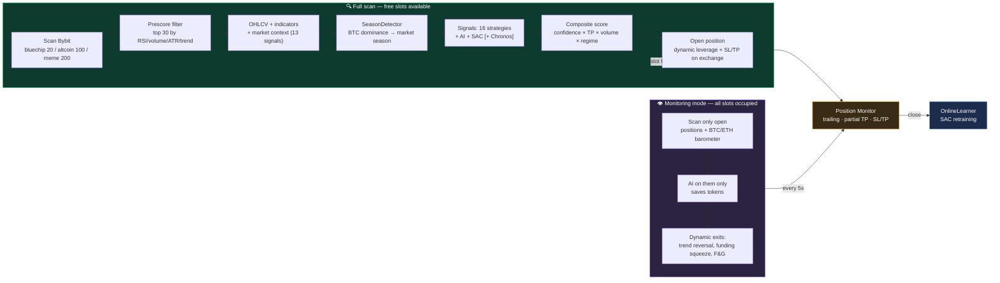

<div align="center">


# 🤖 BitbotBY

### AI-hybrid trading bot for Bybit Futures

Claude / DeepSeek / OpenAI / Groq / Gemini · SAC (RL) · Amazon Chronos · 10+ real-time market signals

[](https://www.python.org/)
[](https://fastapi.tiangolo.com/)
[](https://www.docker.com/)
[](#-tests)
[](https://www.bybit.com/)
[](../LICENSE)

🌐 [Русский](../README.md) · **English** · [中文](README.zh.md) · [Español](README.es.md) · [Deutsch](README.de.md)

</div>

---

BitbotBY scans the Bybit market, combines signals from an AI model, an SAC neural network, and 16
classic strategies with live market context (funding, liquidations, Fear & Greed, order book,
derivatives, social sentiment), and trades perpetual futures long/short — with quant risk management
(Kelly, CVaR, Almgren-Chriss) and full control via Telegram.

Three market profiles tuned for different volatility regimes: **Bluechip** (top 20), **Altcoin**
(top 100), **Meme** (top 200, pump strategies + Twitter/Telegram sentiment).

> ⚠️ This involves trading with real money. Always start with `PAPER_TRADING=true` and go through the
> [checklist before live trading](#-before-live-trading).

---

## Table of Contents

- [How It Works](#-how-it-works)
- [Architecture](#-architecture)
- [Features](#-features)
- [Quick Start](#-quick-start)
- [Configuration](#-configuration)
- [.env Reference — All Variables](#-env-reference--all-variables)
- [Telegram Control](#-telegram-control)
- [Monitoring](#-monitoring)
- [Training the SAC Model](#-training-the-sac-model)
- [Backtesting and Alpha Validation](#-backtesting-and-alpha-validation)
- [Makefile Commands](#-makefile-commands)
- [Tests](#-tests)
- [FAQ](#-faq)
- [Before Live Trading](#-before-live-trading)

---

## 🔄 How It Works

The cycle adapts to the state of the portfolio: a **full scan** of the market when free slots are
available, and a lightweight **monitoring mode** when all positions are occupied (saving 5–33× on
AI tokens).



<details>
<summary><b>Full decision chain — 14 steps with formulas</b> (expand)</summary>

| # | Step | What it does |
|---|---|---|
| 1 | **Snapshots** ([cycle.py](../src/core/cycle.py)) | OHLCV → indicators (RSI/MACD/BB/ATR/trend) + news sentiment per coin |
| 2 | **Prescore** | `score = vol×0.35 + rsi×0.30 + atr×0.20 + regime_bonus×0.15` → top 30 passed to AI |
| 3 | **Market context** ([market_context.py](../src/market/market_context.py)) | 13 signals: funding, OI+liquidations, F&G, basis, order book, Deribit PCR/IV, Google Trends, Glassnode, ETF flows, Reddit (CryptoBERT), stablecoin supply |
| 4 | **SignalCombiner** ([signal_combiner.py](../src/core/signal_combiner.py)) | `local` / `ai` / `dqn` / **`hybrid`** (SAC+AI agreement, weight depends on regime: trending 50/50, ranging 40/60) / **`hybrid+Chronos`** (±0.05…0.15 modifier) |
| 5 | **Context filter** | Each of the 13 signals shifts confidence by ±0.05…0.15 (e.g. F&G ≤15 + a liquidation cascade → confidence = 0) |
| 6 | **Direct context signals** | Extremes (funding overheated, squeeze, imbalance >0.4, F&G ≤10/≥92) generate standalone signals |
| 7 | **Local fallback** | If no signals fire — an indicator-based strategy, with TP wider in a trend and tighter in a range |
| 8 | **Prioritization** | `composite_score = confidence × (1+tp_bonus) × (1+volume_bonus) × regime_mult` |
| 9 | **Portfolio allocation** | CVaR/Markowitz ([portfolio_optimizer.py](../src/research/portfolio_optimizer.py)) when ≥2 signals fire, capped at ×3 |
| 10 | **Execution guards** ([order_executor.py](../src/core/order_executor.py)) | macro blackout → slots/cooldown → trading hours → duplicate symbol → **correlation guard** → Telegram confirmation → **liquidity filter** → SL/TP validation → **Kelly sizing** → drawdown scaling → **Almgren-Chriss** → dynamic leverage → order |
| 11 | **After opening** | PositionMonitor every 5s: the same 13 context signals drive exits (force_close / tighten_sl) |

**What actually differs between profiles** (not just parameter values): Meme is the only profile that
takes Twitter/Telegram sentiment as an input, with the `momentum_burst`/`pump_exit`/`sentiment`
strategies. BTC ETF flows apply only to BTC/USDT. The rest of the logic (contrarian funding/PCR/FNG,
Kelly, correlation guard, Almgren-Chriss) is identical across all profiles — only the numbers differ.

</details>

---

## 🏗 Architecture

```mermaid
flowchart TB
    SUP["supervisor.py\nrestart on crash · SIGTERM"] --> BOT["TradingBot\nsrc/trading_bot.py"]

    subgraph DATA["Data & Signals"]
        SCAN["MarketScanner"]
        DL["DataLoader\nccxt async · CSV cache 24h"]
        REGIME["RegimeDetector\nGaussianHMM"]
        CTX["MarketContext\n10+ sources, TTL 5–240min"]
        NEWS["NewsAnalyzer\nNewsAPI + RSS + VADER"]
        TW["TwitterAnalyzer\nMeme profile"]
        TG["TelegramSentiment\nTelethon MTProto"]
        POLL["SentimentPoller\nasyncio → Redis"]
    end

    subgraph BRAIN["Decision Making"]
        COMBINER["SignalCombiner\nSAC + AI [+Chronos]"]
        CHRONOS["ChronosAnalyzer\namazon/chronos-t5-small"]
        CRYPTOBERT["CryptoSentimentAnalyzer\nElKulako/cryptobert"]
        PORT["PortfolioOptimizer\nCVaR / Markowitz"]
        CORR["CorrelationFilter"]
        MACRO["MacroCalendar\nFOMC/CPI/NFP blackout"]
        ARB["FundingArbDetector"]
    end

    subgraph EXEC["Execution"]
        OE["OrderExecutor\nKelly → CVaR → Almgren-Chriss"]
        PM["PositionMonitor\nSL/TP · trailing · partial TP"]
        API["BybitAPI\nccxt async, linear+spot"]
        LEARN["OnlineLearner\nSAC auto-retrain"]
    end

    subgraph OUT["Observability"]
        NOTIFY["TelegramNotifier"]
        HIST["TradeHistory\nSQLite"]
        HEALTH["HealthServer\n/health /metrics"]
    end

    BOT --> SCAN & DL & REGIME & CTX
    CTX --> NEWS & TW & TG & POLL
    BOT --> COMBINER
    COMBINER --> CHRONOS & CRYPTOBERT
    BOT --> PORT & CORR & MACRO & ARB
    BOT --> OE --> API
    OE --> PM --> LEARN
    BOT --> NOTIFY & HIST & HEALTH

    style SUP fill:#1c1c1c,stroke:#888,color:#fff
    style BOT fill:#0d3b2e,stroke:#2ecc71,color:#fff
    style DATA fill:#16213e,stroke:#4a90e2,color:#fff
    style BRAIN fill:#2b2340,stroke:#9b6bff,color:#fff
    style EXEC fill:#3a2c14,stroke:#f39c12,color:#fff
    style OUT fill:#3a1414,stroke:#e74c3c,color:#fff
```



**RL / backtesting:**

```
reinforcement_learning/
  ├── rl_env.py      — TradingEnv (Gymnasium), OBS_DIM=21, executes on open[i+1]
  ├── train_sac.py   — SAC: 80/20 split, Optuna, walk-forward, online finetune
  └── tune_sac.py     — Optuna hyperparameter search

backtest.py    — walk-forward with 20% holdout, overfit ratio
dashboard.py   — FastAPI :8080 (balance, positions, history)
```

---

## ✨ Features

### 📡 Market Edge — Real-Time Signals

| Source | Logic | Profile |
|---|---|---|
| **Funding Rate** (Bybit) | >0.1% = longs overheated → SHORT contrarian | all |
| **Open Interest + Price** | OI↓ + price↓ → long liquidations | all |
| **Fear & Greed** | ≤15 contrarian BUY (if no cascade), ≥85 suppresses BUY | all |
| **Order Book Imbalance** | ask/bid > 1.4 → SELL | all |
| **Basis (futures–spot)** | >2% premium = greed → SELL | all |
| **Deribit PCR + IV Skew** | PCR <0.5 = all-in calls → SELL | all |
| **ETF Flows** (farside.co.uk) | Outflow < −$100M → SELL, Inflow > $150M → BUY | BTC only |
| **Google Trends** | >75 = retail FOMO peak → SELL | all |
| **Reddit / CryptoBERT** | NLP classification of r/CryptoCurrency posts | all |
| **News sentiment** | NewsAPI/RSS + Claude/DeepSeek/VADER | all |
| **Twitter/X** | VADER, Basic API ~10K tweets/month | Meme only |
| **Telegram pump channels** | Telethon MTProto, 2× weight in score | Meme only |
| **Stablecoin Supply** | USDT market cap ↓ → outflow risk | filter |

All sources are cached (5 min – 4 hours) and gracefully degrade when unavailable.

### 🧠 Strategies and Models

- **10 base strategies**: EMA crossover, RSI, MACD, Bollinger Bands, Scalping, Swing, Breakout, Mean Reversion, Trend Following, Volume Spike
- **6 profile-specific strategies**: activated automatically when the profile changes (`momentum_burst`, `pump_exit`, `sentiment` — Meme; and others)
- **AI analysis**: Claude / DeepSeek / OpenAI / Groq / Gemini with a fallback chain
- **SAC (Soft Actor-Critic)** — an RL model trained on history, fine-tuned online after every trade
- **Amazon Chronos** — a pretrained time-series model, a soft confidence modifier in hybrid mode

### 📐 Quant Tools

| Tool | Where it's used |
|---|---|
| **Kelly Criterion** (half-Kelly) | Position sizing from the strategy's live win rate/EV |
| **CVaR / Markowitz** | Portfolio allocation when multiple signals fire simultaneously |
| **Almgren-Chriss** | Entry price adjustment for market impact from order size |
| **GaussianHMM** | Per-symbol market regime detection (trending/ranging) |
| **Correlation guard** | Blocks a new position that correlates with an open one |

### 🛡 Risk Management

Macro blackout (FOMC/CPI/NFP) · Correlation filter · Liquidity filter (spread/volume) ·
Circuit breaker and daily loss limit · **Hard drawdown halt** (closes losing positions, moves SL to
breakeven on profitable ones, blocks new entries) · **ATR spike protection** (closes all positions,
1h pause) · Dynamic leverage (fixed/volatility/full, ATR-based) · Trailing stop + partial TP.

---

## 📲 App, One-Click Launcher and What's New

> The Russian [README.md](../README.md) is the most up to date; this section summarises what changed.

- **App** (`webapp/`, React + Vite): Telegram MiniApp, browser (`/app/`) and desktop shell share one interface with
  the same capabilities as the Telegram menu. Tabs: Terminal (balance, radar, positions with "why opened", chart,
  Fear & Greed gauge and market season), Bot (risk mode, market profile, spot/futures, decision mode, strategies),
  Learn (train/tune SAC **per profile**, rollback, backtest, alpha checks), Journal (trades with reasons, CSV export),
  Settings (AI providers, keys, all parameters with history, undo and search). Command palette `Ctrl/⌘ K`,
  hotkeys `1–5` / `?` / `N`, notification centre.
- **One-click launcher** (needs Docker Desktop and Python 3): double-click `BitbotBY.command` (macOS) or
  `BitbotBY.bat` (Windows), or run `./bitbotby.sh`. It builds the image, starts Redis + bot + dashboard on
  `127.0.0.1` (a free port is picked if 8080 is taken), creates the encryption master key itself and opens the app
  with a one-time local login link. It starts in **Paper** and **Local** mode, so no keys are needed at first.
- **AI providers**: 16 providers, a chain (ask the next one on error or limit) or a single provider. The chain is
  shown as a node canvas: drag a node to reorder, drag it into "Reserve" to switch it off (the key stays), right-click
  for actions (probe, who replaces it, delete key with undo). Paste a key and the provider is detected automatically.
- **Keys** entered in the app are stored encrypted (Fernet, master key `BITBOT_SECRETS_KEY`); the app shows only the
  last 4 characters. A key from the app wins over `.env`.
- **Strategies**: 20 built-in plus 49 experimental ports from Argent-Systems (off by default). Each has a spot/futures
  flag. Backtests found **no statistically significant edge** for any of them — see [docs/STRATEGIES.md](STRATEGIES.md).
  `MODE=local` runs on local strategies only, without AI.
- **Paper tools**: `PAPER_GUARDS_OFF` switches portfolio protections off in Paper (ignored in Live).
- Tests: 1900 backend (pytest) + 16 frontend (vitest).

---

## 🚀 Quick Start

### Requirements

Python 3.11 · Docker + Docker Compose (recommended) · Bybit API keys · one AI provider · a Telegram bot

### Running with Docker (recommended)

```bash
git clone https://github.com/deuteriumZzz/BitbotBY.git
cd BitbotBY
cp .env.example .env        # fill in your keys — see the "Configuration" section
make setup                  # first run: build, htpasswd, docker compose up
```

### Running Locally (without Docker)

You need Python 3.11, Redis and Node.js 20+ (for the app).

```bash
python -m venv venv && source venv/bin/activate   # Windows: venv\Scripts\activate
pip install -r requirements.txt
cp .env.example .env                              # fill in keys, PAPER_TRADING=true
# Redis: macOS — brew install redis && brew services start redis
#        Linux — sudo apt install redis-server
#        any OS with Docker — docker run -d -p 6379:6379 redis:7-alpine
make webapp                                       # build the app: cd webapp && npm ci && npm run build
python supervisor.py --with-dashboard             # or: make local
```

The bot and the dashboard read `.env` themselves (environment variables take precedence). The app is at http://localhost:8080/app/ in a browser; in the desktop app enter `http://localhost:8080` as the server. Without `--with-dashboard` only the bot starts.

The Telegram MiniApp opens only over a public https address. From your computer a tunnel works, e.g. `cloudflared tunnel --url http://localhost:8080`: put its address plus `/app/` into `WEBAPP_URL` and restart the bot. On a server `docker compose` does all of this — you only need https and `WEBAPP_URL`.

### Minimal `.env` for Paper Trading

```env
BYBIT_API_KEY=...
BYBIT_API_SECRET=...
BYBIT_TESTNET=false
MARKET_TYPE=linear

AI_PROVIDER=deepseek         # or claude / openai / groq / gemini
DEEPSEEK_API_KEY=...

TELEGRAM_BOT_TOKEN=...
TELEGRAM_CHAT_ID=...          # numeric ID from @userinfobot, not a username

PAPER_TRADING=true
AUTO_EXECUTE=false
MODE=hybrid
```

---

## ⚙️ Configuration

The full list of variables with descriptions lives in [`.env.example`](../.env.example) (with comments
in Russian across every section: Bybit API, AI provider, trading mode, Telegram, trading parameters,
position management, risk management, macro blackout, SAC online learning, external signals,
monitoring).

| Category | Key variables |
|---|---|
| Exchange | `BYBIT_API_KEY/SECRET`, `MARKET_TYPE`, `BYBIT_TESTNET` |
| AI | `AI_PROVIDER`, `<PROVIDER>_API_KEY`, `AI_DAILY_BUDGET`, `AI_MAX_SYMBOLS` |
| Mode | `MODE` (`local`/`ai`/`dqn`/`hybrid`), `PAPER_TRADING`, `AUTO_EXECUTE` |
| Profile | `MARKET_PROFILE` (`bluechip`/`altcoin`/`meme`) |
| Positions | `MAX_POSITIONS` (1–20), `RISK_PER_TRADE`, `LEVERAGE`, `LEVERAGE_MODE` |
| Risk | `DAILY_LOSS_LIMIT`, `DRAWDOWN_HALT_HOURS`, `MAX_CORRELATION`, `MAX_SPREAD_PCT` |
| Telegram | `TELEGRAM_BOT_TOKEN`, `TELEGRAM_CHAT_ID`, `TELEGRAM_CONFIRM_TIMEOUT` |
| Infra | `REDIS_HOST/PASSWORD`, `DASHBOARD_USER/PASSWORD` |

Most parameters (mode, strategies, risk profile, trading hours, number of positions) can be changed
**directly from the Telegram menu with no restart** — they're stored in Redis with AOF persistence.

---

## 📋 .env Reference — All Variables

A line-by-line description of every variable. Expand the category you need.

<details>
<summary><b>🔑 Bybit API</b></summary>

```env
BYBIT_API_KEY=           # Get it: bybit.com → Account → API Management
BYBIT_API_SECRET=        # ⚠ Never publish it, never commit it to git

TESTNET=false            # true → trade on testnet.bybit.com (no real money)
                         # Testnet keys are created separately from production!

MARKET_TYPE=linear       # linear → perpetual futures (RECOMMENDED, default on first start)
                         #   + Can open SHORT positions
                         #   + Has a funding rate (extra signal)
                         #   + Leverage up to 100x (we cap it at max=3)
                         # spot → LONG only, no shorting, no leverage
                         # This is only the starting value on first launch —
                         # after that the mode is switched on the fly via Telegram
                         # (💱 Market in Settings), without editing .env or restarting.

LEVERAGE=3               # MAXIMUM leverage. The bot computes it dynamically from 1 up to LEVERAGE.
                         # Recommended: 2–3 to start. Don't go above 5 without a track record.
                         # LEVERAGE=1 = trading with no leverage (like spot, but on futures)
```

> **API key permissions:** for futures — `Contract — Orders` and `Contract — Positions`. If you might
> ever switch to spot via Telegram, enable `Spot — Trade` too right away — both permissions coexist
> fine on one key. Withdrawal permission — **do NOT enable it**.

</details>

<details>
<summary><b>🧠 AI Provider</b></summary>

```env
AI_PROVIDER=auto         # auto      → tries Claude → OpenAI → DeepSeek → Groq → Gemini → local strategies
                         # anthropic → Claude only
                         # deepseek  → DeepSeek only
                         # groq      → Groq only (Llama 3.3 70B, the fastest)
                         # openai    → ChatGPT only
                         # gemini    → Google Gemini Flash only

# ── Groq — FREE tier, 100k tokens/day, Llama 3.3 70B ──
# console.groq.com → API Keys → Create
GROQ_API_KEY=gsk_...
GROQ_MODEL=llama-3.3-70b-versatile

# ── Google Gemini Flash — FREE tier, 1500 requests/day ──
# aistudio.google.com → Get API Key (free, no card required)
GEMINI_API_KEY=...
GEMINI_MODEL=gemini-2.0-flash-lite

# ── DeepSeek — CHEAPEST (~$0.002 per request) ──
# platform.deepseek.com → API Keys → Create
DEEPSEEK_API_KEY=sk-...
DEEPSEEK_MODEL=deepseek-chat

# ── Claude (Anthropic) — best analysis quality ──
# console.anthropic.com → API Keys → Create Key
ANTHROPIC_API_KEY=sk-ant-...
AI_MODEL=claude-sonnet-4-6

# ── ChatGPT (OpenAI) ──
# platform.openai.com → API Keys
OPENAI_API_KEY=sk-...
OPENAI_MODEL=gpt-4o-mini

AI_DAILY_BUDGET=500      # Daily limit on AI calls (UTC). Beyond the limit → local strategies.
                         # Bluechip: 96 requests/day. Altcoin: 288 requests/day.
```

> **Tip for getting started (free):** add Groq + Gemini — that's enough to cover a full day for both
> profiles. For better quality, also top up DeepSeek with $5 (~9–26 days of trading).

**Reliability chain — the bot never stops:**

```
Claude (Anthropic) — best quality, paid
    ↓ no balance → Telegram notification
OpenAI GPT-4o-mini — good quality, paid
    ↓ no balance → Telegram notification
DeepSeek — good quality, cheapest, ~$5 for 9–26 days
    ↓ no balance → Telegram notification
Groq + Gemini — free, enough for a full day
    ↓ exhausted by end of day → notification with a countdown to reset
Local strategies — 10 base + up to 4 profile-specific strategies, no AI, always available
```

Only providers with a key set in `.env` are active. The actual order and status of each is shown in
Telegram: ⚙️ Settings → 🤖 AI Provider.

| Provider | Cost | Quality | Limit |
|---|---|---|---|
| DeepSeek | ~$5 for 9–26 days | Good | balance-based |
| Groq (Llama 3.3 70B) | free | Good | 100k tokens/day |
| Gemini 2.0 Flash | free | Good | 1500 requests/day |
| Claude Sonnet | ~$0.01/request | Excellent | balance-based |
| OpenAI GPT-4o-mini | ~$0.003/request | Good | balance-based |

</details>

<details>
<summary><b>🔀 Trading Mode</b></summary>

```env
MODE=ai                  # ai     → AI analyzes every coin and generates a signal
                         # local  → base strategies only (10 + profile-specific), no AI (free)
                         # dqn    → SAC neural network only (needs a trained model)
                         # hybrid → SAC + AI must agree (most conservative)

AUTO_EXECUTE=false       # false → the bot sends a signal with buttons and a timer.
                         #         Auto-executes when the timeout expires.
                         #         Press Skip to cancel that specific trade.
                         # true  → the bot trades immediately, no dialog. You get a notification after the fact.
                         # Recommended: start with false (2 weeks), then switch to true

PAPER_TRADING=true       # true  → simulation, NO real orders (for getting started)
                         # false → live trading (only after verifying signals!)
                         # Switch it in real time via Telegram:
                         # ⚙️ Settings → 📄 Mode: PAPER → Live (requires a passphrase)

TRADING_MODE_PIN=        # Passphrase for switching Paper ↔ Live via Telegram.
                         # Leave empty and the switch button won't be shown.
                         # Example: TRADING_MODE_PIN=mysecret2024
                         # After entering the passphrase, the bot sends a 🚨 IMPORTANT! notification

SCAN_TOP_N=20            # How many coins to scan (top by 24h volume).
                         # More = more opportunities, but more API requests.

MAX_POSITIONS=3          # Starting value (1–20). Changed in real time
                         # via Telegram: ⚖️ Risk Profile → ➖ / ➕.
                         # In paper mode, 10–15 is recommended for faster SAC training.
```

</details>

<details>
<summary><b>💬 Telegram</b></summary>

```env
TELEGRAM_BOT_TOKEN=      # Step 1: message @BotFather → /newbot → copy the token
                         # Format: 1234567890:ABCdefGHI...

TELEGRAM_CHAT_ID=        # Step 2: message @userinfobot → copy "Your ID"
                         # ⚠ IMPORTANT: this is YOUR numeric ID, not the bot's ID.
                         # Format: 123456789 (digits only, no @)

TELEGRAM_CONFIRM_TIMEOUT=60   # Seconds to wait for a Trade/Skip button reply (when AUTO_EXECUTE=false).
                               # After it expires → auto-executes the trade.
                               # Change without restarting: ⚙️ Settings → ⏱ Confirmation Timeout

SILENT_DEATH_HOURS=6.0   # Telegram alert if there hasn't been a single trade in N hours.
                         # Helps catch the bot hanging early. 0 = disabled.
```

</details>

<details>
<summary><b>📈 Trading Parameters</b></summary>

```env
TIMEFRAME=15m            # Candle timeframe for strategies.
                         # 15m — a good balance. Options: 1m (noisy), 5m, 15m, 1h, 4h.

INITIAL_BALANCE=10000.0  # Starting balance for paper trading (used for calculations and display).
                         # In live trading the bot pulls the balance from the exchange automatically.

RISK_PER_TRADE=0.02      # Risk per trade as a fraction of balance.
                         # 0.02 = 2% of balance. At $10k → risking $200 per trade.
                         # Recommended: 0.01 to start, then 0.02.

MIN_SIGNAL_CONFIDENCE=0.75        # Minimum signal confidence in live mode (0–1).
                                  # Raise to 0.80–0.85 for more conservative trading.
MIN_SIGNAL_CONFIDENCE_PAPER=0.60  # Threshold for paper mode — lower, to accumulate more
                                  # trades for SAC training. Changed via Telegram with no
                                  # restart: ⚖️ Risk Profile → 🎯 Paper ▼/▲.

TRADING_INTERVAL=60      # Fallback cycle interval in seconds (when no profile is active).
                         # With an active profile, the profile's own interval is used:
                         # bluechip → 900s (15 min), altcoin → 300s (5 min).
```

</details>

<details>
<summary><b>🎯 Position Management</b></summary>

```env
# ── Partial profit-taking ────────────────────────────────────────────────
PARTIAL_TP_ENABLED=true  # On reaching 60% of the way to TP:
                         # 1. Closes 50% of the position (locks in part of the profit)
                         # 2. Moves SL to breakeven (the remainder trades risk-free)
PARTIAL_TP_TRIGGER=0.6   # Fraction of the entry→TP distance that triggers it. 0.6 = 60%.
PARTIAL_TP_FRACTION=0.5  # What fraction of the position to close. 0.5 = 50%.

# ── Trailing stop ────────────────────────────────────────────────────────
TRAILING_STOP_ATR_MULT=1.0   # SL trails the price in steps of 1×ATR.
                              # 0.5 = tight stop (triggers more often).
                              # 1.5 = wide stop (triggers less often, larger drawdown).

# ── Drawdown scaling ─────────────────────────────────────────────────────
DRAWDOWN_SCALE_ENABLED=true       # Reduce position size during a drawdown from the peak.
DRAWDOWN_SCALE_THRESHOLD=0.10     # Threshold: 0.10 = at a drawdown >10% from peak balance.
DRAWDOWN_SCALE_FACTOR=0.5         # Size multiplier during drawdown: 0.5 = trade half size.
                                  # Example: balance was $10k, dropped to $9k → positions ×0.5.

# ── Liquidity filter ──────────────────────────────────────────────────────
MIN_VOLUME_USDT=1000000  # Minimum 24h volume for a coin, in USDT.
                         # $1M = liquid coins only. Below that → manipulation risk.
MAX_SPREAD_PCT=0.3       # Maximum bid/ask spread, in %.
                         # 0.3% = we lose no more than 0.3% on entry and exit combined.

# ── Cooldown (overtrading protection) ─────────────────────────────────────
SYMBOL_COOLDOWN_HOURS=3  # Don't reopen the same symbol for N hours after closing it.
                         # Protects against the bot repeatedly re-entering the same token
                         # after fast stop-outs (e.g. 7 times on TAC/USDT in a single day).
                         # 0 = disabled. Recommended: 2–4 hours.

# ── Trading hours ─────────────────────────────────────────────────────────
TRADING_HOURS=           # Empty = trade around the clock (RECOMMENDED for crypto).
                         # "8-22" = only from 8:00 to 22:00 UTC.
                         # Not recommended: crypto is active 24/7, overnight moves are real.
```

</details>

<details>
<summary><b>🛡 Risk Management</b></summary>

```env
DAILY_LOSS_LIMIT=0.05    # Daily loss limit: 0.05 = 5% of balance.
                         # If exceeded → all positions are closed, trading paused until the UTC day rolls over.
                         # Recommended: 0.03 to start, then 0.05.

# ── Black swan / emergency circuit breakers ───────────────────────────────
MAX_DRAWDOWN_PERCENT=0.20     # Hard drawdown halt: equity drawdown from the peak ≥ 20%.
                               # Equity = balance + unrealized PnL (more accurate than free USDT).
                               # On trigger: close all positions → pause for N hours.

DRAWDOWN_HALT_HOURS=4          # Pause length in hours after a hard drawdown halt triggers.

DRAWDOWN_CONFIRM_CYCLES=3      # Flash protection: halt only after N consecutive confirmations.
                               # 1 cycle ≈ 30s. 3 = triggers after ~90s of sustained drawdown.
                               # A flash crash (recovers within seconds) won't trigger it.
                               # Changed without restarting: Telegram → ⚖️ Risk Profile → 🛡 Flash Protection ±

ATR_SPIKE_MULT=3.0             # ATR spike: current ATR N× above average → close positions.
                               # 3.0 = only extreme volatility (war, crash).

ATR_SPIKE_LOOKBACK=20          # Window for computing average ATR (in candles).

CIRCUIT_BREAKER_LOSSES=3 # Auto-stop after N consecutive losing trades.
                         # 3 = three stop-outs in a row → the bot halts until a manual restart.
                         # 0 = disabled. Recommended: 3–5.

MAX_CORRELATION=0.7      # Block a signal if |correlation| with an open position ≥ threshold.
                         # 0.7 = won't open an ETH long if we already hold a BTC long.
                         # 0.0 = filter disabled. Recommended: 0.7.
MAX_CORRELATION_PAPER=0.85  # Correlation threshold for paper mode.
                         # In a ranging market, crypto correlates at 0.70–0.77 —
                         # a 0.7 threshold would block almost every entry.
                         # 0.85 allows accumulating more trades for SAC.
CORRELATION_WINDOW=50    # Correlation calculation window in bars (50 × 15m = 12.5 hours).
```

</details>

<details>
<summary><b>📅 Macro blackout</b></summary>

```env
FINNHUB_API_KEY=         # Finnhub key (free tier): finnhub.io → Dashboard → API Key
                         # If not set — macro blackout is disabled automatically.

MACRO_BLACKOUT_ENABLED=true  # Block new positions for 30 min before/after:
                             # FOMC (Fed rate decision), CPI (inflation), NFP (employment), GDP, PCE.
                             # These events trigger sharp moves — better to sit them out.
```

</details>

<details>
<summary><b>🎓 SAC Online Learning</b></summary>

```env
ONLINE_LEARNING_MODE=periodic  # disabled → off (SAC doesn't retrain automatically)
                                # online   → gradient steps after EVERY trade
                                #            ⚠ RISKY: a losing streak can degrade the model
                                # periodic → retrain every N trades in the background [RECOMMENDED]
                                # hybrid   → periodic + dynamic strategy weights in real time

ONLINE_LEARNING_TRIGGER=50      # Retrain every 50 closed trades (for periodic/hybrid).
                                # 3 positions × 10 trades/day ≈ retrains roughly every ~17 hours.

ONLINE_LEARNING_GRADIENT_STEPS=50  # Gradient steps per online update.
                                    # Only for online mode. Recommended ≤ 50.

TRAIN_TOP_N=20           # How many top coins by volume to use for SAC training.
                         # Change without restarting — Telegram command: /trainn 15
                         # Overridden automatically by an active profile:
                         #   bluechip → 20 coins (15m),  altcoin → 50 coins (5m)
TRAIN_MIN_CANDLES=2880   # Minimum candles per symbol required for SAC training.
                         # 2880 = ~1 month of 15m data. Symbols with less history
                         # are skipped — not enough data to train on.
TOTAL_TIMESTEPS=500000   # SAC training steps (overridden by env on make train).
                         # 500k ≈ 60 min on CPU. 1M = a better-quality model (~2h).
SAC_MODEL_PATH=models/sac_model.zip  # Path to the SAC model file.
                                     # Overridden by profile:
                                     #   bluechip → models/sac_model.zip
                                     #   altcoin  → models/sac_model_altcoin.zip
```

</details>

<details>
<summary><b>🌐 External Signals (Optional)</b></summary>

All keys are optional. Without them the bot still works, just without these signal sources.

```env
# Twitter/X sentiment — VADER over coin-related tweets (active only in the Meme profile)
# Basic tier: $100/mo, ~10,000 tweets/mo. The free READ tier isn't supported.
# developer.twitter.com → Projects & Apps → Keys and Tokens → Bearer Token
# If not set — TwitterAnalyzer silently returns 0.0
TWITTER_BEARER_TOKEN=
TWITTER_MAX_RESULTS=10   # Tweets per request (10 = conserves the Basic tier limit)

# Telegram sentiment — monitors public pump channels (Meme profile only)
# Free via Telethon MTProto. Get it at: my.telegram.org → API development tools
# If not set — TelegramSentiment silently returns 0.0
TELEGRAM_SENTIMENT_API_ID=
TELEGRAM_SENTIMENT_API_HASH=
TELEGRAM_SENTIMENT_PHONE=+375291234567   # Format with country code
TELEGRAM_SENTIMENT_CHANNELS=CryptoMoonAlerts,pumpsignalscrypto,memecoinsnews

# Poller parameters (SentimentPoller, active only in the Meme profile)
SENTIMENT_POLL_INTERVAL=300   # Poll interval in seconds (every 5 min)
SENTIMENT_CACHE_TTL=600       # Redis cache TTL (10 min)
SENTIMENT_BUY_THRESHOLD=0.4   # Score ≥0.4 → buy signal
SENTIMENT_SELL_THRESHOLD=-0.4 # Score ≤-0.4 → sell signal

# Reddit sentiment — r/CryptoCurrency
# reddit.com/prefs/apps → create app (type: script)
REDDIT_CLIENT_ID=
REDDIT_CLIENT_SECRET=
REDDIT_USER_AGENT=BitbotBY/1.0

# Glassnode — on-chain metrics (stablecoin supply and others)
# glassnode.com → Account → API Access
GLASSNODE_API_KEY=

# NewsAPI — news sentiment (CoinDesk, CoinTelegraph)
# newsapi.org → Get API Key (free)
NEWS_API_KEY=
NEWS_UPDATE_INTERVAL=900   # Refresh news every 15 minutes
```

</details>

<details>
<summary><b>🖥 Monitoring and Infrastructure</b></summary>

```env
HEALTH_PORT=8080         # HTTP health server port:
                         # GET /health  → bot status as JSON
                         # GET /metrics → Prometheus metrics
                         # 0 = disabled

DASHBOARD_API_KEY=       # Optional key for the web dashboard.
                         # If set → every request requires the header: X-API-Key: value

GRAFANA_PASSWORD=admin   # Grafana password (http://localhost:3000, login: admin)

REDIS_HOST=localhost     # Automatically overridden to "redis" inside Docker.
REDIS_PORT=6379
REDIS_PASSWORD=          # Recommended to set in production.
```

</details>

---

## 📱 Telegram Control

On startup the bot sends a keyboard with quick access to:

- 🌐 **Market profile** — switch between Bluechip / Altcoin / Meme
- ⚙️ **Mode** — Local / AI / DQN / Hybrid (+ Chronos)
- ⚖️ **Risk profile** — confidence thresholds, flash protection (ATR spike / drawdown halt)
- 🎯 **Positions** — number of slots, risk per trade, leverage
- 🧠 **SAC training** — launch retraining, progress, metrics
- 📊 **Statistics** — win rate, EV, trade history

Each trade confirmation (when `AUTO_EXECUTE=false`) arrives with the strategy's live win rate/EV and
backtest stats, with a timeout of `TELEGRAM_CONFIRM_TIMEOUT`.

---

## 📊 Monitoring

| Service | URL | Purpose |
|---|---|---|
| **Web dashboard** | http://localhost:8080 | Balance, open positions, trade history |
| **Grafana** | http://localhost:3000 | Dashboards for bot metrics |
| **Prometheus** | http://localhost:9090 | Raw metrics |
| **Health check** | http://localhost:8080/health | Status for supervisor/orchestration |
| **Telegram** | — | Signals, Trade/Skip, silent death, arb alerts |

The dashboard is locked down behind nginx (HTTP basic auth, `DASHBOARD_USER`/`DASHBOARD_PASSWORD`)
and isn't reachable directly.

---

## 🎓 Training the SAC Model

```bash
make train           # local training (Optuna + walk-forward)
make train-docker     # the same thing in Docker (~60 min)
make tune             # hyperparameter search only
```

Until training finishes, use `MODE=ai`; switching to `dqn`/`hybrid` becomes available from Telegram
with no restart as soon as training completes. `OnlineLearner` retrains the model automatically after
every closed trade (`periodic`/`hybrid`/`online` modes).

---

## 🔬 Backtesting and Alpha Validation

Order matters — each step checks something the previous one can't:

```bash
make backtest          # walk-forward, 20% holdout, overfit ratio (should be <2×)
make alpha-report       # bootstrap Sharpe + Wilcoxon — is the alpha statistically significant
make live-divergence    # execution slippage/latency: live vs backtest
make ai-isolation       # does the AI layer add edge over bare indicators (burns AI quota)
```

`alpha-report` needs at least 30–50 trades per group, otherwise it returns `INSUFFICIENT DATA` —
that's a signal to keep observing longer, not to treat the check as passed.

---

## 🛠 Makefile Commands

<details>
<summary>Full list (expand)</summary>

| Command | Purpose |
|---|---|
| `make setup` | First run: build + htpasswd + docker compose up |
| `make up` / `make down` | Start / stop containers |
| `make rebuild` | Full rebuild (resets Redis) |
| `make logs` | Bot logs (`./logs.sh`) |
| `make train` / `make train-long` / `make train-docker` | SAC training |
| `make tune` / `make tune-bluechip` / `make tune-altcoin` | Optuna hyperparameter search |
| `make retrain` | Retrain on new data |
| `make backtest` / `make backtest-eth` | Walk-forward backtest |
| `make alpha-report` | Statistical significance of alpha |
| `make live-divergence` | Compares live vs backtest execution |
| `make ai-isolation` | Isolates the AI layer's contribution |
| `make paper` / `make paper-ai` | Paper trading (local / AI mode) |
| `make local` / `make webapp` | Without Docker: bot + dashboard + app on this computer / build the app |
| `make live` | Live trading |
| `make test` / `make lint` / `make fmt` | pytest / ruff / formatting |
| `make htpasswd` | Generates the password for nginx basic auth |

</details>

---

## ✅ Tests

```bash
make test
# pytest tests/ -v --cov=src --cov-fail-under=50
```

**1242 unit tests** — indicators, strategies, risk management, CVaR, Kelly, Almgren-Chriss,
correlation, SAC inference, dynamic leverage, partial TP, drawdown scaling, liquidity filter,
dynamic exits, position monitor, online learner, runtime config, e2e trading cycle. Coverage: **69%**.

---

## ❓ FAQ

<details>
<summary><b>The bot logs "Top 0 by volume" and doesn't trade</b></summary><br>

Make sure `MARKET_TYPE=linear` is set in `.env`. On linear, Bybit returns symbols as
`BTC/USDT:USDT` — the bot normalizes this automatically. If the issue persists, check
`BYBIT_API_KEY`.
</details>

<details>
<summary><b>Telegram isn't receiving messages</b></summary><br>

`TELEGRAM_CHAT_ID` must be **your numeric ID** from @userinfobot, not the bot's ID. Send the bot any
message to activate the chat.
</details>

<details>
<summary><b>MODE=dqn or hybrid fails with a model error</b></summary><br>

Train the model first: `make train` or `make train-docker` (~60 min). Until it's done, use
`MODE=ai`.
</details>

<details>
<summary><b>Why does the bot sometimes go hours without trading</b></summary><br>

This is normal — it's overtrading protection. Live mode waits for confidence ≥
`MIN_SIGNAL_CONFIDENCE` (0.65); in a ranging market, local strategies typically produce ~0.60. The
threshold is adjustable in Telegram: ⚖️ Risk Profile.
</details>

<details>
<summary><b>What happens on a hard drawdown halt / ATR spike</b></summary><br>

**Drawdown halt**: losing positions are closed, profitable ones get their SL moved to breakeven, and
new entries are blocked for `DRAWDOWN_HALT_HOURS`. **ATR spike**: all positions are closed, followed
by a 1-hour pause. In paper mode this only sends a notification — trading continues.
</details>

<details>
<summary><b>What is Chronos, and does it need training</b></summary><br>

A pretrained Amazon time-series model. No training needed — it downloads automatically (~400MB) the
first time it's enabled. It acts as a soft confidence modifier in hybrid mode, not a hard gate.
</details>

<details>
<summary><b>The bot restarted and lost settings made via Telegram</b></summary><br>

It shouldn't — settings live in Redis with AOF persistence (flushed to disk every second). A full
reset only happens via `docker compose down -v` or `make rebuild`.
</details>

---

## 🎯 Before Live Trading

Order matters — each step checks something the previous one can't:

1. ✅ Fill in `.env` — Bybit API, AI key, Telegram, `REDIS_PASSWORD`, `DASHBOARD_PASSWORD`
2. ✅ `make setup`
3. ✅ Train SAC (button in Telegram on first launch, or `make train-docker`)
4. ✅ `make backtest` — overfit ratio <2×, otherwise fix the strategies first
5. ✅ At least **2 weeks** of paper trading (`PAPER_TRADING=true`, `AUTO_EXECUTE=false`)
6. ✅ `make alpha-report` — the alpha is statistically significant, not just "looks decent"
7. ✅ `make live-divergence` — if you suspect slippage or execution lag
8. ⬜ *(optional)* `make ai-isolation` — doesn't block going live, burns AI quota
9. ✅ Start conservatively: `RISK_PER_TRADE=0.01`, `MAX_POSITIONS=2`, `LEVERAGE=2`
10. ✅ `DAILY_LOSS_LIMIT=0.03` for the initial period
11. ✅ `PAPER_TRADING=false` only after step 6 has shown significant alpha

---

## 📄 License

This project is distributed under the [MIT](../LICENSE) license.

---

## ⚠️ Disclaimer

Cryptocurrency trading carries a high risk of financial loss. This bot is not a financial advisor.
Use it at your own risk. Always start with paper trading (`PAPER_TRADING=true`).
