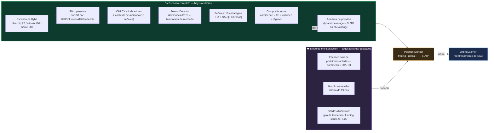

<div align="center">



# 🤖 BitbotBY

### Bot de trading con IA híbrida para Bybit Futures

Claude / DeepSeek / OpenAI / Groq / Gemini · SAC (RL) · Amazon Chronos · 10+ señales de mercado en tiempo real

[](https://www.python.org/)
[](https://fastapi.tiangolo.com/)
[](https://www.docker.com/)
[](../README.md)
[](https://www.bybit.com/)
[](../LICENSE)

🌐 [Русский](../README.md) · [English](README.en.md) · [中文](README.zh.md) · **Español** · [Deutsch](README.de.md)

</div>

> El [README.md](../README.md) ruso y el [README.en.md](README.en.md) inglés están más actualizados (app, lanzador de un clic, cadena de AI, cifrado de claves).


---

BitbotBY escanea el mercado de Bybit, combina las señales del modelo de IA, la red neuronal SAC y 16
estrategias clásicas con el contexto de mercado (funding, liquidaciones, Fear & Greed, libro de
órdenes, derivados, sentimiento en redes sociales) y opera en futuros perpetuos long/short — con
gestión de riesgo cuantitativa (Kelly, CVaR, Almgren-Chriss) y control total a través de Telegram.

Tres perfiles de mercado para distintos niveles de volatilidad: **Bluechip** (top 20), **Altcoin**
(top 100), **Meme** (top 200, estrategias de pump + sentimiento de Twitter/Telegram).

> ⚠️ Trading con dinero real. Empieza siempre con `PAPER_TRADING=true` y sigue la
> [lista de verificación antes de operar en real](#-antes-de-operar-con-dinero-real).

---

## Tabla de contenidos

- [Cómo funciona](#-cómo-funciona)
- [Arquitectura](#-arquitectura)
- [Funcionalidades](#-funcionalidades)
- [Inicio rápido](#-inicio-rápido)
- [Configuración](#-configuración)
- [Referencia .env — todas las variables](#-referencia-env--todas-las-variables)
- [Control por Telegram](#-control-por-telegram)
- [Monitorización](#-monitorización)
- [Entrenamiento del modelo SAC](#-entrenamiento-del-modelo-sac)
- [Backtest y validación de alfa](#-backtest-y-validación-de-alfa)
- [Comandos de Makefile](#-comandos-de-makefile)
- [Tests](#-tests)
- [Preguntas frecuentes](#-preguntas-frecuentes)
- [Antes de operar con dinero real](#-antes-de-operar-con-dinero-real)

---

## 🔄 Cómo funciona

El ciclo se adapta al estado de la cartera: **escaneo completo** del mercado cuando hay slots libres,
y un **modo de monitorización** ligero cuando todas las posiciones están ocupadas (ahorro de tokens de
IA de 5–33×).



<details>
<summary><b>Cadena completa de decisión — 14 pasos con fórmulas</b> (expandir)</summary>

| # | Paso | Qué hace |
|---|---|---|
| 1 | **Snapshots** ([cycle.py](../src/core/cycle.py)) | OHLCV → indicadores (RSI/MACD/BB/ATR/tendencia) + sentimiento de noticias por moneda |
| 2 | **Prescore** | `score = vol×0.35 + rsi×0.30 + atr×0.20 + regime_bonus×0.15` → top-30 pasa a la IA |
| 3 | **Contexto de mercado** ([market_context.py](../src/market/market_context.py)) | 13 señales: funding, OI+liquidaciones, F&G, basis, libro de órdenes, Deribit PCR/IV, Google Trends, Glassnode, flujos de ETF, Reddit (CryptoBERT), oferta de stablecoins |
| 4 | **SignalCombiner** ([signal_combiner.py](../src/core/signal_combiner.py)) | `local` / `ai` / `dqn` / **`hybrid`** (consenso SAC+IA, peso según régimen: trending 50/50, ranging 40/60) / **`hybrid+Chronos`** (modificador ±0.05…0.15) |
| 5 | **Filtro contextual** | Cada una de las 13 señales mueve la confidence ±0.05…0.15 (p. ej. F&G ≤15 + cascada de liquidaciones → confidence = 0) |
| 6 | **Señales contextuales directas** | Los extremos (funding recalentado, squeeze, imbalance >0.4, F&G ≤10/≥92) generan señales propias |
| 7 | **Fallback local** | Si no hay señales, estrategia basada en indicadores, TP más amplio en tendencia, más ajustado en rango |
| 8 | **Priorización** | `composite_score = confidence × (1+tp_bonus) × (1+volume_bonus) × regime_mult` |
| 9 | **Portfolio allocation** | CVaR/Markowitz ([portfolio_optimizer.py](../src/research/portfolio_optimizer.py)) con ≥2 señales simultáneas, tope ×3 |
| 10 | **Execution guards** ([order_executor.py](../src/core/order_executor.py)) | macro blackout → slots/cooldown → horario de trading → símbolo duplicado → **correlation guard** → confirmación en Telegram → **liquidity filter** → validación de SL/TP → **Kelly sizing** → drawdown scaling → **Almgren-Chriss** → dynamic leverage → orden |
| 11 | **Tras la apertura** | PositionMonitor cada 5s: las mismas 13 señales de contexto gestionan la salida (force_close / tighten_sl) |

**Qué cambia realmente entre perfiles** (no solo los parámetros): Meme es el único perfil con
sentimiento de Twitter/Telegram como entrada y las estrategias `momentum_burst`/`pump_exit`/`sentiment`.
Los flujos de ETF de BTC solo se aplican a BTC/USDT. El resto de la lógica (contrarian funding/PCR/FNG,
Kelly, correlation guard, Almgren-Chriss) es idéntica en todos los perfiles — solo cambian las cifras.

</details>

---

## 🏗 Arquitectura

```mermaid
flowchart TB
    SUP["supervisor.py\nrestart on crash · SIGTERM"] --> BOT["TradingBot\nsrc/trading_bot.py"]

    subgraph DATA["Datos y señales"]
        SCAN["MarketScanner"]
        DL["DataLoader\nccxt async · CSV cache 24h"]
        REGIME["RegimeDetector\nGaussianHMM"]
        CTX["MarketContext\n10+ fuentes, TTL 5–240min"]
        NEWS["NewsAnalyzer\nNewsAPI + RSS + VADER"]
        TW["TwitterAnalyzer\nPerfil Meme"]
        TG["TelegramSentiment\nTelethon MTProto"]
        POLL["SentimentPoller\nasyncio → Redis"]
    end

    subgraph BRAIN["Toma de decisiones"]
        COMBINER["SignalCombiner\nSAC + IA [+Chronos]"]
        CHRONOS["ChronosAnalyzer\namazon/chronos-t5-small"]
        CRYPTOBERT["CryptoSentimentAnalyzer\nElKulako/cryptobert"]
        PORT["PortfolioOptimizer\nCVaR / Markowitz"]
        CORR["CorrelationFilter"]
        MACRO["MacroCalendar\nFOMC/CPI/NFP blackout"]
        ARB["FundingArbDetector"]
    end

    subgraph EXEC["Ejecución"]
        OE["OrderExecutor\nKelly → CVaR → Almgren-Chriss"]
        PM["PositionMonitor\nSL/TP · trailing · partial TP"]
        API["BybitAPI\nccxt async, linear+spot"]
        LEARN["OnlineLearner\nSAC auto-retrain"]
    end

    subgraph OUT["Observabilidad"]
        NOTIFY["TelegramNotifier"]
        HIST["TradeHistory\nSQLite"]
        HEALTH["HealthServer\n/health /metrics"]
    end

    BOT --> SCAN & DL & REGIME & CTX
    CTX --> NEWS & TW & TG & POLL
    BOT --> COMBINER
    COMBINER --> CHRONOS & CRYPTOBERT
    BOT --> PORT & CORR & MACRO & ARB
    BOT --> OE --> API
    OE --> PM --> LEARN
    BOT --> NOTIFY & HIST & HEALTH

    style SUP fill:#1c1c1c,stroke:#888,color:#fff
    style BOT fill:#0d3b2e,stroke:#2ecc71,color:#fff
    style DATA fill:#16213e,stroke:#4a90e2,color:#fff
    style BRAIN fill:#2b2340,stroke:#9b6bff,color:#fff
    style EXEC fill:#3a2c14,stroke:#f39c12,color:#fff
    style OUT fill:#3a1414,stroke:#e74c3c,color:#fff
```



**RL / backtest:**

```
reinforcement_learning/
  ├── rl_env.py      — TradingEnv (Gymnasium), OBS_DIM=21, ejecución por open[i+1]
  ├── train_sac.py   — SAC: split 80/20, Optuna, walk-forward, online finetune
  └── tune_sac.py     — búsqueda de hiperparámetros con Optuna

backtest.py    — walk-forward con holdout 20%, overfit ratio
dashboard.py   — FastAPI :8080 (balance, posiciones, historial)
```

---

## ✨ Funcionalidades

### 📡 Edge de mercado — señales en tiempo real

| Fuente | Lógica | Perfil |
|---|---|---|
| **Funding Rate** (Bybit) | >0.1% = longs recalentados → SHORT contrarian | todos |
| **Open Interest + precio** | OI↓ + precio↓ → liquidación de longs | todos |
| **Fear & Greed** | ≤15 BUY contrarian (si no hay cascada), ≥85 anula BUY | todos |
| **Orderbook Imbalance** | ask/bid > 1.4 → SELL | todos |
| **Basis (futures-spot)** | >2% de prima = codicia → SELL | todos |
| **Deribit PCR + IV Skew** | PCR <0.5 = all-in en calls → SELL | todos |
| **ETF Flows** (farside.co.uk) | Salida < −$100M → SELL, entrada > $150M → BUY | solo BTC |
| **Google Trends** | >75 = pico de FOMO retail → SELL | todos |
| **Reddit / CryptoBERT** | Clasificación NLP de posts en r/CryptoCurrency | todos |
| **News sentiment** | NewsAPI/RSS + Claude/DeepSeek/VADER | todos |
| **Twitter/X** | VADER, Basic API ~10K tuits/mes | solo Meme |
| **Canales pump de Telegram** | Telethon MTProto, peso 2× en el score | solo Meme |
| **Stablecoin Supply** | Market cap de USDT ↓ → riesgo de fuga | filtro |

Todas las fuentes están cacheadas (5 min – 4 horas) y degradan de forma gradual (graceful) si no están disponibles.

### 🧠 Estrategias y modelos

- **10 estrategias base**: EMA crossover, RSI, MACD, Bollinger Bands, Scalping, Swing, Breakout, Mean Reversion, Trend Following, Volume Spike
- **6 estrategias por perfil**: se activan automáticamente al cambiar de perfil (`momentum_burst`, `pump_exit`, `sentiment` — Meme; y otras)
- **Análisis con IA**: Claude / DeepSeek / OpenAI / Groq / Gemini con cadena de fallback
- **SAC (Soft Actor-Critic)** — modelo RL, se entrena con el histórico y se reentrena online tras cada operación
- **Amazon Chronos** — modelo de series temporales preentrenado, modificador suave de confidence en modo hybrid

### 📐 Herramientas cuantitativas

| Herramienta | Dónde se aplica |
|---|---|
| **Kelly Criterion** (half-Kelly) | Sizing de la posición según win-rate/EV en vivo de la estrategia |
| **CVaR / Markowitz** | Portfolio allocation cuando hay varias señales simultáneas |
| **Almgren-Chriss** | Ajuste del precio de entrada por el market impact del tamaño de la orden |
| **GaussianHMM** | Detección del régimen de mercado (trending/ranging) por símbolo |
| **Correlation guard** | Bloquea una nueva posición que correlacione con una ya abierta |

### 🛡 Gestión de riesgo

Macro blackout (FOMC/CPI/NFP) · Correlation filter · Liquidity filter (spread/volumen) ·
Circuit breaker y límite diario de pérdidas · **Hard drawdown halt** (cierre de posiciones perdedoras,
SL a breakeven en las ganadoras, bloqueo de nuevas entradas) · **ATR spike protection** (cierre de
todas las posiciones, pausa de 1h) · Dynamic leverage (fixed/volatility/full, basado en ATR) ·
Trailing stop + partial TP.

---

## 🚀 Inicio rápido

### Requisitos

Python 3.11 · Docker + Docker Compose (recomendado) · claves API de Bybit · un proveedor de IA · bot de Telegram

### Ejecución con Docker (recomendado)

```bash
git clone https://github.com/deuteriumZzz/BitbotBY.git
cd BitbotBY
cp .env.example .env        # rellenar las claves — ver la sección «Configuración»
make setup                  # primer arranque: build, htpasswd, docker compose up
```

### Ejecución local (sin Docker)

Necesitas Python 3.11, Redis y Node.js 20+ (para la app).

```bash
python -m venv venv && source venv/bin/activate   # Windows: venv\Scripts\activate
pip install -r requirements.txt
cp .env.example .env                              # completar claves, PAPER_TRADING=true
# Redis: macOS — brew install redis && brew services start redis
#        Linux — sudo apt install redis-server
#        cualquier SO con Docker — docker run -d -p 6379:6379 redis:7-alpine
make webapp                                       # compilar la app: cd webapp && npm ci && npm run build
python supervisor.py --with-dashboard             # o: make local
```

El bot y el panel leen `.env` por sí mismos (las variables de entorno tienen prioridad). La app está en http://localhost:8080/app/ en el navegador; en la app de escritorio indica `http://localhost:8080` como servidor. Sin `--with-dashboard` solo arranca el bot.

La MiniApp de Telegram solo se abre con una dirección https pública. Desde tu ordenador sirve un túnel, por ejemplo `cloudflared tunnel --url http://localhost:8080`: pon su dirección con `/app/` en `WEBAPP_URL` y reinicia el bot. En un servidor `docker compose` hace todo esto: solo necesitas https y `WEBAPP_URL`.

### `.env` mínimo para paper trading

```env
BYBIT_API_KEY=...
BYBIT_API_SECRET=...
BYBIT_TESTNET=false
MARKET_TYPE=linear

AI_PROVIDER=deepseek         # o claude / openai / groq / gemini
DEEPSEEK_API_KEY=...

TELEGRAM_BOT_TOKEN=...
TELEGRAM_CHAT_ID=...          # ID numérico de @userinfobot, no el username

PAPER_TRADING=true
AUTO_EXECUTE=false
MODE=hybrid
```

---

## ⚙️ Configuración

La lista completa de variables con su descripción está en [`.env.example`](../.env.example) (comentarios
en ruso en todas las secciones: API de Bybit, proveedor de IA, modo de trading, Telegram, parámetros de
trading, gestión de posiciones, gestión de riesgo, macro blackout, aprendizaje online de SAC, señales
externas, monitorización).

| Categoría | Variables clave |
|---|---|
| Exchange | `BYBIT_API_KEY/SECRET`, `MARKET_TYPE`, `BYBIT_TESTNET` |
| IA | `AI_PROVIDER`, `<PROVIDER>_API_KEY`, `AI_DAILY_BUDGET`, `AI_MAX_SYMBOLS` |
| Modo | `MODE` (`local`/`ai`/`dqn`/`hybrid`), `PAPER_TRADING`, `AUTO_EXECUTE` |
| Perfil | `MARKET_PROFILE` (`bluechip`/`altcoin`/`meme`) |
| Posiciones | `MAX_POSITIONS` (1–20), `RISK_PER_TRADE`, `LEVERAGE`, `LEVERAGE_MODE` |
| Riesgo | `DAILY_LOSS_LIMIT`, `DRAWDOWN_HALT_HOURS`, `MAX_CORRELATION`, `MAX_SPREAD_PCT` |
| Telegram | `TELEGRAM_BOT_TOKEN`, `TELEGRAM_CHAT_ID`, `TELEGRAM_CONFIRM_TIMEOUT` |
| Infra | `REDIS_HOST/PASSWORD`, `DASHBOARD_USER/PASSWORD` |

La mayoría de los parámetros (modo, estrategias, perfil de riesgo, horario de trading, número de
posiciones) se cambian **directamente desde el menú de Telegram sin reiniciar** — se guardan en Redis
con persistencia AOF.

---

## 📋 Referencia .env — todas las variables

Descripción línea a línea de cada variable. Expande la categoría que necesites.

<details>
<summary><b>🔑 API de Bybit</b></summary>

```env
BYBIT_API_KEY=           # Obtener en: bybit.com → Account → API Management
BYBIT_API_SECRET=        # ⚠ Nunca publicar ni subir a git

TESTNET=false            # true → operar en testnet.bybit.com (sin dinero real)
                         # ¡Las claves de testnet se crean por separado de las de producción!

MARKET_TYPE=linear       # linear → perpetual futures (RECOMENDADO, valor por defecto al iniciar)
                         #   + Puede abrir posiciones SHORT
                         #   + Tiene funding rate (señal adicional)
                         #   + Apalancamiento hasta 100x (nosotros limitamos a max=3)
                         # spot → solo LONG, sin short, sin apalancamiento
                         # Esto es solo el valor inicial en el primer arranque —
                         # después el modo se cambia sobre la marcha desde Telegram
                         # (💱 Mercado en Ajustes), sin tocar .env ni reiniciar.

LEVERAGE=3               # Apalancamiento MÁXIMO. El bot lo calcula dinámicamente entre 1 y LEVERAGE.
                         # Recomendado: 2–3 para empezar. No poner >5 sin tener estadísticas aún.
                         # LEVERAGE=1 = trading sin apalancamiento (como spot, pero en futuros)
```

> **Permisos de las claves API:** para futures — `Contract — Orders` y `Contract — Positions`. Si
> planeas alguna vez cambiar a spot desde Telegram, habilita también `Spot — Trade` desde el
> principio, ambos permisos conviven sin problema en la misma clave. El permiso de retiro de fondos —
> **NO habilitarlo**.

</details>

<details>
<summary><b>🧠 Proveedor de IA</b></summary>

```env
AI_PROVIDER=auto         # auto      → prueba Claude → OpenAI → DeepSeek → Groq → Gemini → estrategias locales
                         # anthropic → solo Claude
                         # deepseek  → solo DeepSeek
                         # groq      → solo Groq (Llama 3.3 70B, el más rápido)
                         # openai    → solo ChatGPT
                         # gemini    → solo Google Gemini Flash

# ── Groq — nivel GRATUITO, 100k tokens/día, Llama 3.3 70B ──
# console.groq.com → API Keys → Create
GROQ_API_KEY=gsk_...
GROQ_MODEL=llama-3.3-70b-versatile

# ── Google Gemini Flash — nivel GRATUITO, 1500 peticiones/día ──
# aistudio.google.com → Get API Key (gratis, sin tarjeta)
GEMINI_API_KEY=...
GEMINI_MODEL=gemini-2.0-flash-lite

# ── DeepSeek — el MÁS BARATO (~$0.002 por petición) ──
# platform.deepseek.com → API Keys → Create
DEEPSEEK_API_KEY=sk-...
DEEPSEEK_MODEL=deepseek-chat

# ── Claude (Anthropic) — mejor calidad de análisis ──
# console.anthropic.com → API Keys → Create Key
ANTHROPIC_API_KEY=sk-ant-...
AI_MODEL=claude-sonnet-4-6

# ── ChatGPT (OpenAI) ──
# platform.openai.com → API Keys
OPENAI_API_KEY=sk-...
OPENAI_MODEL=gpt-4o-mini

AI_DAILY_BUDGET=500      # Límite de llamadas a la IA por día (UTC). Superado el límite → estrategias locales.
                         # Bluechip: 96 peticiones/día. Altcoin: 288 peticiones/día.
```

> **Consejo para empezar (gratis):** añade Groq + Gemini — es suficiente para todo el día en ambos
> perfiles. Para mejor calidad, recarga además DeepSeek con $5 (~9–26 días de trading).

**Cadena de resiliencia — el bot nunca se detiene:**

```
Claude (Anthropic) — mejor calidad, de pago
    ↓ sin saldo → notificación en Telegram
OpenAI GPT-4o-mini — buena calidad, de pago
    ↓ sin saldo → notificación en Telegram
DeepSeek — buena calidad, el más barato, ~$5 para 9–26 días
    ↓ sin saldo → notificación en Telegram
Groq + Gemini — gratuitos, alcanzan para todo el día
    ↓ agotados al final del día → notificación con cuenta atrás hasta el reinicio
Estrategias locales — 10 base + hasta 4 estrategias por perfil sin IA, siempre funcionan
```

Solo se configuran los proveedores que tienen una clave en `.env`. El orden real y el estado de cada
uno están en Telegram: ⚙️ Ajustes → 🤖 Proveedor de IA.

| Proveedor | Coste | Calidad | Límite |
|---|---|---|---|
| DeepSeek | ~$5 para 9–26 días | Buena | según saldo |
| Groq (Llama 3.3 70B) | gratis | Buena | 100k tokens/día |
| Gemini 2.0 Flash | gratis | Buena | 1500 peticiones/día |
| Claude Sonnet | ~$0.01/petición | Excelente | según saldo |
| OpenAI GPT-4o-mini | ~$0.003/petición | Buena | según saldo |

</details>

<details>
<summary><b>🔀 Modo de trading</b></summary>

```env
MODE=ai                  # ai     → la IA analiza cada moneda y genera una señal
                         # local  → solo estrategias base (10+perfil), sin IA (gratis)
                         # dqn    → solo la red neuronal SAC (requiere modelo entrenado)
                         # hybrid → SAC + IA deben coincidir (el más conservador)

AUTO_EXECUTE=false       # false → el bot envía la señal con botones y temporizador.
                         #         Ejecución automática al agotarse el timeout.
                         #         Pulsa Skip para cancelar esa operación en concreto.
                         # true  → el bot opera de inmediato, sin diálogo. Llega una notificación con el hecho.
                         # Recomendado: empezar con false (2 semanas), luego activar true

PAPER_TRADING=true       # true  → simulación, NO hay órdenes reales (para empezar)
                         # false → trading real (¡solo tras verificar las señales!)
                         # Cambio en tiempo real desde Telegram:
                         # ⚙️ Ajustes → 📄 Modo: PAPER → Live (requiere palabra clave)

TRADING_MODE_PIN=        # Palabra clave para cambiar Paper ↔ Live desde Telegram.
                         # Dejar vacío — el botón de cambio no se muestra.
                         # Ejemplo: TRADING_MODE_PIN=mysecret2024
                         # Tras introducir la palabra, el bot envía una notificación 🚨 ¡IMPORTANTE!

SCAN_TOP_N=20            # Cuántas monedas escanear (top por volumen en 24h).
                         # Más = más oportunidades, pero más peticiones a la API.

MAX_POSITIONS=3          # Valor inicial (1–20). Se cambia en tiempo real
                         # desde Telegram: ⚖️ Perfil de riesgo → ➖ / ➕.
                         # En modo paper se recomienda 10–15 para que SAC aprenda más rápido.
```

</details>

<details>
<summary><b>💬 Telegram</b></summary>

```env
TELEGRAM_BOT_TOKEN=      # Paso 1: escribir a @BotFather → /newbot → copiar el token
                         # Formato: 1234567890:ABCdefGHI...

TELEGRAM_CHAT_ID=        # Paso 2: escribir a @userinfobot → copiar "Your ID"
                         # ⚠ IMPORTANTE: es TU ID numérico, no el ID del bot.
                         # Formato: 123456789 (solo dígitos, sin @)

TELEGRAM_CONFIRM_TIMEOUT=60   # Segundos a esperar la respuesta a los botones Trade/Skip (con AUTO_EXECUTE=false).
                               # Al agotarse → ejecuta la operación automáticamente.
                               # Se cambia sin reiniciar: ⚙️ Ajustes → ⏱ Timeout de confirmación

SILENT_DEATH_HOURS=6.0   # Alerta en Telegram si no hay ninguna operación en N horas.
                         # Ayuda a detectar a tiempo si el bot se ha colgado. 0 = desactivado.
```

</details>

<details>
<summary><b>📈 Parámetros de trading</b></summary>

```env
TIMEFRAME=15m            # Timeframe de las velas para las estrategias.
                         # 15m — buen equilibrio. Opciones: 1m (ruidoso), 5m, 15m, 1h, 4h.

INITIAL_BALANCE=10000.0  # Balance inicial para paper trading (para cálculos y visualización).
                         # En trading real el bot toma el balance del exchange automáticamente.

RISK_PER_TRADE=0.02      # Riesgo por operación como fracción del balance.
                         # 0.02 = 2% del balance. Con $10k → se arriesgan $200 por operación.
                         # Recomendado: 0.01 para empezar, luego 0.02.

MIN_SIGNAL_CONFIDENCE=0.75        # Confianza mínima de la señal en modo live (0–1).
                                  # Subir a 0.80–0.85 para un trading más conservador.
MIN_SIGNAL_CONFIDENCE_PAPER=0.60  # Umbral para modo paper — más bajo, para acumular más
                                  # operaciones para entrenar a SAC. Se cambia desde Telegram sin
                                  # reiniciar: ⚖️ Perfil de riesgo → 🎯 Paper ▼/▲.

TRADING_INTERVAL=60      # Intervalo de ciclo de fallback en segundos (sin perfil activo).
                         # Con un perfil activo se usa el intervalo del propio perfil:
                         # bluechip → 900s (15 min), altcoin → 300s (5 min).
```

</details>

<details>
<summary><b>🎯 Gestión de posiciones</b></summary>

```env
# ── Toma de beneficios parcial ──────────────────────────────────────────
PARTIAL_TP_ENABLED=true  # Al alcanzar el 60% del camino hasta el TP:
                         # 1. Cierra el 50% de la posición (asegura parte del beneficio)
                         # 2. Mueve el SL a breakeven (el resto opera sin riesgo)
PARTIAL_TP_TRIGGER=0.6   # Fracción del camino entry→TP para activarse. 0.6 = 60%.
PARTIAL_TP_FRACTION=0.5  # Qué fracción de la posición cerrar. 0.5 = 50%.

# ── Trailing stop ────────────────────────────────────────────────────────
TRAILING_STOP_ATR_MULT=1.0   # El SL sigue al precio con un paso de 1×ATR.
                              # 0.5 = stop ajustado (más activaciones).
                              # 1.5 = stop amplio (menos activaciones, más drawdown).

# ── Drawdown scaling ─────────────────────────────────────────────────────
DRAWDOWN_SCALE_ENABLED=true       # En caso de drawdown desde el pico — reducir el tamaño de las posiciones.
DRAWDOWN_SCALE_THRESHOLD=0.10     # Umbral: 0.10 = con drawdown >10% desde el pico de balance.
DRAWDOWN_SCALE_FACTOR=0.5         # Multiplicador del tamaño en drawdown: 0.5 = operar con la mitad de tamaño.
                                  # Ejemplo: el balance era $10k, cayó a $9k → posiciones ×0.5.

# ── Filtro de liquidez ───────────────────────────────────────────────────
MIN_VOLUME_USDT=1000000  # Volumen mínimo de la moneda en 24h en USDT.
                         # $1M = solo monedas líquidas. Por debajo → riesgo de manipulación.
MAX_SPREAD_PCT=0.3       # Spread máximo bid/ask en %.
                         # 0.3% = en la entrada y salida perdemos como mucho 0.3%.

# ── Cooldown (protección contra overtrading) ─────────────────────────────
SYMBOL_COOLDOWN_HOURS=3  # No reabrir el mismo símbolo durante N horas tras cerrarlo.
                         # Protege contra la situación en la que el bot entra repetidamente en el
                         # mismo token tras SL rápidos (por ejemplo 7 veces en TAC/USDT en un día).
                         # 0 = desactivado. Recomendado: 2–4 horas.

# ── Horario de trading ────────────────────────────────────────────────────
TRADING_HOURS=           # Vacío = operar las 24 horas (RECOMENDADO para cripto).
                         # "8-22" = solo de 8:00 a 22:00 UTC.
                         # No recomendado: la cripta está activa 24/7, los movimientos nocturnos son reales.
```

</details>

<details>
<summary><b>🛡 Gestión de riesgo</b></summary>

```env
DAILY_LOSS_LIMIT=0.05    # Límite diario de pérdida: 0.05 = 5% del balance.
                         # Al superarlo → todas las posiciones se cierran, sin operar hasta el siguiente día UTC.
                         # Recomendado: 0.03 para empezar, luego 0.05.

# ── Black swan / interruptores de emergencia ─────────────────────────────
MAX_DRAWDOWN_PERCENT=0.20     # Hard drawdown halt: drawdown de equity desde el pico ≥ 20%.
                               # Equity = balance + PnL no realizado (más preciso que el USDT libre).
                               # Al activarse: cerrar todas las posiciones → pausa de N horas.

DRAWDOWN_HALT_HOURS=4          # Duración de la pausa en horas tras activarse el hard drawdown halt.

DRAWDOWN_CONFIRM_CYCLES=3      # Protección flash: el halt solo se activa tras N confirmaciones seguidas.
                               # 1 ciclo ≈ 30s. 3 = se activará tras ~90s de drawdown sostenido.
                               # Un flash crash (recuperado en segundos) no lo dispara.
                               # Se cambia sin reiniciar: Telegram → ⚖️ Perfil de riesgo → 🛡 Protección flash ±

ATR_SPIKE_MULT=3.0             # ATR spike: el ATR actual es N× superior a la media → cerrar posiciones.
                               # 3.0 = solo volatilidad extrema (guerra, crash).

ATR_SPIKE_LOOKBACK=20          # Ventana para calcular el ATR medio (en velas).

CIRCUIT_BREAKER_LOSSES=3 # Autostop tras N operaciones perdedoras seguidas.
                         # 3 = tres stops seguidos → el bot se detiene hasta un reinicio manual.
                         # 0 = desactivado. Recomendado: 3–5.

MAX_CORRELATION=0.7      # Bloquear la señal si |correlación| con una posición abierta ≥ el umbral.
                         # 0.7 = no abrimos ETH long si ya tenemos BTC long.
                         # 0.0 = filtro desactivado. Recomendado: 0.7.
MAX_CORRELATION_PAPER=0.85  # Umbral de correlación para el modo paper.
                         # En mercado lateral la cripto correlaciona a 0.70–0.77 —
                         # un umbral de 0.7 bloquearía casi todas las entradas.
                         # 0.85 permite acumular más operaciones para SAC.
CORRELATION_WINDOW=50    # Ventana de cálculo de correlación en barras (50 × 15m = 12.5 horas).
```

</details>

<details>
<summary><b>📅 Macro blackout</b></summary>

```env
FINNHUB_API_KEY=         # Clave de Finnhub (nivel gratuito): finnhub.io → Dashboard → API Key
                         # Si no se define, el macro blackout se desactiva automáticamente.

MACRO_BLACKOUT_ENABLED=true  # Bloquea nuevas posiciones 30 min antes/después de:
                             # FOMC (tipos de la Fed), CPI (inflación), NFP (empleo), GDP, PCE.
                             # Estos eventos provocan movimientos bruscos — mejor esperar.
```

</details>

<details>
<summary><b>🎓 Aprendizaje online de SAC</b></summary>

```env
ONLINE_LEARNING_MODE=periodic  # disabled → desactivado (SAC no se reentrena automáticamente)
                                # online   → gradient steps tras CADA operación
                                #            ⚠ ARRIESGADO: una racha de pérdidas puede estropear el modelo
                                # periodic → reentrenamiento cada N operaciones en segundo plano [RECOMENDADO]
                                # hybrid   → periodic + pesos de estrategias dinámicos en tiempo real

ONLINE_LEARNING_TRIGGER=50      # Reentrenamiento cada 50 operaciones cerradas (para periodic/hybrid).
                                # 3 posiciones × 10 operaciones/día ≈ reentrenamiento cada ~17 horas.

ONLINE_LEARNING_GRADIENT_STEPS=50  # Pasos de gradiente por actualización online.
                                    # Solo para el modo online. Recomendado ≤ 50.

TRAIN_TOP_N=20           # Cuántas top monedas por volumen usar para entrenar SAC.
                         # Se cambia sin reiniciar — comando de Telegram: /trainn 15
                         # Con un perfil activo se sobrescribe automáticamente:
                         #   bluechip → 20 monedas (15m),  altcoin → 50 monedas (5m)
TRAIN_MIN_CANDLES=2880   # Mínimo de velas por símbolo para entrenar SAC.
                         # 2880 = ~1 mes de datos de 15m. Los símbolos con menos
                         # se omiten — historial insuficiente para entrenar.
TOTAL_TIMESTEPS=500000   # Pasos de entrenamiento de SAC (se sobrescribe con env al hacer make train).
                         # 500k ≈ 60 min en CPU. 1M = modelo de mayor calidad (~2h).
SAC_MODEL_PATH=models/sac_model.zip  # Ruta al archivo del modelo SAC.
                                     # Se sobrescribe según el perfil:
                                     #   bluechip → models/sac_model.zip
                                     #   altcoin  → models/sac_model_altcoin.zip
```

</details>

<details>
<summary><b>🌐 Señales externas (opcional)</b></summary>

Todas las claves son opcionales. Sin ellas el bot funciona, simplemente sin esas fuentes de señal.

```env
# Twitter/X sentiment — VADER sobre tuits de las monedas (activo solo con el perfil Meme)
# Tarifa Basic: $100/mes, ~10 000 tuits/mes. El tier gratuito READ no es compatible.
# developer.twitter.com → Projects & Apps → Keys and Tokens → Bearer Token
# Si no se define — TwitterAnalyzer devuelve 0.0 en silencio
TWITTER_BEARER_TOKEN=
TWITTER_MAX_RESULTS=10   # Tuits por petición (10 = ahorro de la cuota Basic)

# Telegram sentiment — monitorización de canales pump públicos (solo perfil Meme)
# Gratis vía Telethon MTProto. Se obtiene en: my.telegram.org → API development tools
# Si no se define — TelegramSentiment devuelve 0.0 en silencio
TELEGRAM_SENTIMENT_API_ID=
TELEGRAM_SENTIMENT_API_HASH=
TELEGRAM_SENTIMENT_PHONE=+375291234567   # Formato con código de país
TELEGRAM_SENTIMENT_CHANNELS=CryptoMoonAlerts,pumpsignalscrypto,memecoinsnews

# Parámetros del poller (SentimentPoller, activo solo con el perfil Meme)
SENTIMENT_POLL_INTERVAL=300   # Intervalo de consulta en segundos (cada 5 min)
SENTIMENT_CACHE_TTL=600       # TTL de la caché en Redis (10 min)
SENTIMENT_BUY_THRESHOLD=0.4   # Score ≥0.4 → señal de compra
SENTIMENT_SELL_THRESHOLD=-0.4 # Score ≤-0.4 → señal de venta

# Reddit sentiment — r/CryptoCurrency
# reddit.com/prefs/apps → create app (tipo: script)
REDDIT_CLIENT_ID=
REDDIT_CLIENT_SECRET=
REDDIT_USER_AGENT=BitbotBY/1.0

# Glassnode — métricas on-chain (oferta de stablecoins, etc.)
# glassnode.com → Account → API Access
GLASSNODE_API_KEY=

# NewsAPI — sentimiento de noticias (CoinDesk, CoinTelegraph)
# newsapi.org → Get API Key (gratis)
NEWS_API_KEY=
NEWS_UPDATE_INTERVAL=900   # Actualizar noticias cada 15 minutos
```

</details>

<details>
<summary><b>🖥 Monitorización e infraestructura</b></summary>

```env
HEALTH_PORT=8080         # Puerto del servidor HTTP de health:
                         # GET /health  → estado del bot en JSON
                         # GET /metrics → métricas Prometheus
                         # 0 = desactivado

DASHBOARD_API_KEY=       # Clave opcional para el dashboard web.
                         # Si se define → todas las peticiones requieren el header: X-API-Key: valor

GRAFANA_PASSWORD=admin   # Contraseña de Grafana (http://localhost:3000, usuario: admin)

REDIS_HOST=localhost     # En Docker se sobrescribe automáticamente a "redis".
REDIS_PORT=6379
REDIS_PASSWORD=          # Se recomienda definirla en producción.
```

</details>

---

## 📱 Control por Telegram

Al arrancar, el bot envía un teclado con acceso rápido a:

- 🌐 **Perfil de mercado** — cambio entre Bluechip / Altcoin / Meme
- ⚙️ **Modo** — Local / AI / DQN / Hybrid (+ Chronos)
- ⚖️ **Perfil de riesgo** — umbrales de confidence, protección flash (ATR spike / drawdown halt)
- 🎯 **Posiciones** — número de slots, risk per trade, leverage
- 🧠 **Entrenamiento de SAC** — lanzar reentrenamiento, progreso, métricas
- 📊 **Estadísticas** — win rate, EV, historial de operaciones

La confirmación de cada operación (si `AUTO_EXECUTE=false`) llega con el win-rate/EV en vivo de la
estrategia y estadísticas de backtest, con timeout `TELEGRAM_CONFIRM_TIMEOUT`.

---

## 📊 Monitorización

| Servicio | URL | Función |
|---|---|---|
| **Dashboard web** | http://localhost:8080 | Balance, posiciones abiertas, historial de operaciones |
| **Grafana** | http://localhost:3000 | Dashboards de métricas del bot |
| **Prometheus** | http://localhost:9090 | Métricas en bruto |
| **Health check** | http://localhost:8080/health | Estado para supervisor/orquestación |
| **Telegram** | — | Señales, Trade/Skip, silent death, alertas de arbitraje |

El dashboard está protegido por nginx (HTTP basic auth, `DASHBOARD_USER`/`DASHBOARD_PASSWORD`), no es
accesible directamente.

---

## 🎓 Entrenamiento del modelo SAC

```bash
make train           # entrenamiento local (Optuna + walk-forward)
make train-docker     # lo mismo en Docker (~60 min)
make tune             # solo búsqueda de hiperparámetros
```

Hasta que termine el entrenamiento usa `MODE=ai`; el cambio a `dqn`/`hybrid` está disponible desde
Telegram sin reiniciar en cuanto termine el entrenamiento. `OnlineLearner` reentrena el modelo
automáticamente tras cada operación cerrada (modos `periodic`/`hybrid`/`online`).

---

## 🔬 Backtest y validación de alfa

El orden importa — cada paso verifica algo que el anterior no puede:

```bash
make backtest          # walk-forward, holdout 20%, overfit ratio (debe ser <2×)
make alpha-report       # bootstrap Sharpe + Wilcoxon — si el alfa es estadísticamente significativa
make live-divergence    # slippage/retraso de ejecución live vs backtest
make ai-isolation       # si la capa de IA aporta edge por encima de los indicadores puros (consume cuota de IA)
```

`alpha-report` requiere un mínimo de 30–50 operaciones por grupo; en caso contrario `INSUFFICIENT DATA`
— es una señal para observar más tiempo, no para considerar la verificación superada.

---

## 🛠 Comandos de Makefile

<details>
<summary>Lista completa (expandir)</summary>

| Comando | Función |
|---|---|
| `make setup` | Primer arranque: build + htpasswd + docker compose up |
| `make up` / `make down` | Arrancar / detener contenedores |
| `make rebuild` | Reconstrucción completa (reset de Redis) |
| `make logs` | Logs del bot (`./logs.sh`) |
| `make train` / `make train-long` / `make train-docker` | Entrenamiento de SAC |
| `make tune` / `make tune-bluechip` / `make tune-altcoin` | Búsqueda de hiperparámetros con Optuna |
| `make retrain` | Reentrenamiento con datos nuevos |
| `make backtest` / `make backtest-eth` | Backtest walk-forward |
| `make alpha-report` | Significancia estadística del alfa |
| `make live-divergence` | Comparación de ejecución live vs backtest |
| `make ai-isolation` | Aislamiento de la contribución de la capa de IA |
| `make paper` / `make paper-ai` | Paper trading (modo local / AI) |
| `make local` / `make webapp` | Sin Docker: bot + panel + app en este ordenador / compilar la app |
| `make live` | Trading en vivo |
| `make test` / `make lint` / `make fmt` | pytest / ruff / formateo |
| `make htpasswd` | Generación de contraseña para nginx basic auth |

</details>

---

## ✅ Tests

```bash
make test
# pytest tests/ -v --cov=src --cov-fail-under=50
```

**2012 tests unitarios** — indicadores, estrategias, gestión de riesgo, CVaR, Kelly, Almgren-Chriss,
correlación, inferencia de SAC, dynamic leverage, partial TP, drawdown scaling, liquidity filter,
dynamic exits, position monitor, online learner, runtime config, ciclo de trading e2e. Cobertura: **69%**.

---

## ❓ Preguntas frecuentes

<details>
<summary><b>El bot muestra "Top 0 by volume" y no opera</b></summary><br>

Comprueba que `MARKET_TYPE=linear` en `.env`. Con linear, Bybit devuelve los símbolos como
`BTC/USDT:USDT` — el bot los normaliza automáticamente. Si el error persiste, revisa `BYBIT_API_KEY`.
</details>

<details>
<summary><b>Telegram no recibe mensajes</b></summary><br>

`TELEGRAM_CHAT_ID` debe ser **tu ID numérico** de @userinfobot, no el ID del bot. Escríbele al bot
cualquier mensaje para activar el chat.
</details>

<details>
<summary><b>MODE=dqn o hybrid falla con un error sobre el modelo</b></summary><br>

Primero hay que entrenar: `make train` o `make train-docker` (~60 min). Hasta entonces, usa `MODE=ai`.
</details>

<details>
<summary><b>Por qué el bot a veces no opera durante horas</b></summary><br>

Es normal — protección contra overtrading. En live espera confidence ≥ `MIN_SIGNAL_CONFIDENCE` (0.65),
en mercado lateral las estrategias locales dan ~0.60. El umbral se ajusta en Telegram: ⚖️ Perfil de
riesgo.
</details>

<details>
<summary><b>Qué ocurre en un hard drawdown halt / ATR spike</b></summary><br>

**Drawdown halt**: las posiciones perdedoras se cierran, las ganadoras reciben SL a breakeven, las
nuevas entradas se bloquean durante `DRAWDOWN_HALT_HOURS`. **ATR spike**: se cierran todas las
posiciones, pausa de 1 hora. En modo paper — solo se notifica, el trading continúa.
</details>

<details>
<summary><b>Qué es Chronos y hay que entrenarlo</b></summary><br>

Es un modelo preentrenado de Amazon para series temporales. No requiere entrenamiento, se descarga
automáticamente (~400MB) la primera vez que se activa. Funciona como un modificador suave de
confidence en modo hybrid, no como una condición estricta.
</details>

<details>
<summary><b>El bot se reinició y perdió los ajustes de Telegram</b></summary><br>

No debería — los ajustes están en Redis con persistencia AOF (volcado a disco cada segundo). Un reset
completo solo ocurre con `docker compose down -v` o `make rebuild`.
</details>

---

## 🎯 Antes de operar con dinero real

El orden importa — cada paso verifica algo que el anterior no puede:

1. ✅ Rellenar `.env` — API de Bybit, clave de IA, Telegram, `REDIS_PASSWORD`, `DASHBOARD_PASSWORD`
2. ✅ `make setup`
3. ✅ Entrenar SAC (botón en Telegram en el primer arranque, o `make train-docker`)
4. ✅ `make backtest` — overfit ratio <2×, si no primero hay que revisar las estrategias
5. ✅ Mínimo **2 semanas** de paper trading (`PAPER_TRADING=true`, `AUTO_EXECUTE=false`)
6. ✅ `make alpha-report` — el alfa es estadísticamente significativa, no solo "parece buena"
7. ✅ `make live-divergence` — si hay sospecha de slippage/retraso
8. ⬜ *(opcional)* `make ai-isolation` — no bloquea el paso a real, consume cuota de IA
9. ✅ Empezar de forma conservadora: `RISK_PER_TRADE=0.01`, `MAX_POSITIONS=2`, `LEVERAGE=2`
10. ✅ `DAILY_LOSS_LIMIT=0.03` durante el primer tiempo
11. ✅ `PAPER_TRADING=false` solo después de que el paso 6 muestre alfa significativa

---

## 📄 Licencia

Este proyecto se distribuye bajo la licencia [MIT](../LICENSE).

---

## ⚠️ Descargo de responsabilidad

El trading de criptomonedas conlleva un alto riesgo de pérdida de capital. Este bot no es un asesor
financiero. Úsalo bajo tu propia responsabilidad. Empieza siempre con paper trading (`PAPER_TRADING=true`).
