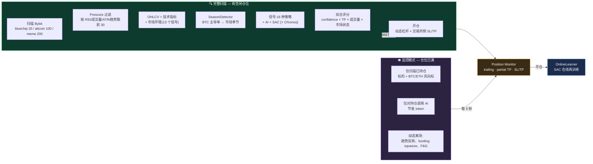

<div align="center">


# 🤖 BitbotBY

### Bybit 期货 AI 混合交易机器人

Claude / DeepSeek / OpenAI / Groq / Gemini · SAC(强化学习)· Amazon Chronos · 10+ 实时市场信号

[](https://www.python.org/)
[](https://fastapi.tiangolo.com/)
[](https://www.docker.com/)
[](../README.md)
[](https://www.bybit.com/)
[](../LICENSE)

🌐 [Русский](../README.md) · [English](README.en.md) · **中文** · [Español](README.es.md) · [Deutsch](README.de.md)

</div>

> 俄文 [README.md](../README.md) 和英文 [README.en.md](README.en.md) 更新更及时（应用、一键启动器、AI 链、密钥加密）。


---

BitbotBY 扫描 Bybit 市场,综合 AI 模型、SAC 神经网络与 16 种经典策略给出的信号,结合市场环境
(资金费率、爆仓、恐惧贪婪指数、订单簿、衍生品、社交媒体情绪),在永续合约上进行多空双向交易——
配备量化风控体系(Kelly、CVaR、Almgren-Chriss),并可通过 Telegram 完整管理。

针对不同波动性设计了三种市场画像:**Bluechip**(市值前 20)、**Altcoin**(市值前 100)、
**Meme**(市值前 200,含拉盘策略 + Twitter/Telegram 情绪分析)。

> ⚠️ 本项目涉及真实资金交易。请务必先以 `PAPER_TRADING=true` 启动,并完成
> [实盘交易前的检查清单](#-实盘交易前须知)。

---

## 目录

- [工作原理](#-工作原理)
- [架构](#-架构)
- [功能特性](#-功能特性)
- [快速开始](#-快速开始)
- [配置](#-配置)
- [.env 完整参考 — 全部变量](#-env-完整参考--全部变量)
- [Telegram 控制](#-telegram-控制)
- [监控](#-监控)
- [SAC 模型训练](#-sac-模型训练)
- [回测与 Alpha 验证](#-回测与-alpha-验证)
- [Makefile 命令](#-makefile-命令)
- [测试](#-测试)
- [常见问题](#-常见问题)
- [实盘交易前须知](#-实盘交易前须知)

---

## 🔄 工作原理

机器人的运行周期会根据持仓状态自适应:当有空闲仓位时执行**完整扫描**,当所有仓位都已占用时切换到
轻量级**监控模式**(可节省 5–33 倍的 AI token 消耗)。



<details>
<summary><b>完整决策链路 — 14 个步骤及公式</b>(展开)</summary>

| # | 步骤 | 说明 |
|---|---|---|
| 1 | **快照**([cycle.py](../src/core/cycle.py)) | OHLCV → 技术指标(RSI/MACD/BB/ATR/趋势)+ 每个币种的新闻情绪 |
| 2 | **Prescore** | `score = vol×0.35 + rsi×0.30 + atr×0.20 + regime_bonus×0.15` → 取前 30 送入 AI |
| 3 | **市场环境**([market_context.py](../src/market/market_context.py)) | 13 个信号:资金费率、持仓量+爆仓、F&G、基差、订单簿、Deribit PCR/IV、Google Trends、Glassnode、ETF 资金流、Reddit(CryptoBERT)、稳定币供应量 |
| 4 | **SignalCombiner**([signal_combiner.py](../src/core/signal_combiner.py)) | `local` / `ai` / `dqn` / **`hybrid`**(SAC+AI 一致,权重取决于市场状态:趋势市 50/50,震荡市 40/60)/ **`hybrid+Chronos`**(±0.05…0.15 修正) |
| 5 | **环境过滤器** | 13 个信号中的每一个都会将 confidence 上下浮动 ±0.05…0.15(例如 F&G ≤15 且出现爆仓连锁 → confidence = 0) |
| 6 | **直接环境信号** | 极端情况(资金费率过热、squeeze、订单簿失衡 >0.4、F&G ≤10/≥92)会单独生成信号 |
| 7 | **本地兜底** | 无信号时使用指标策略,趋势中 TP 更宽,震荡中更紧 |
| 8 | **优先级排序** | `composite_score = confidence × (1+tp_bonus) × (1+volume_bonus) × regime_mult` |
| 9 | **组合分配** | 当存在 ≥2 个信号时使用 CVaR/Markowitz([portfolio_optimizer.py](../src/research/portfolio_optimizer.py)),上限 ×3 |
| 10 | **执行防护**([order_executor.py](../src/core/order_executor.py)) | 宏观静默期 → 仓位/冷却 → 交易时段 → 重复标的 → **相关性防护** → Telegram 确认 → **流动性过滤** → SL/TP 校验 → **Kelly 仓位管理** → 回撤缩放 → **Almgren-Chriss** → 动态杠杆 → 下单 |
| 11 | **开仓之后** | PositionMonitor 每 5 秒运行一次:同样的 13 个环境信号控制离场(force_close / tighten_sl) |

**各画像之间真正的区别**(不仅是参数不同):Meme 是唯一以 Twitter/Telegram 情绪作为输入的画像,
拥有 `momentum_burst`/`pump_exit`/`sentiment` 专属策略。BTC ETF 资金流信号仅作用于 BTC/USDT。
其余逻辑(逆势资金费率/PCR/FNG、Kelly、相关性防护、Almgren-Chriss)在所有画像中完全一致——只是数值不同。

</details>

---

## 🏗 架构

```mermaid
flowchart TB
    SUP["supervisor.py\nrestart on crash · SIGTERM"] --> BOT["TradingBot\nsrc/trading_bot.py"]

    subgraph DATA["数据与信号"]
        SCAN["MarketScanner"]
        DL["DataLoader\nccxt async · CSV 缓存 24 小时"]
        REGIME["RegimeDetector\nGaussianHMM"]
        CTX["MarketContext\n10+ 数据源,TTL 5–240 分钟"]
        NEWS["NewsAnalyzer\nNewsAPI + RSS + VADER"]
        TW["TwitterAnalyzer\nMeme 画像"]
        TG["TelegramSentiment\nTelethon MTProto"]
        POLL["SentimentPoller\nasyncio → Redis"]
    end

    subgraph BRAIN["决策"]
        COMBINER["SignalCombiner\nSAC + AI [+Chronos]"]
        CHRONOS["ChronosAnalyzer\namazon/chronos-t5-small"]
        CRYPTOBERT["CryptoSentimentAnalyzer\nElKulako/cryptobert"]
        PORT["PortfolioOptimizer\nCVaR / Markowitz"]
        CORR["CorrelationFilter"]
        MACRO["MacroCalendar\nFOMC/CPI/NFP 静默期"]
        ARB["FundingArbDetector"]
    end

    subgraph EXEC["执行"]
        OE["OrderExecutor\nKelly → CVaR → Almgren-Chriss"]
        PM["PositionMonitor\nSL/TP · trailing · partial TP"]
        API["BybitAPI\nccxt async, linear+spot"]
        LEARN["OnlineLearner\nSAC 自动再训练"]
    end

    subgraph OUT["可观测性"]
        NOTIFY["TelegramNotifier"]
        HIST["TradeHistory\nSQLite"]
        HEALTH["HealthServer\n/health /metrics"]
    end

    BOT --> SCAN & DL & REGIME & CTX
    CTX --> NEWS & TW & TG & POLL
    BOT --> COMBINER
    COMBINER --> CHRONOS & CRYPTOBERT
    BOT --> PORT & CORR & MACRO & ARB
    BOT --> OE --> API
    OE --> PM --> LEARN
    BOT --> NOTIFY & HIST & HEALTH

    style SUP fill:#1c1c1c,stroke:#888,color:#fff
    style BOT fill:#0d3b2e,stroke:#2ecc71,color:#fff
    style DATA fill:#16213e,stroke:#4a90e2,color:#fff
    style BRAIN fill:#2b2340,stroke:#9b6bff,color:#fff
    style EXEC fill:#3a2c14,stroke:#f39c12,color:#fff
    style OUT fill:#3a1414,stroke:#e74c3c,color:#fff
```



**强化学习 / 回测:**

```
reinforcement_learning/
  ├── rl_env.py      — TradingEnv (Gymnasium), OBS_DIM=21, 按 open[i+1] 成交
  ├── train_sac.py   — SAC: 80/20 切分, Optuna, walk-forward, 在线微调
  └── tune_sac.py     — Optuna 超参数搜索

backtest.py    — walk-forward,holdout 20%,overfit ratio
dashboard.py   — FastAPI :8080(余额、持仓、历史记录)
```

---

## ✨ 功能特性

### 📡 市场 Edge — 实时信号

| 来源 | 逻辑 | 画像 |
|---|---|---|
| **资金费率**(Bybit) | >0.1% = 多头过热 → SHORT 逆势 | 全部 |
| **持仓量 + 价格** | OI↓ + 价格↓ → 多头爆仓 | 全部 |
| **恐惧贪婪指数** | ≤15 逆势 BUY(若无连环爆仓),≥85 抑制 BUY | 全部 |
| **订单簿失衡** | ask/bid > 1.4 → SELL | 全部 |
| **基差(期货-现货)** | >2% 溢价 = 市场贪婪 → SELL | 全部 |
| **Deribit PCR + IV Skew** | PCR <0.5 = 全仓看涨期权 → SELL | 全部 |
| **ETF 资金流**(farside.co.uk) | 净流出 < −1 亿美元 → SELL,净流入 > 1.5 亿美元 → BUY | 仅 BTC |
| **Google Trends** | >75 = 散户 FOMO 达到顶峰 → SELL | 全部 |
| **Reddit / CryptoBERT** | 对 r/CryptoCurrency 帖子做 NLP 分类 | 全部 |
| **新闻情绪** | NewsAPI/RSS + Claude/DeepSeek/VADER | 全部 |
| **Twitter/X** | VADER,Basic API 约 1 万条推文/月 | 仅 Meme |
| **Telegram 拉盘频道** | Telethon MTProto,权重 2× 计入评分 | 仅 Meme |
| **稳定币供应量** | USDT 市值 ↓ → 资金外流风险 | 过滤器 |

所有数据源均带缓存(5 分钟 – 4 小时),在不可用时会优雅降级。

### 🧠 策略与模型

- **10 种基础策略**:EMA 交叉、RSI、MACD、布林带、剥头皮(Scalping)、波段(Swing)、突破(Breakout)、均值回归、趋势跟随、成交量突增
- **6 种画像专属策略**:随画像切换自动激活(`momentum_burst`、`pump_exit`、`sentiment` 等 — Meme 画像)
- **AI 分析**:Claude / DeepSeek / OpenAI / Groq / Gemini,带故障转移链路
- **SAC(Soft Actor-Critic)** — 强化学习模型,基于历史数据训练,每笔交易后在线继续训练
- **Amazon Chronos** — 预训练时间序列模型,在 hybrid 模式下作为 confidence 的柔性修正项

### 📐 量化工具

| 工具 | 应用场景 |
|---|---|
| **Kelly 公式**(半 Kelly) | 根据策略的实时胜率/EV 计算仓位大小 |
| **CVaR / Markowitz** | 存在多个并发信号时的组合分配 |
| **Almgren-Chriss** | 根据订单规模对市场冲击进行入场价修正 |
| **GaussianHMM** | 按标的判断市场状态(趋势 / 震荡) |
| **相关性防护** | 阻止与现有持仓相关性过高的新信号开仓 |

### 🛡 风险管理

宏观静默期(FOMC/CPI/NFP)· 相关性过滤器 · 流动性过滤器(点差/成交量)·
熔断机制与每日亏损上限 · **强制回撤熔断**(平掉亏损仓位、盈利仓位止损移至保本、封锁新开仓)·
**ATR 突增保护**(平掉所有仓位,暂停 1 小时)·
动态杠杆(fixed/volatility/full,基于 ATR)· 移动止损 + 部分止盈。

---

## 🚀 快速开始

### 环境要求

Python 3.11 · Docker + Docker Compose(推荐)· Bybit API 密钥 · 至少一个 AI 提供方 · Telegram 机器人

### 通过 Docker 启动(推荐)

```bash
git clone https://github.com/deuteriumZzz/BitbotBY.git
cd BitbotBY
cp .env.example .env        # 填写密钥 — 参见「配置」一节
make setup                  # 首次启动:构建、htpasswd、docker compose up
```

### 本地启动（不使用 Docker）

需要 Python 3.11、Redis 和 Node.js 20+（用于应用）。

```bash
python -m venv venv && source venv/bin/activate   # Windows: venv\Scripts\activate
pip install -r requirements.txt
cp .env.example .env                              # 填写密钥，PAPER_TRADING=true
# Redis: macOS — brew install redis && brew services start redis
#        Linux — sudo apt install redis-server
#        任意装有 Docker 的系统 — docker run -d -p 6379:6379 redis:7-alpine
make webapp                                       # 构建应用: cd webapp && npm ci && npm run build
python supervisor.py --with-dashboard             # 或: make local
```

机器人和仪表盘会自行读取 `.env`（环境变量优先）。应用地址为浏览器中的 http://localhost:8080/app/；在桌面应用中将服务器填写为 `http://localhost:8080`。不加 `--with-dashboard` 时只启动机器人。

Telegram MiniApp 只能通过公网 https 地址打开。在本机可以使用隧道，例如 `cloudflared tunnel --url http://localhost:8080`：把它的地址加上 `/app/` 填入 `WEBAPP_URL` 并重启机器人。在服务器上，`docker compose` 会完成这一切——只需要 https 和 `WEBAPP_URL`。

### Paper trading 最小 `.env` 配置

```env
BYBIT_API_KEY=...
BYBIT_API_SECRET=...
BYBIT_TESTNET=false
MARKET_TYPE=linear

AI_PROVIDER=deepseek         # 或 claude / openai / groq / gemini
DEEPSEEK_API_KEY=...

TELEGRAM_BOT_TOKEN=...
TELEGRAM_CHAT_ID=...          # 来自 @userinfobot 的数字 ID,不是 username

PAPER_TRADING=true
AUTO_EXECUTE=false
MODE=hybrid
```

---

## ⚙️ 配置

完整变量列表及说明见 [`.env.example`](../.env.example)(文件内对以下各部分均有俄文注释:Bybit API、
AI 提供方、交易模式、Telegram、交易参数、仓位管理、风险管理、宏观静默期、SAC 在线学习、外部信号、监控)。

| 分类 | 关键变量 |
|---|---|
| 交易所 | `BYBIT_API_KEY/SECRET`, `MARKET_TYPE`, `BYBIT_TESTNET` |
| AI | `AI_PROVIDER`, `<PROVIDER>_API_KEY`, `AI_DAILY_BUDGET`, `AI_MAX_SYMBOLS` |
| 模式 | `MODE`(`local`/`ai`/`dqn`/`hybrid`), `PAPER_TRADING`, `AUTO_EXECUTE` |
| 画像 | `MARKET_PROFILE`(`bluechip`/`altcoin`/`meme`) |
| 仓位 | `MAX_POSITIONS`(1–20), `RISK_PER_TRADE`, `LEVERAGE`, `LEVERAGE_MODE` |
| 风险 | `DAILY_LOSS_LIMIT`, `DRAWDOWN_HALT_HOURS`, `MAX_CORRELATION`, `MAX_SPREAD_PCT` |
| Telegram | `TELEGRAM_BOT_TOKEN`, `TELEGRAM_CHAT_ID`, `TELEGRAM_CONFIRM_TIMEOUT` |
| 基础设施 | `REDIS_HOST/PASSWORD`, `DASHBOARD_USER/PASSWORD` |

大多数参数(模式、策略、风险画像、交易时段、仓位数量)都可以**直接在 Telegram 菜单中修改,无需重启**——
它们存储在带 AOF 持久化的 Redis 中。

---

## 📋 .env 完整参考 — 全部变量

逐条说明每一个变量。点击展开所需的分类。

<details>
<summary><b>🔑 Bybit API</b></summary>

```env
BYBIT_API_KEY=           # 获取方式:bybit.com → Account → API Management
BYBIT_API_SECRET=        # ⚠ 切勿公开,切勿提交到 git

TESTNET=false            # true → 在 testnet.bybit.com 上交易(不涉及真实资金)
                         # testnet 密钥与正式环境密钥是分开创建的!

MARKET_TYPE=linear       # linear → 永续合约(推荐,启动时默认值)
                         #   + 支持开 SHORT 仓位
                         #   + 有资金费率(额外信号)
                         #   + 杠杆最高 100x(我们设置上限 max=3)
                         # spot → 仅支持 LONG,无法做空,无杠杆
                         # 这只是首次启动时的初始值 ——
                         # 之后可通过 Telegram 实时切换市场类型
                         # (设置中的 💱 市场),无需修改 .env 或重启。

LEVERAGE=3               # 最大杠杆倍数。机器人会在 1 到 LEVERAGE 之间动态计算实际杠杆。
                         # 建议:起步阶段用 2–3。在没有统计数据支撑前不要设置 >5。
                         # LEVERAGE=1 = 无杠杆交易(类似现货,但在合约上)
```

> **API 密钥权限:** 合约交易需要 `Contract — Orders` 和 `Contract — Positions`。如果你计划将来
> 通过 Telegram 切换到 spot——请同时启用 `Spot — Trade`,两个权限可以共用同一把密钥。
> 提现权限 —— **切勿启用**。

</details>

<details>
<summary><b>🧠 AI 提供方</b></summary>

```env
AI_PROVIDER=auto         # auto      → 依次尝试 Claude → OpenAI → DeepSeek → Groq → Gemini → 本地策略
                         # anthropic → 仅使用 Claude
                         # deepseek  → 仅使用 DeepSeek
                         # groq      → 仅使用 Groq(Llama 3.3 70B,速度最快)
                         # openai    → 仅使用 ChatGPT
                         # gemini    → 仅使用 Google Gemini Flash

# ── Groq — 免费额度,每天 10 万 token,Llama 3.3 70B ──
# console.groq.com → API Keys → Create
GROQ_API_KEY=gsk_...
GROQ_MODEL=llama-3.3-70b-versatile

# ── Google Gemini Flash — 免费额度,每天 1500 次请求 ──
# aistudio.google.com → Get API Key(免费,无需信用卡)
GEMINI_API_KEY=...
GEMINI_MODEL=gemini-2.0-flash-lite

# ── DeepSeek — 最便宜(约 0.002 美元/次请求)──
# platform.deepseek.com → API Keys → Create
DEEPSEEK_API_KEY=sk-...
DEEPSEEK_MODEL=deepseek-chat

# ── Claude(Anthropic)— 分析质量最好 ──
# console.anthropic.com → API Keys → Create Key
ANTHROPIC_API_KEY=sk-ant-...
AI_MODEL=claude-sonnet-4-6

# ── ChatGPT(OpenAI)──
# platform.openai.com → API Keys
OPENAI_API_KEY=sk-...
OPENAI_MODEL=gpt-4o-mini

AI_DAILY_BUDGET=500      # 每日(UTC)AI 调用次数上限。超出后 → 切换到本地策略。
                         # Bluechip:每天 96 次请求。Altcoin:每天 288 次请求。
```

> **免费起步建议:** 添加 Groq + Gemini —— 两个画像一整天都够用。
> 若追求更好的质量,可再给 DeepSeek 充值 5 美元(约可支撑 9–26 天交易)。

**故障转移链路 —— 机器人永不停机:**

```
Claude(Anthropic)—— 质量最好,付费
    ↓ 余额不足 → Telegram 通知
OpenAI GPT-4o-mini —— 质量良好,付费
    ↓ 余额不足 → Telegram 通知
DeepSeek —— 质量良好,最便宜,约 5 美元可用 9–26 天
    ↓ 余额不足 → Telegram 通知
Groq + Gemini —— 免费,足够用一整天
    ↓ 当天额度耗尽 → 附带重置倒计时的通知
本地策略 —— 10 种基础策略 + 最多 4 种画像专属策略,无需 AI,始终可用
```

只有在 `.env` 中配置了密钥的提供方才会被启用。各提供方的实际顺序与状态可在 Telegram 中查看:
⚙️ 设置 → 🤖 AI 提供方。

| 提供方 | 成本 | 质量 | 限额 |
|---|---|---|---|
| DeepSeek | 约 5 美元用 9–26 天 | 良好 | 按余额 |
| Groq(Llama 3.3 70B) | 免费 | 良好 | 每天 10 万 token |
| Gemini 2.0 Flash | 免费 | 良好 | 每天 1500 次请求 |
| Claude Sonnet | 约 0.01 美元/次 | 优秀 | 按余额 |
| OpenAI GPT-4o-mini | 约 0.003 美元/次 | 良好 | 按余额 |

</details>

<details>
<summary><b>🔀 交易模式</b></summary>

```env
MODE=ai                  # ai     → AI 分析每个币种并生成信号
                         # local  → 仅使用基础策略(10 种 + 画像专属),不调用 AI(免费)
                         # dqn    → 仅使用 SAC 神经网络(需要已训练好的模型)
                         # hybrid → 需要 SAC 与 AI 同时认可(最保守)

AUTO_EXECUTE=false       # false → 机器人推送带按钮和倒计时的信号。
                         #         超时后自动执行。
                         #         点击 Skip 可取消该笔交易。
                         # true  → 机器人直接交易,无需确认。仅收到成交结果通知。
                         # 建议:先用 false 观察两周,再切换为 true

PAPER_TRADING=true       # true  → 模拟交易,不会产生真实订单(适合起步阶段)
                         # false → 真实交易(仅在验证过信号质量后开启!)
                         # 可通过 Telegram 实时切换:
                         # ⚙️ 设置 → 📄 模式:PAPER → Live(需要口令)

TRADING_MODE_PIN=        # 通过 Telegram 在 Paper ↔ Live 之间切换所需的口令。
                         # 留空则不显示切换按钮。
                         # 示例:TRADING_MODE_PIN=mysecret2024
                         # 输入口令后机器人会发送 🚨 重要提示!通知

SCAN_TOP_N=20            # 扫描多少个币种(按 24 小时成交量取前 N)。
                         # 数值越大 = 机会越多,但 API 请求也越多。

MAX_POSITIONS=3          # 初始值(1–20)。可通过 Telegram 实时修改:
                         # ⚖️ 风险画像 → ➖ / ➕。
                         # Paper 模式下建议设为 10–15,以加快 SAC 的学习速度。
```

</details>

<details>
<summary><b>💬 Telegram</b></summary>

```env
TELEGRAM_BOT_TOKEN=      # 第一步:找 @BotFather → /newbot → 复制 token
                         # 格式:1234567890:ABCdefGHI...

TELEGRAM_CHAT_ID=        # 第二步:找 @userinfobot → 复制 "Your ID"
                         # ⚠ 重要:这是你自己的数字 ID,不是机器人的 ID。
                         # 格式:123456789(仅数字,不带 @)

TELEGRAM_CONFIRM_TIMEOUT=60   # 等待 Trade/Skip 按钮响应的秒数(仅当 AUTO_EXECUTE=false 时生效)。
                               # 超时后 → 自动执行该笔交易。
                               # 无需重启即可修改:⚙️ 设置 → ⏱ 确认超时时间

SILENT_DEATH_HOURS=6.0   # 若超过 N 小时没有任何成交,发送 Telegram 告警。
                         # 有助于及时发现机器人卡死。0 = 关闭。
```

</details>

<details>
<summary><b>📈 交易参数</b></summary>

```env
TIMEFRAME=15m            # 策略使用的 K 线周期。
                         # 15m —— 较好的平衡点。可选:1m(噪音大)、5m、15m、1h、4h。

INITIAL_BALANCE=10000.0  # Paper trading 的初始余额(用于计算和展示)。
                         # 实盘交易时机器人会自动从交易所读取余额。

RISK_PER_TRADE=0.02      # 单笔交易的风险占余额的比例。
                         # 0.02 = 2% 的余额。余额 $10k 时 → 单笔风险 $200。
                         # 建议:起步阶段用 0.01,之后再调到 0.02。

MIN_SIGNAL_CONFIDENCE=0.75        # 实盘模式下信号的最低置信度(0–1)。
                                  # 提高到 0.80–0.85 可实现更保守的交易。
MIN_SIGNAL_CONFIDENCE_PAPER=0.60  # Paper 模式下的阈值 —— 更低,以便积累更多交易样本
                                  # 供 SAC 训练。可通过 Telegram 实时修改,无需
                                  # 重启:⚖️ 风险画像 → 🎯 Paper ▼/▲。

TRADING_INTERVAL=60      # 无画像时的兜底循环间隔(秒)。
                         # 启用画像后使用画像自带的间隔:
                         # bluechip → 900 秒(15 分钟),altcoin → 300 秒(5 分钟)。
```

</details>

<details>
<summary><b>🎯 仓位管理</b></summary>

```env
# ── 部分止盈 ──────────────────────────────────────────
PARTIAL_TP_ENABLED=true  # 当价格达到 entry→TP 路径的 60% 时:
                         # 1. 平掉 50% 仓位(锁定部分利润)
                         # 2. 将止损移至保本价(剩余仓位无风险持有)
PARTIAL_TP_TRIGGER=0.6   # 触发部分止盈所需达到的 entry→TP 路径比例。0.6 = 60%。
PARTIAL_TP_FRACTION=0.5  # 平掉的仓位比例。0.5 = 50%。

# ── 移动止损 ────────────────────────────────────────────────
TRAILING_STOP_ATR_MULT=1.0   # 止损随价格移动,步长为 1×ATR。
                              # 0.5 = 紧止损(触发更频繁)。
                              # 1.5 = 宽止损(触发更少,但回撤更大)。

# ── 回撤缩放 ─────────────────────────────────────────────────
DRAWDOWN_SCALE_ENABLED=true       # 相对峰值出现回撤时 —— 缩小仓位规模。
DRAWDOWN_SCALE_THRESHOLD=0.10     # 触发阈值:0.10 = 相对余额峰值回撤 >10%。
DRAWDOWN_SCALE_FACTOR=0.5         # 回撤期间的仓位倍数:0.5 = 仓位减半交易。
                                  # 示例:余额峰值 $10k,回落到 $9k → 仓位 ×0.5。

# ── 流动性过滤器 ───────────────────────────────────────────────────
MIN_VOLUME_USDT=1000000  # 币种 24 小时成交量下限(USDT)。
                         # $1M = 仅交易流动性充足的币种。低于此值 → 存在操纵风险。
MAX_SPREAD_PCT=0.3       # bid/ask 最大点差(%)。
                         # 0.3% = 进出场合计损耗不超过 0.3%。

# ── 冷却期(防止过度交易)─────────────────────────────────────────────
SYMBOL_COOLDOWN_HOURS=3  # 同一标的平仓后 N 小时内不再开仓。
                         # 防止机器人在快速止损后反复进出同一代币
                         # (例如同一天在 TAC/USDT 上进出 7 次)。
                         # 0 = 关闭。建议:2–4 小时。

# ── 交易时段 ────────────────────────────────────────────────────
TRADING_HOURS=           # 留空 = 全天候交易(加密货币推荐)。
                         # "8-22" = 仅在 UTC 8:00–22:00 交易。
                         # 不建议设置:加密货币 24/7 活跃,夜间行情同样真实有效。
```

</details>

<details>
<summary><b>🛡 风险管理</b></summary>

```env
DAILY_LOSS_LIMIT=0.05    # 每日亏损上限:0.05 = 5% 的余额。
                         # 超过后 → 平掉所有仓位,当日(UTC)停止交易。
                         # 建议:起步阶段用 0.03,之后再调到 0.05。

# ── 黑天鹅 / 紧急熔断 ────────────────────────────────────────────
MAX_DRAWDOWN_PERCENT=0.20     # 强制回撤熔断:权益相对峰值回撤 ≥ 20%。
                               # 权益 = 余额 + 未实现盈亏(比可用 USDT 更精确)。
                               # 触发时:平掉所有仓位 → 暂停 N 小时。

DRAWDOWN_HALT_HOURS=4          # 触发强制回撤熔断后的暂停时长(小时)。

DRAWDOWN_CONFIRM_CYCLES=3      # 闪崩防护:需连续 N 次确认后才触发熔断。
                               # 1 个周期 ≈ 30 秒。3 = 约 90 秒的持续回撤后才会触发。
                               # 闪崩后快速恢复的情况不会触发。
                               # 可实时修改,无需重启:Telegram → ⚖️ 风险画像 → 🛡 闪崩防护 ±

ATR_SPIKE_MULT=3.0             # ATR 突增:当前 ATR 达到均值的 N 倍 → 平仓。
                               # 3.0 = 仅在极端波动时触发(战争、崩盘等)。

ATR_SPIKE_LOOKBACK=20          # 计算 ATR 均值的窗口(K 线数量)。

CIRCUIT_BREAKER_LOSSES=3 # 连续 N 笔亏损后自动停止。
                         # 3 = 连续三次止损 → 机器人停止运行,需手动重启。
                         # 0 = 关闭。建议:3–5。

MAX_CORRELATION=0.7      # 若与现有持仓的|相关性|≥ 阈值,则阻止该信号。
                         # 0.7 = 已持有 BTC 多单时不会再开 ETH 多单。
                         # 0.0 = 关闭该过滤器。建议:0.7。
MAX_CORRELATION_PAPER=0.85  # Paper 模式下的相关性阈值。
                         # 震荡市中加密货币之间的相关性通常在 0.70–0.77 之间——
                         # 用 0.7 的阈值几乎会屏蔽所有开仓。
                         # 0.85 可以让 SAC 积累更多交易样本。
CORRELATION_WINDOW=50    # 相关性计算窗口(K 线数,50 × 15m = 12.5 小时)。
```

</details>

<details>
<summary><b>📅 宏观静默期</b></summary>

```env
FINNHUB_API_KEY=         # Finnhub 密钥(免费额度):finnhub.io → Dashboard → API Key
                         # 未设置时 —— 宏观静默期功能会自动关闭。

MACRO_BLACKOUT_ENABLED=true  # 在以下事件前后 30 分钟内阻止新开仓:
                             # FOMC(美联储利率决议)、CPI(通胀数据)、NFP(非农就业)、GDP、PCE。
                             # 这些事件会引发剧烈波动 —— 最好回避。
```

</details>

<details>
<summary><b>🎓 SAC 在线学习</b></summary>

```env
ONLINE_LEARNING_MODE=periodic  # disabled → 关闭(SAC 不自动训练)
                                # online   → 每笔交易后都执行梯度更新
                                #            ⚠ 风险较高:连续亏损可能会损坏模型
                                # periodic → 每 N 笔交易在后台重新训练一次 [推荐]
                                # hybrid   → periodic + 实时动态调整策略权重

ONLINE_LEARNING_TRIGGER=50      # 每 50 笔已平仓交易重新训练一次(适用于 periodic/hybrid)。
                                # 3 个仓位 × 每天 10 笔交易 ≈ 每约 17 小时重新训练一次。

ONLINE_LEARNING_GRADIENT_STEPS=50  # 每次在线更新的梯度步数。
                                    # 仅适用于 online 模式。建议 ≤ 50。

TRAIN_TOP_N=20           # 训练 SAC 时按成交量取前多少个币种。
                         # 无需重启即可修改 —— Telegram 命令:/trainn 15
                         # 启用画像时会自动被覆盖:
                         #   bluechip → 20 个币种(15m),altcoin → 50 个币种(5m)
TRAIN_MIN_CANDLES=2880   # 训练 SAC 时单个标的所需的最少 K 线数量。
                         # 2880 = 约 1 个月的 15m 数据。K 线数不足的标的
                         # 会被跳过 —— 历史数据太少不足以训练。
TOTAL_TIMESTEPS=500000   # SAC 训练步数(在 make train 时可通过环境变量覆盖)。
                         # 500k ≈ CPU 上约 60 分钟。1M = 模型质量更高(约 2 小时)。
SAC_MODEL_PATH=models/sac_model.zip  # SAC 模型文件路径。
                                     # 会被画像覆盖:
                                     #   bluechip → models/sac_model.zip
                                     #   altcoin  → models/sac_model_altcoin.zip
```

</details>

<details>
<summary><b>🌐 外部信号(可选)</b></summary>

所有密钥均为可选项。不填写这些密钥,机器人依然可以运行,只是缺少对应的信号来源。

```env
# Twitter/X sentiment —— 对币种相关推文做 VADER 分析(仅在 Meme 画像下启用)
# Basic 套餐:每月 100 美元,约 1 万条推文/月。免费版 READ 权限不支持。
# developer.twitter.com → Projects & Apps → Keys and Tokens → Bearer Token
# 未设置时 —— TwitterAnalyzer 会静默返回 0.0
TWITTER_BEARER_TOKEN=
TWITTER_MAX_RESULTS=10   # 每次请求获取的推文数(10 = 节省 Basic 套餐额度)

# Telegram sentiment —— 监控公开拉盘频道(仅 Meme 画像)
# 通过 Telethon MTProto 免费实现。获取方式:my.telegram.org → API development tools
# 未设置时 —— TelegramSentiment 会静默返回 0.0
TELEGRAM_SENTIMENT_API_ID=
TELEGRAM_SENTIMENT_API_HASH=
TELEGRAM_SENTIMENT_PHONE=+375291234567   # 需带国家区号
TELEGRAM_SENTIMENT_CHANNELS=CryptoMoonAlerts,pumpsignalscrypto,memecoinsnews

# 轮询器参数(SentimentPoller,仅在 Meme 画像下启用)
SENTIMENT_POLL_INTERVAL=300   # 轮询间隔(秒,每 5 分钟一次)
SENTIMENT_CACHE_TTL=600       # Redis 缓存 TTL(10 分钟)
SENTIMENT_BUY_THRESHOLD=0.4   # 得分 ≥0.4 → 买入信号
SENTIMENT_SELL_THRESHOLD=-0.4 # 得分 ≤-0.4 → 卖出信号

# Reddit sentiment —— r/CryptoCurrency
# reddit.com/prefs/apps → create app(类型:script)
REDDIT_CLIENT_ID=
REDDIT_CLIENT_SECRET=
REDDIT_USER_AGENT=BitbotBY/1.0

# Glassnode —— 链上数据(稳定币供应量等)
# glassnode.com → Account → API Access
GLASSNODE_API_KEY=

# NewsAPI —— 新闻情绪(CoinDesk、CoinTelegraph)
# newsapi.org → Get API Key(免费)
NEWS_API_KEY=
NEWS_UPDATE_INTERVAL=900   # 每 15 分钟更新一次新闻
```

</details>

<details>
<summary><b>🖥 监控与基础设施</b></summary>

```env
HEALTH_PORT=8080         # HTTP 健康检查服务端口:
                         # GET /health  → 机器人状态的 JSON
                         # GET /metrics → Prometheus 指标
                         # 0 = 关闭

DASHBOARD_API_KEY=       # Web 仪表盘的可选密钥。
                         # 设置后 → 所有请求需携带请求头:X-API-Key: 值

GRAFANA_PASSWORD=admin   # Grafana 密码(http://localhost:3000,用户名:admin)

REDIS_HOST=localhost     # 在 Docker 中会自动被覆盖为 "redis"。
REDIS_PORT=6379
REDIS_PASSWORD=          # 生产环境建议设置。
```

</details>

---

## 📱 Telegram 控制

机器人启动时会推送一个键盘,快速访问以下功能:

- 🌐 **市场画像** —— 在 Bluechip / Altcoin / Meme 之间切换
- ⚙️ **模式** —— Local / AI / DQN / Hybrid(+ Chronos)
- ⚖️ **风险画像** —— confidence 阈值、闪崩防护(ATR 突增 / 回撤熔断)
- 🎯 **仓位** —— 仓位数量、单笔风险、杠杆
- 🧠 **SAC 训练** —— 启动再训练、查看进度和指标
- 📊 **统计** —— 胜率、EV、交易历史

每笔交易的确认消息(当 `AUTO_EXECUTE=false` 时)会附带该策略的实时胜率/EV 及回测统计数据,
超时时间由 `TELEGRAM_CONFIRM_TIMEOUT` 控制。

---

## 📊 监控

| 服务 | URL | 用途 |
|---|---|---|
| **Web 仪表盘** | http://localhost:8080 | 余额、当前持仓、交易历史 |
| **Grafana** | http://localhost:3000 | 机器人指标仪表盘 |
| **Prometheus** | http://localhost:9090 | 原始指标数据 |
| **Health check** | http://localhost:8080/health | 供 supervisor/编排系统使用的状态接口 |
| **Telegram** | — | 信号、Trade/Skip、静默告警、套利提醒 |

仪表盘由 nginx 保护(HTTP basic auth,`DASHBOARD_USER`/`DASHBOARD_PASSWORD`),无法直接访问。

---

## 🎓 SAC 模型训练

```bash
make train           # 本地训练(Optuna + walk-forward)
make train-docker     # 在 Docker 中执行相同流程(约 60 分钟)
make tune             # 仅执行超参数搜索
```

训练完成前请使用 `MODE=ai`;训练完成后可立即通过 Telegram 无需重启地切换到 `dqn`/`hybrid`。
`OnlineLearner` 会在每笔交易平仓后自动继续训练模型(`periodic`/`hybrid`/`online` 模式)。

---

## 🔬 回测与 Alpha 验证

顺序很重要 —— 每一步验证的都是前一步无法验证的内容:

```bash
make backtest          # walk-forward,holdout 20%,overfit ratio(应 <2×)
make alpha-report       # bootstrap Sharpe + Wilcoxon —— alpha 是否统计显著
make live-divergence    # 实盘 vs 回测的滑点/执行延迟对比
make ai-isolation       # AI 层是否在裸指标基础上带来额外 edge(会消耗 AI 额度)
```

`alpha-report` 每组至少需要 30–50 笔交易,否则会返回 `INSUFFICIENT DATA` —— 这是在提示你
需要继续观察更长时间,而不是说明检验已经通过。

---

## 🛠 Makefile 命令

<details>
<summary>完整列表(展开)</summary>

| 命令 | 用途 |
|---|---|
| `make setup` | 首次启动:构建 + htpasswd + docker compose up |
| `make up` / `make down` | 启动 / 停止容器 |
| `make rebuild` | 完全重新构建(重置 Redis) |
| `make logs` | 查看机器人日志(`./logs.sh`) |
| `make train` / `make train-long` / `make train-docker` | 训练 SAC |
| `make tune` / `make tune-bluechip` / `make tune-altcoin` | Optuna 超参数搜索 |
| `make retrain` | 基于新数据继续训练 |
| `make backtest` / `make backtest-eth` | Walk-forward 回测 |
| `make alpha-report` | Alpha 的统计显著性检验 |
| `make live-divergence` | 实盘 vs 回测执行对比 |
| `make ai-isolation` | 隔离评估 AI 层的贡献 |
| `make paper` / `make paper-ai` | Paper trading(本地 / AI 模式) |
| `make local` / `make webapp` | 不使用 Docker:在本机运行机器人 + 仪表盘 + 应用 / 构建应用 |
| `make live` | 实盘交易 |
| `make test` / `make lint` / `make fmt` | pytest / ruff / 代码格式化 |
| `make htpasswd` | 生成 nginx basic auth 密码 |

</details>

---

## ✅ 测试

```bash
make test
# pytest tests/ -v --cov=src --cov-fail-under=50
```

**1242 个单元测试** —— 覆盖指标、策略、风险管理、CVaR、Kelly、Almgren-Chriss、
相关性、SAC 推理、动态杠杆、部分止盈、回撤缩放、流动性过滤器、
动态离场、仓位监控、在线学习器、运行时配置、端到端交易循环。测试覆盖率:**69%**。

---

## ❓ 常见问题

<details>
<summary><b>机器人提示 "Top 0 by volume" 且不交易</b></summary><br>

确认 `.env` 中 `MARKET_TYPE=linear`。Bybit 在 linear 模式下返回的符号形如 `BTC/USDT:USDT` ——
机器人会自动做归一化处理。如果问题依旧存在 —— 检查 `BYBIT_API_KEY`。
</details>

<details>
<summary><b>Telegram 收不到消息</b></summary><br>

`TELEGRAM_CHAT_ID` 必须是通过 @userinfobot 获取的**你自己的数字 ID**,而不是机器人的 ID。
先给机器人发一条任意消息以激活会话。
</details>

<details>
<summary><b>MODE=dqn 或 hybrid 报模型相关错误</b></summary><br>

先执行训练:`make train` 或 `make train-docker`(约 60 分钟)。训练完成前请使用 `MODE=ai`。
</details>

<details>
<summary><b>为什么机器人有时几个小时都不交易</b></summary><br>

属于正常现象 —— 这是防止过度交易的保护机制。实盘模式要求 confidence ≥ `MIN_SIGNAL_CONFIDENCE`(0.65),
震荡市中本地策略通常只能给出约 0.60。该阈值可在 Telegram 中调整:⚖️ 风险画像。
</details>

<details>
<summary><b>强制回撤熔断 / ATR 突增触发后会发生什么</b></summary><br>

**回撤熔断**:亏损仓位会被平掉,盈利仓位止损移至保本价,新开仓在 `DRAWDOWN_HALT_HOURS` 内被阻止。
**ATR 突增**:所有仓位被平掉,暂停 1 小时。在 paper 模式下 —— 仅发送通知,交易照常继续。
</details>

<details>
<summary><b>Chronos 是什么,需要自己训练吗</b></summary><br>

这是 Amazon 提供的预训练时间序列模型。无需训练,首次启用时会自动下载(约 400MB)。
在 hybrid 模式下作为 confidence 的柔性修正项,而非硬性判断条件。
</details>

<details>
<summary><b>机器人重启后 Telegram 里设置的参数丢失了</b></summary><br>

正常情况下不会 —— 设置存储在带 AOF 持久化的 Redis 中(每秒落盘一次)。
只有执行 `docker compose down -v` 或 `make rebuild` 才会完全重置。
</details>

---

## 🎯 实盘交易前须知

顺序很重要 —— 每一步验证的都是前一步无法验证的内容:

1. ✅ 填写 `.env` —— Bybit API、AI 密钥、Telegram、`REDIS_PASSWORD`、`DASHBOARD_PASSWORD`
2. ✅ `make setup`
3. ✅ 训练 SAC(首次启动时 Telegram 里的按钮,或执行 `make train-docker`)
4. ✅ `make backtest` —— overfit ratio <2×,否则先排查策略问题
5. ✅ 至少 **两周** 的 paper trading(`PAPER_TRADING=true`,`AUTO_EXECUTE=false`)
6. ✅ `make alpha-report` —— alpha 需在统计上显著,而不只是「看起来不错」
7. ✅ `make live-divergence` —— 如怀疑存在滑点/延迟问题时执行
8. ⬜ *(可选)* `make ai-isolation` —— 不会阻塞上线流程,会消耗 AI 额度
9. ✅ 从保守参数开始:`RISK_PER_TRADE=0.01`、`MAX_POSITIONS=2`、`LEVERAGE=2`
10. ✅ 初期设置 `DAILY_LOSS_LIMIT=0.03`
11. ✅ 只有在第 6 步确认 alpha 显著之后,才将 `PAPER_TRADING=false`

---

## 📄 许可证

本项目基于 [MIT](../LICENSE) 许可证发布。

---

## ⚠️ 免责声明

加密货币交易存在高风险,可能导致资金损失。本机器人不构成任何形式的投资建议。
使用风险自负。请务必先以 `PAPER_TRADING=true` 开始模拟交易。
