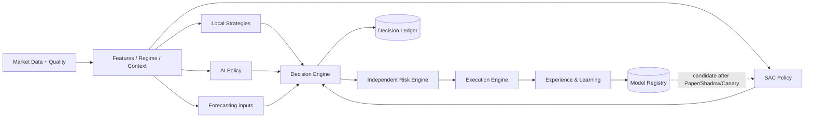

# BitbotBY — Master Technical Specification v2

Редакция v2 объединяет: исходное мастер-ТЗ, дополнения по инфраструктуре (NautilusTrader, ClickHouse, drift/OOD/conformal, LLM gateway, Bybit-микроструктура), и решение по роли SAC/AI (Multi-Policy Adaptive Trading System).
Язык документов — русский, код — английский.

> **Редакция v2.1:** добавлены §11 (реестр всех идей из чата), §12 (правило «реализуем всё, включаем по воротам»), §13 (восстановленные разделы исходного ТЗ), §14 (утверждения для проверки первоисточником).

---

## 0. Нерушимые принципы

1. **Модель не торгует.** LLM, SAC, Chronos/TimesFM, LightGBM, HMM выдают типизированную оценку. Решение принимает Decision Engine, допустимость проверяет независимый Risk Engine, исполняет Execution Engine.
2. **Один путь для всех режимов.** Local / AI / SAC / Hybrid → Decision Engine → Risk → Execution. Обхода нет, включая Telegram-сигналы.
3. **Доказанная польза, а не количество моделей.** Компонент включается в live, только если ablation (с компонентом / без) на одинаковых данных показывает значимое улучшение после комиссий, funding, slippage.
4. **«Нет данных» ≠ «успех».** Нехватка выборки = `UNKNOWN`. Отсутствие ответа модели никогда не подтверждение сделки.
5. **Сначала аудит, потом проектирование.** Нельзя создавать модуль, пока не доказано, что аналога в коде нет. Существующее расширяем, не переписываем.
6. **Не менять торговую логику / веса / confidence / параметры SAC / Risk без отдельного согласования.**
7. **Заглушка = заглушка.** Если модуль — только интерфейс или эксперимент, отчёт обязан так и написать.
8. **Безопасность ключей:** ключи только в шифрованном хранилище (решение пользователя), `.env` в приложение не попадает; изменения безопасности — только по явному «go».
9. **Новые зависимости — только через ADR** (лицензия, совместимость с Python-стеком, поддержка, польза против текущей реализации, стоимость внедрения). Не устанавливать «пакетом».
10. **Торговый цикл не ждёт LLM.** Для каждого AI-компонента задан таймаут и своя политика отказа: пропустить поправку / нейтрально / запретить новый вход.
12. **Провайдеро-независимость AI.** Названия моделей в ТЗ (DeepSeek, Gemini, Claude и др.) — примеры. Система использует fallback-цепочку многих провайдеров; контракт, валидация, метрики и Ledger не привязаны к конкретному. Каждое AI-решение несёт provider/model/version фактически ответившего звена, а оценка качества считается и по слою целиком, и по звеньям.
11. **Решение владельца: реализуются ВСЕ идеи из обсуждения**, включая отложенные. Ни одна идея не вычёркивается. Порядок задаётся зависимостями, а включение в live — воротами (см. §12). План не упрощается выбрасыванием пунктов: можно предложить другой порядок или ADR с аргументами, решение за владельцем.

---

## 1. Целевая модель: пять контуров + сквозной слой

| Контур | Содержание |
|---|---|
| **1. Data Intelligence** | Сбор данных, Data Quality, Feature Pipeline, Market Context, Regime, хранилища, RAG |
| **2. Model Intelligence** | SAC, LightGBM/CatBoost (meta-model), Chronos/TimesFM, HMM/GARCH, LLM, OOD |
| **3. Decision Intelligence** | Signal Intelligence (дедупликация), Decision Engine, Model Performance, Portfolio Allocation, Decision Ledger |
| **4. Risk & Execution** | Risk Engine (Kelly, CVaR, корр., drawdown), Order State Machine, Reconciliation, Smart Execution, Internal Ledger |
| **5. Learning & Feedback** | Experience Collector, SAC Dataset Builder, обучение, Model Registry, Drift Monitoring, Counterfactual |

Сквозной слой: Observability, Security, Configuration, Operational Control.



---

## 2. Режимы торговли (решение зафиксировано)

Режимы — это **разные способы принятия решения** над общей инфраструктурой, а не разные боты.

| Режим | Активные политики | Примечание |
|---|---|---|
| Local | Strategy Engine | AI/SAC не вмешиваются |
| AI | AI Policy | структурированный выход, без прямых ордеров |
| SAC | SAC Standalone | автономный агент |
| Hybrid | AI + SAC независимо → Decision Engine | AI не управляет SAC |
| Hybrid + Forecasting | Hybrid + прогноз с неопределённостью | прогноз не создаёт ордер |

**Решение:** SAC — и автономный агент, и участник Hybrid. В Hybrid AI и SAC оценивают независимо; объединяет Decision Engine.

Требования:
- Единый `TradingDecision` контракт для всех режимов.
- Политика перехода между режимами при открытых позициях (сохранить и передать / запретить новые входы / иное — явно задаётся). Две политики не отправляют ордера по одному инструменту в обход общего Portfolio/Order Management.
- UI показывает статус обученности SAC-модели (Not approved / Paper / Shadow / Canary / Production). Необученный или не прошедший проверку SAC **технически** не может включиться в live.
- **Нет утечки между режимами:** Standalone-SAC не получает AI-признаков, недоступных в Standalone.
- Стратегии объединения в Decision Engine — **экспериментальные варианты**, сравниваемые на одинаковых данных: Agreement, Weighted (калиброванная надёжность), Contextual (режим рынка), Risk-aware (неопределённость + экспозиция). Лучший заранее не назначен.

### 2.1 Типизированный контракт (иллюстрация, не обязательство заполнять все поля)

```python
class ModelOutput:
    model_id: str; model_version: str; snapshot_id: str; timestamp: int
    target_exposure: float | None      # SAC: [-1, 1]
    direction: str | None              # LONG/SHORT/HOLD
    confidence: float | None           # НЕ вероятность прибыли
    uncertainty: float | None
    regime: str | None
    rationale: dict
    error_status: str | None
    latency_ms: float
```
Разделять: LLM Confidence ≠ Signal Confidence ≠ Forecast Confidence ≠ Calibrated Trade Probability (последнюю даёт только калиброванная Meta-Model).

---

## 3. SAC: Cold Start и жизненный цикл

**Ответ на исходный вопрос:** идея постепенного обучения верна, но (а) сбор сделок ≠ обучение, (б) «только прибыльные сделки» — смещённая выборка, (в) реальная торговля не должна быть единственным источником опыта.

### 3.1 Источники опыта
1. **Historical Replay** (приоритет №1) — симулятор с комиссиями, funding, slippage, частичными исполнениями. Без этих издержек SAC выучит стратегию, существующую только в симуляции.
2. **Опыт AI/Local** — только с корректными (s, a, r, s′, terminated, truncated); **не** смешивается безусловно с online-буфером (это Offline RL: исследовать CQL/IQL, не загружать чужие сделки в обычный SAC-буфер).
3. **Paper Trading** — актуальный рынок без капитала.
4. **SAC Shadow** — собственные решения без исполнения.

Различать Behavior Cloning (опциональная инициализация, только если докажет пользу) и RL (основа).

### 3.2 SAC Dataset Builder (отдельный модуль)
- State: Market, Technical, Microstructure, Regime, Forecast, Portfolio, Position, Costs, (AI Context только для Hybrid-политики).
- Action: исследовать целевую экспозицию `a ∈ [-1, 1]` + управление открытой позицией. **Сначала проверить в коде**, непрерывное пространство или дискретное (если LONG/SHORT/HOLD — это Discrete SAC или иная схема?).
- Reward: изменение equity за вычетом издержек, штрафы за просадку/риск. Без двойного учёта комиссий/funding. Коэффициенты калибруются на независимых периодах.
- `terminated` vs `truncated` различаются.
- Point-in-time данные, без look-ahead; historical universe без survivorship bias (включая делистнутые).
- Отклонённые решения сохраняются отдельно (counterfactual), **не** попадают в буфер как реальные сделки.
- Для Standalone и Hybrid — исследовать: общий encoder / частично общие веса / независимые политики. Выбор — по результатам сравнения.

### 3.3 Lifecycle
`Cold Start → Experience Collection → Dataset Validation → Initial/Offline Training → Walk-Forward → Paper → Shadow → Canary → Production → Continuous Learning`

- Production-модель **не** заменяется автоматически и **не** обновляется после каждой сделки; кандидат проходит независимую проверку, Paper/Shadow/Canary, явное одобрение.
- Model Registry: версия, версия датасета, версия feature pipeline, гиперпараметры, период обучения, backtest/walk-forward/paper метрики, дата и причина допуска/отказа, предыдущая версия для rollback.
- OOD/drift → запрет новых входов или снижение риска; закрытие существующих позиций — отдельное решение Risk Engine.

---

## 4. Фазы реализации (с входными и выходными воротами)

Каждая фаза: **Entry** (что должно быть готово) → **Deliverables** → **Exit** (измеримые критерии, тесты, отчёт). Фазы 1+ стартуют только после явного подтверждения пользователя.

### PHASE 0 — Аудит (единственная разрешённая сейчас)
Результат: `docs/architecture/AUDIT_REPORT.md`, затем `TARGET_ARCHITECTURE.md`, `docs/implementation/IMPLEMENTATION_PLAN.md`, список затрагиваемых файлов, риски совместимости, критерии приёмки. Торговую логику не менять, ордера не открывать.

Обязательно проследить по коду (файл/класс/функция):
- Реальный путь: данные → скан/прескор → стратегии → `signal_combiner` → AI → SAC → Chronos → решение → риск → ордер. Фактический порядок, не предполагаемый.
- **AI-цепочка провайдеров (DeepSeek, Gemini, Groq и т.д. — только примеры, не привязка):** система работает через fallback по множеству провайдеров (`backend/bitbot/ai/providers.py`, `ai_analyzer.py`). Выяснить: порядок и правила fallback, какой провайдер реально ответил на каждое решение (сохраняется ли это), prompt и данные, валидация ответа, влияние на вход и размер позиции, поведение при ошибке/таймауте, сохраняется ли сырой ответ, воспроизводимо ли решение после сделки, различается ли качество/калибровка ответов между провайдерами, и не смешивается ли в статистике «ответ провайдера A» с «ответом провайдера B». (Известно из прошлых сессий: AI-провайдеры отваливаются в ~82% циклов — оценить влияние на путь решения.)
- **SignalCombiner:** формулы, веса, fixed modifiers, Chronos-модификатор, конфликты; места двойного учёта (коррелированные индикаторы, один фактор считан несколько раз).
- **SAC (12 вопросов):** observation, action space, reward, когда формируются transitions, сохраняется ли состояние на момент решения, replay buffer, когда и на чём обучается, обновляются ли веса после каждой сделки, как работает текущий Hybrid, могут ли Local/AI/SAC обойти Risk, как переключаются режимы и что с открытыми позициями, какие данные теряются при перезапуске.
- Risk: что реально есть (Kelly, CVaR, корр.-фильтр, kill-switch, circuit breaker), всё ли идёт одним путём, включая Telegram и `trusted_trader`.
- Биржа: учёт часов (exchange/UTC/monotonic), целостность стакана, `tickSize/qtyStep/fundingInterval` (динамические или зашиты), reconcile, idempotency (`orderLinkId`), partial fills, in-flight margin.
- Результаты прошлых исследований (бэктесты, walk-forward, paper-alpha, ai-isolation, live-divergence) — **как факты**, без новых выводов о преимуществе по одному результату.
- Реальные аналоги из ТЗ: `decision_trace.py`, `experience_buffer.py`, `online_learner.py`, `regime_detector.py`, `market_impact.py`, `portfolio_optimizer.py`, `ai_signal_isolation_backtest.py`, `backtest_live_divergence.py`, `paper_alpha_report.py` — отметить «есть / частично / нет».

### PHASE 1 — Единая архитектура и контракты
Trading Mode Manager, Strategy Registry, Decision Router, `TradingDecision`/`ModelOutput` контракты, Portfolio Context, **Decision Ledger** (trace_id; расширить существующий `decision_trace.py`, не дублировать).
Exit: все режимы выдают один контракт; регрессионные тесты старого пути зелёные; поведение не изменилось.

### PHASE 2 — Market Data & Intelligence
Data Quality (TTL по типу источника, статусы VALID/STALE/INCOMPLETE/INVALID/UNAVAILABLE), snapshot_id, три временные метки (exchange / UTC / monotonic), целостность стакана Bybit (snapshot+delta, `u`; `seq` не считать непрерывным), динамические спецификации контрактов и funding interval, Feature Pipeline, режим рынка.
Exit: решение не принимается на STALE/INVALID; snapshot воспроизводит вход без будущих данных.

### PHASE 3 — Signal Intelligence
Unified Signal Schema, группы независимости (конфигурируемые), дедупликация/корреляция (Pearson/Spearman, rolling, по режимам), вклад сигнала, конфликты как объекты, anomaly discovery.
Exit: измеримо показано, где один фактор считался несколько раз; изменение confidence — **только после согласования** и с A/B на истории.

### PHASE 4 — Data Engineering
Транзакционное состояние остаётся в существующей operational-БД (позиции, ордера — **не** в ClickHouse). Аналитика/история — ClickHouse (если ADR подтвердит необходимость против текущего хранения); датасеты — Parquet+ZSTD, Polars/Arrow. Event Store для последовательности действий системы (сигнал → признаки → решение → ордер → ответ биржи), отдельно от рыночных рядов. Dataset versioning, lineage, retention, replay по сделке/интервалу.
Exit: replay одной сделки воспроизводит решение бит-в-бит на тех же входах.

### PHASE 4b — WebSocket Market-Data Ingestion (решение владельца: добавить)
Контекст аудита: сейчас REST-опрос через ccxt, WS для рынка нет (AUDIT_REPORT §10). Цель — получать данные потоком, не ломая текущий путь.
- **Принцип:** REST остаётся рабочим fallback и эталоном сверки; WS включается за флагом, сначала Shadow (параллельно с REST, без влияния на решения), затем Paper, затем live.
- **Потоки Bybit v5:** публичные `kline`, `orderbook` (snapshot+delta), `publicTrade`, `tickers` (funding/OI), `liquidation`, `adlAlert`; приватные `order`, `execution`, `position`, `wallet`. Конкретные топики/глубины сверить с актуальной докой (Phase 0 §14).
- **Целостность стакана:** snapshot+delta по `u`; `seq` не считать непрерывным; при пропуске — сброс через REST-снимок и блок торговли парой до ресинка.
- **Клиент:** сравнить ccxt.pro, `pybit` и cryptofeed (ADR); выбрать один. Не писать свой протокол без обоснования.
- **Время:** exchange timestamp + UTC + monotonic; lag = monotonic-разность прихода и exchange ts с поправкой на оценку смещения часов.
- **Надёжность:** reconnect с backoff и jitter, heartbeat/ping, повторная подписка, дедупликация и проверка порядка событий, ограничение размера очередей (backpressure), метрики lag/gap/reconnect по каждому потоку в Prometheus + алерты (тихие сбои).
- **Приватные потоки** — основа периодической сверки состояния (закрывает H-7 из аудита) вместе с REST-reconcile раз в 30–60 с.
- **Интеграция:** WS-слой публикует нормализованные события в общий интерфейс данных (тот же контракт, что у REST-загрузчика), чтобы стратегии/SAC/AI не знали об источнике (research-to-live parity). Событийная шина (Redis Streams) — по ADR.
- **Фиче-пайплайн:** свечи из WS собираются в OHLCV по тем же правилам, что REST; расхождение WS vs REST > порога — алерт и откат на REST.
- **Не блокировать event loop:** парсинг через orjson/msgspec по профилю, тяжёлое — в процессе/пуле.
- **Exit:** замер на реальном потоке за ≥7 дней: доля пропусков стакана, число reconnect, p50/p99 lag, расхождение WS vs REST по свечам; решения Shadow-режима не хуже REST; chaos-тест (обрыв WS в момент частичного исполнения, дубли/перестановка сообщений).

### PHASE 5 — Execution & Exchange Reliability
Order State Machine, Reconciliation Loop, идемпотентность/`orderLinkId`, in-flight margin, Partial Fill Manager, Reduce-Only, Dead Man's Switch (отмена ордеров ≠ закрытие позиций; управление позициями — отдельно), Internal Ledger (комиссии, funding, net PnL, сверка с биржей), Dust. Smart Execution (TWAP, Post-Only) — только после измерения slippage на paper.
Exit: chaos-тесты на mock-бирже (потеря WS в момент исполнения, дубли/перестановка событий, 429/5xx) проходят; ошибка API не трактуется как «ордер не исполнен» без проверки статуса.

### PHASE 6 — Decision Engine и Hybrid
Независимые оценки AI и SAC; 4 стратегии объединения сравниваются; Explainability (decision_id, участники, включённые/исключённые сигналы, пороги, reason codes); Decision Status: LONG/SHORT/NO_TRADE/INSUFFICIENT_DATA.
Exit: Hybrid не хуже лучшего из компонентов **после издержек** на out-of-sample, иначе не включается.

### PHASE 7 — SAC Pipeline и Lifecycle
Experience Collector, Dataset Builder, Dataset Validator, Replay Buffer Manager, Offline training (CQL/IQL в исследовании), walk-forward, Model Registry, rollback.
Exit: SAC побеждает baseline (в т.ч. buy-and-hold и лучший Local) на независимом периоде и в нескольких режимах рынка; иначе остаётся в Shadow.

### PHASE 8 — Forecasting, Meta-Model, Model Reliability
Chronos vs TimesFM на общем датасете и сплитах, baseline (naive, MA, GARCH), метрики MAE/RMSE/MASE, pinball, coverage, directional accuracy, затем **торговая ценность через ablation**. Проверить лицензию каждой версии TimesFM. LightGBM Meta-Model с калибровкой (Brier, ECE, Platt/isotonic). Drift: PSI/KS (data drift), OOD (Mahalanobis, Isolation Forest, Alibi Detect), concept drift (ADWIN/CUSUM — только при наличии меток). Conformal — измерять **фактическое покрытие**, не обещать 95%.
Предварительный факт: Kronos-mini на BTC/USDT 15m показал точность 49.1% при базе 49.4% — foundation-модели не получают веса без доказанного ablation.
Exit: модель получает вес только при статистически значимом ΔExpectancy/ΔSharpe; недостаточно выборки → UNKNOWN.

### PHASE 9 — Risk, Portfolio, Capital Allocation
Единый Risk Gate, независимый от AI. Kelly/Half-Kelly, CVaR, корр.-guard, drawdown halt. Riskfolio-Lib/Black-Litterman — исследование (BL — модель ожиданий/весов, не замена Kelly/CVaR); Thompson Sampling — только после OOS и с ограничением скорости перераспределения.
Circuit breaker — независимые уровни: (1) запрет входов, (2) отмена ордеров, (3) сокращение/закрытие по правилам, (4) полная остановка.

### PHASE 10 — AI Infrastructure
Typed contracts, Pydantic/JSON Schema, проверка чисел по snapshot (LLM не придумывает цены/OI/funding), защита от prompt injection (новости и RAG — недоверенные данные), fallback-политика на компонент, health/cost мониторинг. LLM Gateway — выбрать **один** (Bifrost первым кандидатом; не ставить несколько).
RAG (Qdrant или существующее хранилище) — после того как есть что искать (Decision Ledger, Outcomes).

### PHASE 11 — Observability & Ops
Prometheus/Grafana/FastAPI/Telegram (существующее), OpenTelemetry (если ADR), Decision Audit (Data→…→Outcome), Daily Health Digest, hot-reload config, Emergency Control. Shadow → Paper → Canary → Production, переход — явный.

---

## 5. Исследовательские кандидаты (каждому — ADR: внедрить / частично / референс / отказ)

| Приоритет | Кандидат | Что проверить | Оговорка |
|---|---|---|---|
| Высокий | NautilusTrader | архитектура event sourcing, backtest=live | как ориентир/источник компонентов; **не** переписывать на него бот |
| Высокий | hftbacktest | очередь лимиток, задержки, Post-Only | исследование/симуляция; live — Rust; позиция в очереди — модельная оценка, не факт |
| Высокий | ClickHouse | нужен ли при текущих объёмах | не источник истины для позиций |
| Высокий | Polars/Arrow/Parquet | датасеты SAC | |
| Средний | Riskfolio-Lib | HRP, CVaR, BL | доказать OOS-улучшение после издержек |
| Средний | Alibi Detect / Frouros / Menelaus | OOD, drift | разные задачи, не один «универсальный предохранитель» |
| Средний | FoundationForecast / TorchCP | conformal для Chronos/TimesFM | `online_conformal` архивирован 2025-05-01 — не production-зависимость |
| Средний | Bifrost | latency overhead, fallback, бюджеты | один gateway |
| Исслед. | vectorbt | быстрые прогоны | не заменяет симуляцию стакана |
| Исслед. | cryptofeed | сравнение с текущим WS-сборщиком | менять только при доказанной выгоде |
| Исслед. | uvloop / orjson / msgspec | профилирование | только если узкое место доказано |

Инфраструктурный benchmark (не обещание «1–5 мс»): RTT, jitter, packet loss, WS-задержка, время подтверждения ордера из нескольких регионов; затем выбор расположения сервера (учесть заявленную миграцию Bybit).

---

## 6. Правки к исходным предложениям (чтобы не внедрить неверное)

| Предложение | Корректировка |
|---|---|
| Всегда время биржи | exchange + UTC + monotonic |
| Сервер в Токио = 1–5 мс | измерить |
| HMM жёстко фильтрует | вероятности режимов + неопределённость |
| Replay 70/30 | сравнить схемы sampling, не фиксировать |
| Conformal = 95% | измерять покрытие на нестационарных данных |
| SAC/LLM ≤0.5% депозита | лимит из общего risk budget |
| OOD → закрыть позицию | запретить входы/снизить риск; закрытие решает Risk Engine |
| Thompson Sampling перелив капитала | после OOS, с лимитом скорости и drawdown |
| Всегда хеджировать на другой бирже | только при инфраструктуре, ликвидности, учёте basis risk |
| Dead Man's Switch | отменяет ордера, позиции не закрывает |
| SHAP | для tree-моделей; SAC/LLM — другие методы аудита |

---

## 7. Правила разработки

1. Аудит → проектирование → реализация. Никогда наоборот.
2. Не дублировать: перед модулем искать аналог.
3. Не ослаблять тесты и Risk Guards ради зелёных тестов.
4. Каждая фаза: unit + integration + regression + (где применимо) backtest/perf; не снижать текущее покрытие.
5. Новая модель сначала Research → Validation → Shadow; paper по умолчанию.
6. Воспроизводимость: версии датасета, конфигурации, весов, feature pipeline.
7. Implementation Log после каждого этапа: файлы, решения, тесты, результаты, остаточные проблемы, ограничения.
8. Ошибка, влияющая на корректность решений, блокирует переход к следующей фазе.
9. Любое утверждение «есть преимущество» — только после независимых статистических тестов (walk-forward, purged CV + embargo, bootstrap/deflated Sharpe, поправка на множественное тестирование).
10. Counterfactual-результаты никогда не выдаются за реальный PnL и не попадают в буфер как реальные исполнения.

---

## 8. Определение готовности компонента

Код + тесты (включая граничные) + документация + логирование + мониторинг (если применимо) + проверка совместимости + измеримые критерии эффективности + безопасный fallback + отчёт. Наличие класса или файла — не готовность.

## 9. Критерии приёмки системы

Единый контракт решения во всех режимах · общий Risk Gate · SAC работает независимо от AI · Hybrid получает независимые оценки · все решения в Decision Ledger (включая отклонённые) · SAC учится на корректных последовательностях без look-ahead · replay учитывает издержки исполнения · offline-опыт не смешивается безусловно с online-буфером · новая SAC не заменяет production автоматически · переключение режима не дублирует ордера · не прошедшая проверку SAC не торгует реальным капиталом · дедупликация сигналов и отсутствие искусственного роста confidence · контроль свежести данных · разделение LLM confidence и trade probability · объективное сравнение Chronos/TimesFM · калибровка Meta-Model · устойчивость в Shadow и Paper.

## 11. Реестр идей (полный, из всего чата)

Статус: **P** = в плане, реализуется; **R** = сначала ADR/исследование, затем реализация; **G** = реализуется, но в live включается только после ворот. «Ф» — номер фазы из §4.

### 11.1 Архитектура и производительность
| # | Идея | Ф | Ст. | Заметка |
|---|---|---|---|---|
| 1 | Hot path / Cold path: LLM в фоне, обновляет только контекст (режим, сентимент, веса) раз в 15–60 мин; торговый цикл не ждёт | 1,10 | P | интервал подбирается измерением |
| 2 | Шина событий между сбором данных, аналитикой и исполнением (Redis Streams первым кандидатом, Kafka — только если ADR докажет) | 4 | R | Redis уже есть в проекте |
| 3 | Экспорт SAC в ONNX Runtime для быстрого инференса | 7 | R | проверить совпадение выходов с PyTorch |
| 4 | Тяжёлая математика (ковариации для CVaR, инференс, тяжёлый JSON) в ProcessPoolExecutor / отдельный сервис, чтобы не блокировать asyncio | 2,9 | P | сначала профилирование |
| 5 | uvloop, orjson/msgspec | 4 | R | только по профилю |
| 6 | Изоляция контейнеров с лимитами CPU/RAM; переобучение на отдельном воркере, в бой уходят только проверенные веса | 7,11 | P | |
| 7 | Метрики lag по каждому из 13+ потоков в Prometheus/Grafana + алерты (тихие сбои: поток не упал, но отстаёт) | 11 | P | |
| 8 | CI: ruff, mypy, unit на Kelly/CVaR, тесты промптов/парсеров LLM перед деплоем | 1 | P | не снижать текущие 1200+ тестов |
| 9 | Единый код стратегии для backtest и live (research-to-live parity): стратегия не знает источник событий; replayer с задержками и slippage | 4,7 | P | ориентир NautilusTrader |

### 11.2 Модели и обучение
| # | Идея | Ф | Ст. | Заметка |
|---|---|---|---|---|
| 10 | Meta-labeling: LightGBM/CatBoost принимает сигналы Local+SAC+волатильность+стакан, выдаёт вероятность успеха; вероятность идёт в Kelly для размера | 8,9 | P | только после калибровки (Brier/ECE) |
| 11 | Разделение ответственности: GBM — табличные закономерности; SAC — действие/размер/выход; LLM — контекст, новости, события; HMM/GARCH — режим; Chronos/TimesFM — волатильность/интервалы | 6 | P | |
| 12 | Защита от деградации SAC: скользящий Sharpe за N сделок ниже порога → вес SAC снижается вплоть до 0 | 7 | G | N и порог — калибровать, не угадывать |
| 13 | Drift: PSI/KS (данные), OOD (Mahalanobis, автоэнкодер, Alibi Detect), concept drift (ADWIN/BOCD/CUSUM — только при наличии меток) | 8 | R | при OOD: запрет входов/снижение риска |
| 14 | Conformal-калибровка интервалов (foundationforecast, TorchCP); измерять фактическое покрытие | 8 | R | `online_conformal` архивирован |
| 15 | Fractional differentiation признаков для SAC (память + стационарность); skforecast как референс | 2,7 | R | сравнить с returns/log-returns |
| 16 | Replay для дообучения: смесь свежих данных и исторических стресс-сценариев (дамп, сквиз, флэт); пропорцию (70/30 из чата) подбирать экспериментом | 7 | R | |
| 17 | Forecasting как радар риска: ширина квантильного коридора → размер позиции и стопы; выход цены за q90 → временно отключить трендовые стратегии; не как генератор входа | 8 | P | проверять ablation'ом |
| 18 | Динамический CVaR с тяжёлыми хвостами (implied vol / квантильный прогноз вместо статического окна) | 9 | P | |
| 19 | Корреляционный обвал: общая BTC-бета в Kelly/CVaR, стресс-корреляция→1 | 9 | P | отдельный стресс-тест |
| 20 | Black-Litterman (Riskfolio-Lib): LLM даёт **структурированные** views, не текст→вес | 9 | R | BL ≠ замена Kelly/CVaR |
| 21 | Weight-centric контракт (FinRL-X): все политики возвращают target weight [-1,1] + confidence/uncertainty | 1 | P | |
| 22 | Capital Allocation: стратегии как «управляющие» с виртуальными субсчетами; экспоненциальное взвешивание / Thompson Sampling | 9 | G | лимит скорости перелива, OOS |
| 23 | AI Risk Sandbox: потолок потерь AI-модуля, запрет входов против тренда старшего ТФ | 9 | P | лимит из общего risk budget, не жёсткие 0.5% |

### 11.3 LLM
| # | Идея | Ф | Ст. | Заметка |
|---|---|---|---|---|
| 24 | Недетерминизм LLM: кэш ответов по хэшу входного контекста (воспроизводимость бэктеста) + Pydantic/Outlines/Instructor | 10 | P | |
| 25 | Каскад: основной → резервный облачный (таймаут 1.5–2 с) → локальная квантованная (vLLM/Ollama) → нейтрально (weight=0) | 10 | R | локальная — после первых этапов |
| 26 | LLM Gateway — один (Bifrost / resilient-llm-router / OneLLM сравнить, выбрать одного) | 10 | R | |
| 27 | Экономика LLM: A/B или replay — улучшает ли Sharpe/просадку vs латентность и стоимость API | 8 | P | |
| 28 | Оценка AI-компонента в Hybrid: standalone + incremental (Δ к baseline без него) на тех же сплитах — **и на уровне «AI-слоя целиком», и по каждому провайдеру** (в ответе и Ledger фиксируется provider+model+version, т.к. fallback меняет источник решения); при малой выборке по провайдеру — UNKNOWN | 8 | P | DeepSeek — лишь пример; оценивается цепочка fallback, а не одна модель |

### 11.4 Биржа и исполнение
| # | Идея | Ф | Ст. | Заметка |
|---|---|---|---|---|
| 29 | Smart Execution: TWAP, Post-Only chase | 5 | G | после измерения slippage на paper |
| 30 | Reconciliation каждые 10–30 с (позиции, балансы, ордера через REST) | 5 | P | |
| 31 | Circuit breaker, триггеры: просадка equity за 1 ч (3–5%), серия 5xx / rate-limit, lag тика > 500–1000 мс | 5 | P | по уровням (вход→отмена→сокращение→стоп); «закрыть всё по рынку» — только по явному правилу, иначе дороже |
| 32 | Order State Machine; `orderLinkId` от trace_id+попытка; in-flight margin | 5 | P | |
| 33 | Dead Man's Switch (Cancel All After) | 5 | P | сначала сверить параметры в доке Bybit |
| 34 | Hot-reload конфигурации (Redis/файл), Reduce-Only, пульт (Telegram/FastAPI) | 11 | P | |
| 35 | Часы exchange+UTC+monotonic; стакан `u`/`seq`+REST-resync и блок торговли парой; спецификации контрактов раз в час + пересчёт реального риска после округления ордера; ADL через публичный `adlAlert` | 2,5 | P | |
| 36 | Market impact: ордер ≤ 10–15% объёма топ-3 уровней | 5,9 | P | порог настраивается |
| 37 | Internal Ledger (VIP-комиссии, maker-скидки, funding, net PnL), сверка с биржей; Dust Manager | 5 | P | |
| 38 | Мультибиржевая устойчивость / хедж / резервный ключ | 12 | G | basis risk, ликвидность, капитал |
| 39 | Бенчмарк расположения сервера (RTT, jitter из нескольких регионов) | 4 | R | без обещаний 1–5 мс |

### 11.5 Данные и валидация
| # | Идея | Ф | Ст. | Заметка |
|---|---|---|---|---|
| 40 | ClickHouse (QuestDB как альтернатива в ADR), Parquet+ZSTD, Polars/Arrow; формат для SAC не JSON | 4 | R | ClickHouse ≠ источник истины по позициям |
| 41 | Event Sourcing / Decision Ledger с trace_id, replay | 1,4 | P | расширить `decision_trace.py` |
| 42 | Survivorship bias: делистнутые активы в обучающей выборке | 4 | P | |
| 43 | Бэктест: funding, задержка сигнал→ордер, комиссии со стресс-множителем (≈0.1% на круг), очередь стакана (hftbacktest) | 4,7 | P | |
| 44 | CPCV (Combinatorial Purged CV) + PBO (Probability of Backtest Overfitting; порог 30–40% из чата — ориентир, калибровать) + Deflated Sharpe + bootstrap | 7,8 | P | гейт перед выпуском любой модели |
| 45 | Shadow 1–2 недели → Canary 10% → 100% | 7 | P | |
| 46 | Counterfactual-лог заблокированных сигналов; человекочитаемый аудит-лог сделки (SHAP для tree-моделей) | 6,11 | P | не смешивать с реальным PnL |
| 47 | Chaos-тесты mock-биржи; Daily Health Digest | 5,11 | P | |
| 48 | Справочные проекты: Freqtrade/FreqAI, CCXT | — | R | только референс/сверка данных |
| 49 | WebSocket-ingestion рынка и приватных событий (Phase 4b); с ним становятся применимы пункты 5 (uvloop/orjson), 7 (lag-метрики потоков), 35 (стакан `u/seq`), cryptofeed | 4b | G | REST остаётся fallback; Shadow → Paper → live |

---

## 12. Правило «реализуем всё»: как не потерять деньги и не раздуть сроки

Идеи со статусом **G** и часть **R** — реализуются, но:
1. Каждая идёт через ADR (польза против текущей реализации, лицензия, стоимость).
2. Live-включение только после ворот фазы: ablation/walk-forward/CPCV+PBO после издержек, затем Shadow → Paper → Canary.
3. Порядок реализации — по зависимостям: аудит → контракты/Ledger → надёжность исполнения → данные и Replay → Dataset Builder/SAC → Decision/Hybrid → Meta-Model/Forecast/Drift → портфель и капитал → инфраструктура AI → мультибиржа.
4. Пункт не исключается; перенос — через ADR с аргументами, решение за владельцем.
5. Факт из прошлых исследований проекта: 0 из 23 локальных стратегий статистически значимы на BTC/USDT 15m; Kronos-mini без эджа; SAC необучена. Поэтому ворота «побеждает baseline после издержек» — обязательное условие live, а не формальность.

---

## 13. Восстановленные разделы исходного ТЗ (сжато, обязательны к исполнению)

### 13.1 AI Orchestrator
Решает: какие модели запускать, в каком порядке, с какими данными, когда хватит базового анализа, когда глубокий, когда Chronos/TimesFM/RAG/LLM, когда повторная проверка, когда безопасный отказ.
- Уровни: **L1** Signal Intelligence + Meta-Model → **L2** + SAC + Forecasting → **L3** + LLM + RAG → **L4** разрешение конфликтов (данные, альтернативные гипотезы).
- Complexity Score: конфликты сигналов, качество данных, волатильность, неопределённость режима, расхождение прогнозов/моделей, аномальность.
- Routing: по задаче, режиму, производительности, латентности, стоимости, доступности. Модель не получает вес за то, что быстрее отвечает.
- Параллельно: Chronos, TimesFM, SAC, LLM; учитывать timeout, cancellation, partial failure, дубли запросов, лимиты ресурсов и конкурентности.

### 13.2 Контракты
- **Сигнал:** signal_id, symbol, timeframe, direction, confidence, source, strategy_id, signal_family, timestamp, freshness, independence_group, reliability, features, evidence, invalidation_conditions.
- **LLM-ответ:** model_id, model_version, prompt_version, snapshot_id, decision, direction, confidence, signal_quality, supporting_evidence, conflicting_evidence, risk_factors, missing_information, reason_codes, latency, error_status.
- **Защита:** структурированный вывод, JSON Schema, Pydantic, strict enum, диапазоны, неизвестные поля — отказ, любое число проверяется по snapshot; новости/RAG — недоверенные данные (prompt-injection).
- Разделять: LLM confidence ≠ signal confidence ≠ forecast confidence ≠ Meta-Model probability ≠ calibrated trade probability.

### 13.3 Signal Intelligence
Дедупликация (RSI/Stoch/Williams — один фактор), независимые группы (Momentum, Trend, Structure, Volume, Order Flow, OI, Funding, Volatility, Liquidity, Sentiment, Forecasting; конфигурируемые; разные группы ≠ доказанная независимость), корреляции Pearson/Spearman/rolling/по режимам, вклад сигнала (инкрементальный, избыточность), конфликты как объекты (не усреднять), anomaly discovery (volume/OI spikes, ликвидации, order book imbalance, funding) и проверка, не режет ли Top-N прескор перспективные активы.

### 13.4 Failure Handling: fallback по сценариям
| Сбой | Fallback |
|---|---|
| LLM недоступна/таймаут | поправка AI пропускается или neutral по политике компонента; цикл не блокируется |
| Chronos/TimesFM недоступны | прогнозная поправка = neutral, флаг в Ledger; Hybrid+Forecasting деградирует в Hybrid |
| SAC сбой | SAC-вклад = нет; в режиме SAC Standalone — запрет новых входов |
| RAG сбой | контекст пуст, решение без RAG, пометка |
| Невалидный JSON / число | ответ отбрасывается, retry ≤N, затем нет голоса |
| STALE/INVALID данные | INSUFFICIENT_DATA, новых входов нет |
| Exchange API | запрос статуса ордера до любых повторов; reduce-only при серии ошибок |
| Redis | деградация к in-memory/БД, предупреждение; критичное состояние не в Redis |
| БД | запрет новых входов, существующие позиции ведёт Risk Engine по последнему известному состоянию + reconcile |
| Execution fail | state machine + reconcile, не слепой retry |
| Risk validation fail | отказ, причина в Ledger |
Принцип: отсутствие ответа ≠ подтверждение сделки.

### 13.5 Тесты
Unit: дедупликация, корреляция, вклад, свежесть, валидация данных, контракты, калибровка, правила решений, Risk Gate. Integration: Signal Intelligence+Combiner, Orchestrator+LLM/Chronos/TimesFM, RAG+LLM, SAC/Meta-Model+Decision, Decision+Risk, Risk+Execution. Failure: таймаут провайдера, невалидный вывод, partial failure, пропуски/устаревание данных, сбой БД/Redis, несовпадение версии модели. Regression: поведение старого пайплайна не меняется незаметно. Покрытие не снижать; финансовые и risk-компоненты — полные граничные сценарии.

### 13.6 Статистика и утечки
Walk-forward, purged CV + embargo, CPCV, holdout, multi-asset, по режимам; look-ahead, target leakage, survivorship, рассинхронизация времени, пересекающиеся метки, нормализация только по train-окну; bootstrap Sharpe, Deflated Sharpe, поправка на множественное тестирование, Wilcoxon; PBO.

### 13.7 Сохранение результатов
Сделка: snapshot, сигналы, выходы моделей, прогнозы, решение, риск, исполнение, вход/выход, fees, funding, slippage, net PnL. Отклонённая возможность: исходный сигнал, причина, выходы моделей, snapshot, последующий исход рынка, counterfactual TP/SL по заранее заданным правилам — не реальное исполнение.

### 13.8 Структура документации
`docs/architecture/`: AUDIT_REPORT, TARGET_ARCHITECTURE, DATA_FLOW, DECISION_FLOW, MODEL_LIFECYCLE, FAILURE_HANDLING. `docs/research/`: CHRONOS_VS_TIMESFM, META_MODEL, AI_PERFORMANCE, SIGNAL_INTELLIGENCE. `docs/implementation/`: IMPLEMENTATION_PLAN, MIGRATION_GUIDE, ACCEPTANCE_CRITERIA. Не дублировать существующие `docs/*`.

### 13.9 Сравнение Chronos и TimesFM (обязательное)
Chronos-T5/Bolt/Chronos-2 vs TimesFM 2.5/3.0: общий датасет, одинаковые сплиты/горизонты (5m–1d), baseline (naive, seasonal naive, MA, GARCH); метрики MAE/RMSE/MASE, pinball, coverage, directional accuracy, затем торговая ценность ablation'ом (без forecasting / Chronos / TimesFM / оба / +SAC / +Meta-Model); отдельно BTC/ETH/bluechip/alt/meme и режимы; ensemble-веса только на validation, test — один раз. Ожидание из чата: полезны прежде всего для волатильности/коридора/аномалий, а не как «хрустальный шар».

---

## 14. Утверждения из чата, которые Phase 0 обязана проверить по первоисточнику

Это формулировки помощников/поисковых сниппетов, не факты проекта:
- Лицензия весов TimesFM 3.0 («non-commercial») против Apache-2.0 у 2.5; существование и параметры 3.0 и Chronos-2 (ковариаты, мультивариативность).
- Параметры Cancel All After / Dead Man's Switch в API Bybit.
- Содержимое и семантика публичного потока `adlAlert` (индивидуальный ADL-ранг не предполагать).
- Миграция Bybit из Сингапура в Токио с 12.11.2026 и реальный выигрыш по RTT (измерять).
- Статус архива `salesforce/online_conformal` (2025-05-01) и актуальность остальных библиотек.
- Числовые ориентиры из чата (ускорение uvloop 20–40%, сжатие ClickHouse 10–15×, пороги circuit breaker, PBO 30–40%, 0.1% комиссии) — гипотезы для измерения, не константы.
- «ADL/маржа и ликвидация только через приватный стрим» — оспорено, проверять документацию.
