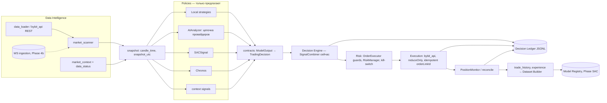

# BitbotBY — Target Architecture

Основа: [MASTER_SPEC_v2.md](MASTER_SPEC_v2.md) (требования), [AUDIT_REPORT.md](AUDIT_REPORT.md) (факты о коде). Этот документ — проектное решение: что оставляем, что добавляем и как компоненты связаны. Торговая логика не меняется без отдельного согласования; всё новое сначала наблюдает (ledger, контракты), потом Shadow/Paper, потом live.

## 1. Принципы

1. Модель (AI, SAC, Chronos, контекст, локальная стратегия) только **предлагает**; решает Decision Engine; допустимость проверяет независимый Risk; исполняет Execution.
2. Режимы (Local / AI / SAC / Hybrid / Hybrid+Forecasting) — разные наборы политик над **общей** инфраструктурой, а не разные боты.
3. Всё, что влияет на решение, оставляет след в Decision Ledger (кто, что, из каких данных).
4. «Нет данных» ≠ «успех»; отказ компонента ведёт к безопасному отказу, не к подтверждению сделки.

## 2. Компоненты: сейчас → цель

| Контур | Сейчас (по аудиту) | Цель | Фаза |
|---|---|---|---|
| Data | REST-опрос, fail-neutral | + WS-ingestion, статусы данных, snapshot-id | 2, 4b |
| Policies | AI/SAC/Chronos/context/local независимо вызываются из combiner | единый контракт `ModelOutput` на выходе каждой | **1** |
| Decision | `SignalCombiner` (смесь режимов, фильтров, merge) | Decision Engine: явный пайплайн, `TradingDecision`, reason codes | 1→6 |
| Risk | часть в `RiskManager`, часть в `OrderExecutor.execute` | единый Risk Gate; Telegram-сигналы тем же путём (решение владельца по `trusted`) | 9 |
| Execution | идемпотентность есть, reduceOnly исправлен | + Order State Machine, Dead Man's Switch, периодическая сверка | 5 |
| Feedback | `experience_buffer` (бедный формат), `trade_history` | Decision Ledger → Dataset Builder (s,a,r,s′) | 7 |
| Observability | `decision_trace` (UI), Prometheus | + Ledger, lag-метрики, Decision Audit | 11 |

## 3. Контракты (Phase 1)

- `ModelOutput` — выход одной политики: `model_id`, `kind`, `direction`, `confidence` + `confidence_kind` (чем является число: самооценка LLM, величина действия SAC, эвристика), `provider/model_version`, `latency_ms`, `error_status`, `rationale`.
- `TradingDecision` — итог по символу: `decision_id` (детерминированный), `trace_id`, `mode`, `status` (LONG/SHORT/NO_TRADE/INSUFFICIENT_DATA), `confidence`, уровни входа/SL/TP, `outputs[]` (все участвовавшие `ModelOutput`), `conf_trail`, `reason_codes`, `regime`.
- На Phase 1 контракты строятся **адаптером** из существующих словарей рекомендаций и пишутся в ledger; поток данных и значения не меняются.
- `TradingMode`/`ModeSpec` — таблица режимов: какие политики активны, что требуется (SAC-модель, AI-ключи), `readiness(mode)` → (готов, причина). Один источник правды для combiner-guard, состояния бота для приложения и будущего UI-статуса «SAC не допущен».

## 4. Хранилища

| Данные | Хранилище | Заметка |
|---|---|---|
| Состояние позиций/ордеров, настройки, дневная ссылка лимита | Redis + SQLite (`trades_*.db`) | остаются источником истины; ClickHouse **не** хранит позиции |
| Журнал решений | JSONL `data/decision_ledger.jsonl` (ротация) | Phase 1; затем Parquet/ClickHouse по ADR |
| Рыночные ряды/датасеты SAC | CSV-кэш → Parquet+ZSTD | Phase 4 |
| Модели SAC | файлы + Model Registry (версия, датасет, метрики, rollback) | Phase SAC |

## 5. Жизненный цикл SAC

`Cold Start → Experience Collection → Dataset Validation → Offline Training → Walk-Forward → Paper → Shadow → Canary → Production`. Автоподмена production-модели запрещена (выключена по умолчанию, допуск «не хуже buy&hold»); необученная/не допущенная SAC технически не торгует (`readiness`).

## 6. Отказы

Матрица fallback по сбоям — MASTER_SPEC §13.4. Принцип: LLM не блокирует цикл; отсутствие ответа ≠ подтверждение; критичное состояние не хранится только в Redis.

## 7. Точки интеграции (файлы)

`backend/bitbot/ai/analyzer.py` (provenance), `backend/bitbot/domain/signals/combiner.py` (Decision Engine, trail), `backend/bitbot/storage/decision_ledger.py` (журнал), `backend/bitbot/domain/contracts.py` (контракты), `backend/bitbot/domain/trading_modes.py` (режимы), `backend/bitbot/workers/bot.py` (оркестрация, запись в ledger), `backend/bitbot/execution/order_executor.py` + `position_monitor.py` (Risk/Execution), `src/market/*` (данные).
